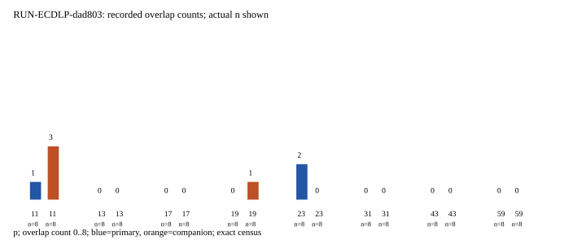

# EXP-ECDLP-da4ba3 / RUN-ECDLP-dad803

Observations only; no scientific verdict or ECDLP claim.

Independent check: passed; rows checked: 128; failed checks: 0.

Producer wall seconds (measured): 2.040924355000243; CPU seconds (measured): 2.059629574; producer peak RSS bytes (measured): 53055488.

The exact primary 64 cells, next-64 structural companions, forward/reverse counts, candidate rejects, synthetic controls and operation vectors are in raw-result.json. Checker costs are separate in verification.json. Source revision, command, dependencies, seeds and field definitions are in manifest.yaml and environment.json.

Fp/Fp2 certify two D traces only. F_D_candidate is inferred from geometry; no complete independent genus-three Frobenius verification, Jacobian map, subgroup action or recovery. Previously seen F43 (0,1) is calibration.

PDF inspection is required before archiving; it is not asserted by this renderer.
