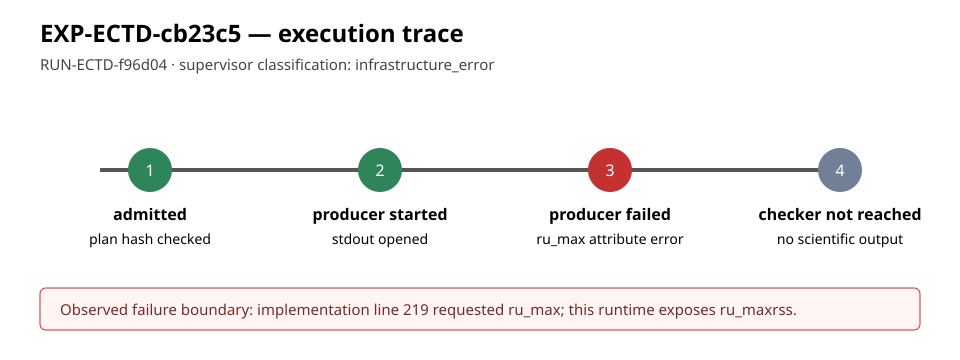

# EXP-ECTD-cb23c5 execution report

## Scope and disposition

This is an observation-only execution report for the single frozen trial
`least-prime-one-edge`, run as `RUN-ECTD-f96d04`. The repository supervisor
classified the trial as `infrastructure_error` and `needs_reconciliation`.
No scientific output was produced and no hypothesis or goal status changes.



## Frozen inputs and custody

- Experiment: `EXP-ECTD-cb23c5`
- Trial: `least-prime-one-edge`
- Run: `RUN-ECTD-f96d04`
- Plan: `experiments/EXP-ECTD-cb23c5/trial-plan-v2.json`
- Plan SHA-256: `5f29a49a3539cdbfcd6a1ec260b23b8f84ff99dea670c1cddc1b1f8430e54dae`
- Execution checkout commit: `fd715c3ee81d51ff90cb10031cc5a3d99f5d7a42`
- Dispatch-plan SHA-256: `8e37027ee0f052c2b23a9a02a64419645c83d2e7dcd4eb9ccab93f685318671d`
- Owner and lease: `executor-ectd-cb23c5`, epoch `1`
- Execution command: `python3 tools/experiment_execution.py run --plan experiments/EXP-ECTD-cb23c5/trial-plan-v2.json --owner executor-ectd-cb23c5 --epoch 1`
- Container: `crypto-ci-python:20261008`, network disabled, virtual-memory limit 131072 KB

## Recorded observation

The supervisor launched the producer and recorded return code `1`. The
producer traceback ends at `experiments/EXP-ECTD-cb23c5/implementation/run.py`
line 219:

```text
AttributeError: 'resource.struct_rusage' object has no attribute 'ru_max'. Did you mean: 'ru_maxrss'?
```

The checker was not reached. The run receipt has `status:
infrastructure_error`, `check_returncode: null`, `published: false`, and no
scientific conclusion. The raw stdout, stderr, launch record, environment,
command, and empty checker logs are preserved under the run directory.

## Interpretation boundary

This record establishes only that this execution environment rejected the
producer's resource-usage attribute access before the experiment emitted its
result. It does not evaluate the elliptic-curve construction, the prime
selection rule, the quotient map, or any claimed mathematical mechanism.
Resolving the portability defect requires a separately coordinated additive
implementation correction and a new frozen plan/run; this execution task did
not modify source or retry the trial.
