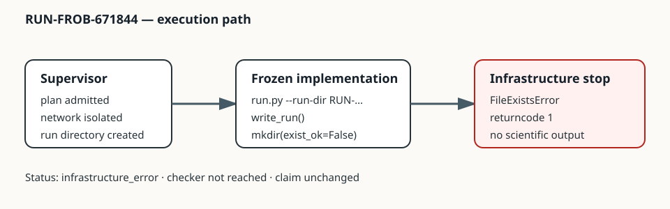

# EXP-FROB-c3bc90 execution report

Observation-only record for `RUN-FROB-671844` (`frob-trace-gap`).

## Scope and disposition

The supervisor admitted the frozen successor plan in the pinned container, but
the implementation exited with `infrastructure_error` before producing a
scientific artifact. The designated run directory had already been created by
the supervisor; `implementation/run.py` then called
`mkdir(parents=True, exist_ok=False)` on that same directory and raised
`FileExistsError`. The checker was not reached. This is an execution
impediment, not a conclusion about the trace-gap hypothesis.

The run receipt and stderr are preserved under the run directory. The claim is
not released or reinterpreted by this report.

## Frozen inputs and custody

- Experiment: `EXP-FROB-c3bc90`; trial: `frob-trace-gap`; run: `RUN-FROB-671844`.
- Successor plan SHA-256: `18f42381d8e177d7a1f263a0d71fcdfa1ae0e0900ab8cc1da28b2e4baf6be795`.
- Execution checkout commit: `9c82d27a6642fdf27fb1b0de93ff8c954b6a54e6`.
- Dispatch-plan SHA-256: `a49e06fc0cc539823a3dcf5451b3635ec1567442e2cc41803894f34ed05c708a`.
- Owner and lease: `executor-frob-c3bc90`, epoch `1`.
- Container: `crypto-ci-python:20261008`; network disabled; virtual-memory ceiling 512 MiB.
- Receipt: `returncode: 1`; checker: not reached; status: `infrastructure_error`.



## Recorded observation

The only recorded execution observation is the implementation exception:

```text
FileExistsError: [Errno 17] File exists:
/repo/experiments/EXP-FROB-c3bc90/runs/RUN-FROB-671844
```

No raw result, reading, manifest, or checker result was produced. The
supervisor receipt, launch record, command, environment, stdout/stderr, and
checker logs remain immutable under the run directory.

## Interpretation boundary

This attempt establishes only that the current supervisor/implementation pair
does not admit this frozen run because both layers create the designated run
directory. It does not test the mathematical mechanism, trace proportions,
null comparison, or any ECDLP claim. A future attempt requires a Coordinator
approved correction or a successor implementation that preserves the frozen
scientific inputs and run identity while making the execution contract
compatible.
