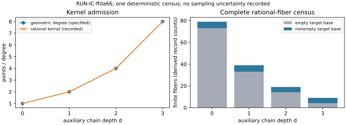

# Auxiliary factor-base run observations

This report describes recorded outputs only. It supplies no scientific verdict, hypothesis promotion, novelty determination, or ECDLP speedup claim. Independent mathematical and accounting review remains pending.

Experiment **EXP-IC-18a59e**, hypothesis **H-IC-bcc2eb**, question **RQ-IC-a39c7e**. One trial requested; one completed with output validation; zero failed or timed out. Run **RUN-IC-ffda66**, seed **1729**, began 2026-10-15T07:11:36.223414+00:00 and ended 2026-10-15T07:12:38.153465+00:00. Raw records are in [the immutable run directory](../../runs/RUN-IC-ffda66/). Run-only publication commit: `8b9f0d4c581d41acd34efdc1ac19017a61caf925`.

## Exact instance and schedule

Target: E/F97, y²=x³+2; recorded order 117, subgroup r=13, cofactor 9, P=(7,32). Recorded action (x,y)↦(35x,y) has scalar3 on this subgroup. Representation alias `EC1P7Cauxfbh68a87019e50a`; full global UID is `urn:ec-record:1:sha256:68a87019e50a564eeb3407096b8b22d033e6883e99fa027423c57015119ed8e4`, also retained in [curve-identities.json](curve-identities.json). That metadata adapter hashes the exact recorded field/model/subgroup/generator; hashing is not mathematical certification.

Auxiliary curves use y²=x³+a_j x with a_j=(-4)^j mod97, j=0..3. They define rational x-fibers; no isogeny from an auxiliary curve to the target is asserted. The schedule retains every finite rational image fiber, full kernel/pole paths, empty and duplicate target bases, and the separately marked first-coset slice. Relation enumeration uses ordered lengths m=2,3 and every subgroup target including O. Orbit completion, fixed-target column merging, and the public-known affine normalization are recorded separately from formal ranks.

## Recorded admission and equality

| d | Rational kernel / degree | Finite fibers | Empty / nonempty bases | Equal list/map/chain | First-coset M |
|---|---|---|---|---|---|
| 0 | 1 / 1 | 79 | 73 / 6 | 79 | 0 |
| 1 | 2 / 2 | 39 | 33 / 6 | 39 | 0 |
| 2 | 4 / 4 | 19 | 14 / 5 | 19 | 0 |
| 3 | 8 / 8 | 9 | 4 / 5 | 9 | 2 |

All 146 finite fibers have equal list/expanded-map/chain target point sets. The 124 empty and 22 nonempty counts are derived by counting recorded fibers, including duplicate bases. Every nonempty original base has recorded M=2; completed orbit sizes and all-target histograms are retained in raw records. First-coset M differs from the full census and is not a coverage estimate.

Figure: recorded kernel sizes/degree and derived counts of the immutable fiber records in RUN-IC-ffda66. One deterministic complete census, not independent statistical replication; no sampling uncertainty is recorded.

## Relation rank and controls

The run contains 153 cases: 29 measured and 124 zero_yield. Each finite-fiber cell retains candidate, identity-action, size-matched random-base, random-coordinate-label and relabeled generic-group controls where admitted. The all-lines F25 control records 4 rational order3 lines, 3 nonstable. Pole/projective branches and P1-only roots without auxiliary rational lifts remain explicit witnesses.

For a fixed target, useful marginal rank is rank(K+N)-rank(K) over F13, where K contains only prescribed public point/action logarithm constraints. The recorded maximum separate-fixed-target marginal rank within nonempty fiber cells is 1 or 2. These maxima are not pooled across targets or fibers. They are not new independent measurements or a cryptographic recovery rate. Transformed-family ranks, homogeneous O rows, augmented formal ranks and public-normalized rows remain separately inspectable. Exact all-target ordered-decomposition histograms are retained; the first-moment identity uses M^m/r and does not assert a Poisson law or a sufficient success probability.

## Measured resources and accounting boundary

Driver-through-result-assembly wall time: 39.388437s; process CPU: 39.385414s. This includes the internal checker. Artifact I/O, separate checker and supervisor work are separate. The internal checker records 22.032832s wall and 22.031112s CPU. Do not add that nested time to the driver total. Supervisor start/end elapsed is derived from the timestamps, not an independently sampled timer. Driver process-lifetime high-water RSS before the internal checker: 111017984bytes; after it: 111149056bytes. These are not exclusive per-phase memory allocations.

The following table derives sums over the 146 fresh membership arms only. Shared discovery, catalog setup, relation enumeration, rank analysis and checking are additional paid components retained in raw records. Counts name different API layers and are not summed into a single work unit; field multiplication can be nested within power/inversion calls.

| Arm | Membership attempts | Field multiplication calls | Membership phase wall s |
|---|---|---|---|
| list | 1752 | 1022 | 0.001056 |
| expanded | 1752 | 204074 | 0.578832 |
| chain | 1752 | 184214 | 0.490141 |

Shared setup is charged once as observed work and identically included in each alternative cold-start interpretation. No timing advantage is inferred from these totals. Python allocation/hash/loop overhead and integer bit complexity have no separately calibrated primitive unit cost. No Pollard-rho comparison or cryptographic-scale timing is measured.

## Integrity, publication and limits

Both producer and separate checker passed; the producer reports 39590 checked certificate items. This is software/certificate checking, not independent scientific review. Command: `python3 tools/lattice_ic_factorbase.py --seed 1729 --output-dir <run_dir>`; check: `python3 tools/lattice_ic_factorbase.py --check <run_dir>/raw-result.json`. Native supervisor invocation and authority appear in launch.json and execution-receipt.json. Approval: DEC-20261015-723ab3. Bound code commit: `8e03ee8b280ac25982d1d5fb57fe28a0438eeb1c`. Python 3.12.14 on recorded Linux; exact dependency/source hashes are in manifest.yaml and environment.json. Hostname and full dirty-tree state were not sampled by the writer; the latter is recorded null with a reason, not clean.

One initial admission refusal occurred before a run directory existed because the claim had not been fetched into the origin tracking ref. After the published ref was fetched, the unchanged plan was admitted. There was no failed scientific attempt or adaptive fixture replacement. No second trial was run.

The raw file is 114070749 bytes. Its unchanged canonical payload SHA-256 is `5a489b0d688e2c220eb8361e9520ba62057620671fe4ecc3f2aadd1dd9695519`. GitLFS stores its transport pointer; canonical payload hashes remain distinct from Git pointer hashes. LFS upload and independent fresh-cache remote payload verification are recorded in the separate custody proof. The sealed ten-file run has not been rewritten or supplemented.

The run reports exact small-field outputs only. There is no polynomial-lattice solve in this factor-base trial, no asymptotic result, no demonstrated advantage over a matched generic algorithm, and no conclusion that the construction scales. The polynomial and combined tracks must test their own actual density/height/root-extraction interfaces. Tracking: [#2172](https://github.com/aburan28/crypto-autoresearcher/issues/2172), parent [#2151](https://github.com/aburan28/crypto-autoresearcher/issues/2151). Earlier independent research gates #2152–#2155 remain pending.

All numerical aggregates in this report are explicitly counts or sums of recorded cells; the editable [plot.py](plot.py) reads [summary.json](summary.json). No extra scientific computation or rerun produced the report.
