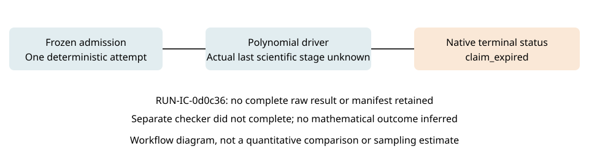

# Polynomial successor terminal attempt

This report records an unsuccessful operational attempt. It supplies no mathematical verdict, independent review, novelty claim, ECDLP advantage or research-status promotion.

**EXP-IC-66c447 / RUN-IC-0d0c36**, H-IC-4fb1db, RQ-IC-a39c7e; seed1729, executor TASK-20261015-ff93a4, approval DEC-20261015-3213c7. One trial was requested; zero trials produced an output-validated result. Native terminal status is **claim_expired**; recorded driver returncode `None`, separate-checker returncode `None`, detail `null`. The attempt's [8 actual runtime files](../../runs/RUN-IC-0d0c36/) remain unchanged. No missing output is reconstructed or replaced with a dummy.

## Actual outcome and missing measurements

The native supervisor stopped the process when its published claim authority expired. The cached deadline was not renewed or bypassed. A lease expiry is an infrastructure event, not a failed lattice certificate or a demonstrated HNF defect.

The supervisor recorded start 2026-10-15T08:43:58.076644+00:00 and finish 2026-10-15T10:43:30.038197+00:00. Their subtraction gives **7171.961553 seconds** of elapsed attempt time (derived). This is not driver CPU time, successful solver time or time per useful relation. The retained driver stderr is empty; it identifies no triggering mathematical cell or source location. The scientific stage, completed-cell count, dimensions, achieved norms, roots, marginal rank, CPU time, peak RSS and per-stage work at termination are unavailable in the terminal archive. Prior in-memory work is not scored as completed observations. No stage is inferred from CPU activity observed during the attempt.

Raw-result.json and manifest.yaml are absent; the separate checker did not yield a successful returncode. Empty checker logs, if present, do not establish a checker pass. Complete actual file inventory:

| Artifact | Bytes |
|---|---|
| check.stderr.log | 0 |
| check.stdout.log | 0 |
| command.txt | 162 |
| environment.json | 1448 |
| execution-receipt.json | 1419 |
| launch.json | 933 |
| stderr.log | 0 |
| stdout.log | 0 |

Figure: RUN-IC-0d0c36, one fixed deterministic attempt. A pipeline diagram is used because no comparable completed scientific measurements were retained. No statistical success rate or uncertainty estimate is inferred.

## Frozen workload and provenance

Prime fixtures (43,1,0), (97,0,2), (101,2,3), coordinate windows2/4/8, all-target m2/3/5 density controls and expanded m2/3 S3/S4 reductions at t1/2,L0/1 with dense/finite-union sparse shifts were prescribed. The existing exact derived caps remain row rank64, monomials256 and coefficient bits4096. Degree-five scope remains density/addition-tree heights only. This failed attempt does not establish that an uncomputed cap was exceeded, a mathematical certificate failed, or any planned control completed.

Native launch: `python3 tools/experiment_execution.py run --plan experiments/EXP-IC-66c447/trial-plan.json --owner lattice-ic-polynomial-successor-run-20261015 --epoch 1`. Source commit `e259e4f5b8afcff384f0b1dd0f5a7fc864fe676e`; plan SHA `c741824b32ad5b737859f932ac73c62caad9867a4cfc7514990bfc06e85dd14e`; driver SHA `6c90e1c98832e8b93d4aca07997ab648e7d9d5f3ce8e0c9adc2d5d743bba17c0`. The frozen guard was2048MiB. Recorded Python 3.12.14, platform linux; environment.json retains all source and specification hashes. Full dirty-tree state and hostname were not sampled. Those metadata are unknown.

The original EXP-IC-74cbb1 / RUN-IC-0dacba MemoryError attempt, its eight actual files, failure report and separate administrative custody remain immutable. The successor used the previously accepted implementation repair retaining all lattice generators and exact integer identities H=C*A and A=D*H. Forty-one scoped software tests preceded admission; they were not completion of this study. The present event alone does not determine whether that repair is adequate for the full schedule.

## Remaining obligations

The Coordinator must arrange a scoped prospective remedy and new native admission if another attempt is necessary, preserving these inputs, this failed attempt, all prior source/archive commits and the original mathematical region. No source, claim, clock or supervisor was changed to evade the live boundary. A longer future lease, instrumentation or implementation change must be prospectively recorded and separately admitted; this report authorizes none of them.

The four-track exploration remains incomplete, with full independent checks still gated on actual observations. Track[#2173](https://github.com/aburan28/crypto-autoresearcher/issues/2173), parent[#2151](https://github.com/aburan28/crypto-autoresearcher/issues/2151); historical mathematical/map certification#2152–#2155 remains pending. [stderr.log](../../runs/RUN-IC-0d0c36/stderr.log), [summary.json](summary.json) and editable [diagram.mmd](diagram.mmd) retain the evidence and labeled arithmetic. No new scientific execution generated this report.
