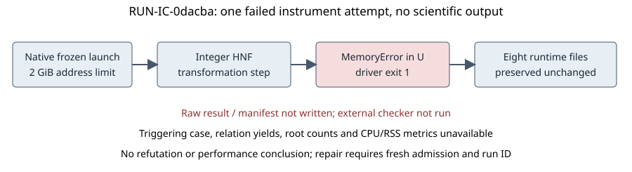

# Polynomial lattice instrument failure

This report records one operational failure. It gives no mathematical verdict, hypothesis promotion, novelty determination, or ECDLP performance conclusion. No scientific result was serialized, and the separate checker did not run.

Experiment **EXP-IC-74cbb1**, hypothesis **H-IC-4fb1db**, question **RQ-IC-a39c7e**; run **RUN-IC-0dacba**, seed1729, executor TASK-20261015-2454ff, approval DEC-20261015-26a51c. Requested1 trial, completed0, failed1, timed out0. Native status is **infrastructure_error**, driver exit1, checker returncode null. The failed attempt is preserved in [its eight-file directory](../../runs/RUN-IC-0dacba/) and producer snapshot `38d2ea4496eb12bdfa4ae6c13d22d12b5f6cf56b`.

## Recorded failure and missing data

The exact traceback ends in `MemoryError` at `tools/lattice_ic_polynomial.py:197`, inside `_integer_row_hnf`, during the update `U[i] = [(-b//g)*x+(a//g)*y for x,y in zip(u,v)]`. The source call stack is main → run_experiment → reduction_cell → build_shift_lattice → integer HNF. [stderr.log](../../runs/RUN-IC-0dacba/stderr.log) retains the complete traceback.

The Linux native supervisor imposed the frozen2048MiB address-space guard (RLIMIT_AS). The run began 2026-10-15T07:54:12.888028+00:00 and finished 2026-10-15T08:02:24.563725+00:00; the difference is **491.675697seconds**, derived by subtracting the recorded supervisor timestamps. This is elapsed attempt time, not driver CPU time or a successful solver measurement. CPU time, peak RSS, exact triggering cell, candidate matrix dimensions, achieved norm bounds, recovered roots, relation yields and per-phase work were not retained. They remain unknown. Earlier in-memory calculations are not scored as completed observations.

The output manifest and raw-result.json are absent. Eight sealed files remain: command, environment, launch, stdout/stderr, empty checker stdout/stderr and execution receipt. Empty checker logs do not mean a passing checker; check_returncode is null. No missing file has been replaced with a dummy or reconstructed result.

Figure: attempted pipeline and recorded failure point. A workflow diagram is used because there is no comparable successful measurement or result array to graph. Sample size is one failed deterministic attempt; no sampling uncertainty or success estimate is inferred.

## Frozen workload and provenance

The planned workload contains prime curves (43,1,0), (97,0,2), (101,2,3), coordinate windows2/4/8, all-target m2/3/5 density controls, and expanded m2/3 reductions at t1/2,L0/1 with dense and finite-union sparse shifts. The declared scientific caps are row rank64, monomial count256 and coefficient bits4096, determined exactly before classification. Degree-five cases concern density/addition-tree heights only. This failure does not establish that any uncomputed cap was exceeded or that any mathematical acceptance criterion failed.

Exact launch: `python3 tools/experiment_execution.py run --plan experiments/EXP-IC-74cbb1/trial-plan.json --owner lattice-ic-polynomial-run-20261015 --epoch 1`. The driver command is `python3 tools/lattice_ic_polynomial.py --seed 1729 --output-dir <run_dir>`. Bound source commit `719e976e26b975fdc16e9c57a65cf240b50ebe25`; driver hash `3733ce902927979a91cb1e48a4e7b8a083ea0a18b0b215ad7078b7ad23dd39cc`. Python3.12.14, recorded Linux; all source/specification/plan bindings and authority are in environment.json, launch.json and execution-receipt.json. Full dirty-tree state and hostname were not sampled; none is invented.

## Scope of repair and remaining gates

Transformation-coefficient growth in the exact HNF implementation is a suspected mechanism; the recorded fact is the failed allocation while updating U. The scientific model and lattice conditions have not been refuted. A narrow implementation repair must retain the exact weighted integer row lattice and two-way Z-membership certificates, preserve original fixtures/caps/resources, pass meaningful non-study regression checks, and receive an archived source binding and prospective admission under a new run ID. The original frozen specification, plan, failure and reports remain unchanged. A successor experiment may carry the same scientific scope if native selector semantics require it.

No repair or rerun is asserted as completed here. The original trial remains failed, missing results remain missing, and independent review remains pending. Tracking:[#2173](https://github.com/aburan28/crypto-autoresearcher/issues/2173), parent[#2151](https://github.com/aburan28/crypto-autoresearcher/issues/2151). Earlier independent mathematical/map gates#2152–#2155 remain pending.

[summary.json](summary.json) contains the directly recorded status, file inventory and labeled elapsed-time arithmetic; [diagram.mmd](diagram.mmd) is editable workflow source. No additional scientific execution produced this report.
