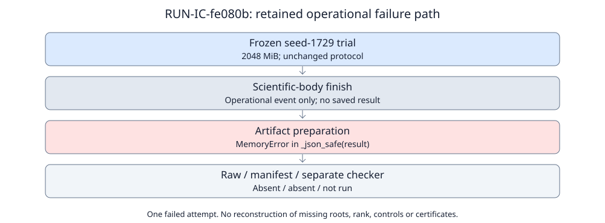

# Polynomial telemetry attempt: serialization failure

This report records an operational failure. It is not independent scientific review, a mathematical verdict, a baseline improvement or a research-state transition.

**EXP-IC-9f9a4b / RUN-IC-fe080b**, H-IC-4fb1db, RQ-IC-a39c7e; parent issue #2151, track #2173. One frozen seed-1729 trial was requested: zero output-validated trials, one infrastructure failure, zero native timeouts. The separate checker did not run. [Actual eight runtime files](../../runs/RUN-IC-fe080b/) were published first at commit `6c23687ca2`; this report introduces no new trial or output reconstruction.

## What happened

Native start: **2026-10-15T11:13:56.203333+00:00**. Native finish: **2026-10-16T05:05:34.296975+00:00**. The supervisor recorded `infrastructure_error`, program return code **1**, checker return code **null**, and no scientific conclusion. Elapsed supervisor interval is **64298.093642 seconds**, derived by subtracting those UTC timestamps; it is not CPU time or useful solver work. This failure preceded the unchanged cached claim deadline, 2026-10-16T11:13:19UTC.

Durable stderr contains **22260 complete operational JSONL events** (derived count), followed by the actual traceback. A `scientific_body` finish boundary was emitted at sequence 22257; `write_artifacts` then started and emitted `MemoryError` at sequence 22259. The traceback names `tools/lattice_ic_core.py:480`, `payload = _json_safe(result)`, and recursive list/dict conversion. It identifies artifact preparation as the observed failing call; it does not establish a new HNF defect or prove a particular remedy sufficient.

The CLI exception boundary records elapsed wall **64294.741358 seconds** and elapsed CPU **64284.197580 seconds**. The artifact exception boundary records elapsed wall **25.498302 seconds**. These are recorded, inclusive telemetry intervals, sampled before their own sink persistence; they overlap and must not be added. They are not full process-lifetime accounting, primitive costs, isolated benchmarks or scientific yield. Peak RSS and host load for the complete attempt were not retained in a native resource record.

Figure: one failed attempt, diagrammed from its recorded boundaries and traceback. No comparable successful measurements exist for a performance plot. A body-finish event does not supply a saved or checked observation archive.

## Inputs, controls and missing outputs

The [frozen specification](../../specification.yaml) and [trial plan](../../trial-plan.json) define the exact curves, windows, dense/sparse reductions, density/generic controls, adverse lifts, seed and derived instrument caps. Source and scientific criteria remained unchanged under the **2048 MiB** guard; there was no resume, reuse, fixture substitution or relaxed stopping rule. The retained [command](../../runs/RUN-IC-fe080b/command.txt) runs `python3 tools/lattice_ic_polynomial.py --seed 1729 --output-dir` with the exact original run path; `launch.json` also retains the checker command that was not executed.

No `raw-result.json` or `manifest.yaml` exists. No scientific case counts, norms, roots, subgroup admissions, ranks, control outcomes or useful-relation costs are recovered from the lost result object. The two checker logs are empty placeholders, not successful checks. Internal assertions and event boundaries are not a full checker replay, independent review, or proof of complete execution. The scientific ten-output archive TASK-20261015-3047d1 remains incomplete; a later separate administrative custody record must bind only the eight actual files plus its own receipt.

| Retained file | Bytes |
|---|---:|
| check.stderr.log | 0 |
| check.stdout.log | 0 |
| command.txt | 162 |
| environment.json | 1799 |
| execution-receipt.json | 1423 |
| launch.json | 933 |
| stderr.log | 17299685 |
| stdout.log | 0 |

[summary.json](summary.json) retains the exact byte lengths and SHA-256 digests, receipt fields and selected operational events. Seven non-receipt files match the hashes recorded in the native receipt. Digest agreement is content custody, not execution-proof integration, metric validation, Cairn settlement, or a scientific conclusion.

## Provenance and continuation boundary

Authority/source commit: `efb08e06a7a18e522c5cbac4f6185ff8a2a175c6`. Executor TASK-20261015-61db74, owner `lattice-ic-polynomial-telemetry-run-20261015`, epoch 1; approval DEC-20261015-469c31. Plan SHA-256: `c8868357a1a5b8df8cca0cf8eccc81ed180a9d70126b4d824c8dae1f86b98742`. `environment.json` retains the scientific source closure, Linux and Python 3.12.14; runtime-lock fields are null. Hostname, complete dirty-tree status and authenticated serving-model identity are unavailable and are not invented. The post-terminal read found all 23 recorded bound input hashes unchanged. Original HNF MemoryError and later claim-expired attempts and their inspected reports remain immutable.

A prospective serialization-memory repair requires its own approved scoped source work, compatibility and memory controls, separate admission and a fresh output location. This report neither approves nor launches that work. There is no same-directory rerun or renewal of the failed authority. The four-track study, fresh blind derivation, five full independent joints and separate integrity checks remain incomplete. Historical mathematical/map certification issues #2152–#2155 remain pending. No list/map/chain, subgroup, root, rank, baseline improvement, novelty or secure-ECDLP advantage is certified here. Canonical research graphs are unchanged because no new validated scientific observation is available.
