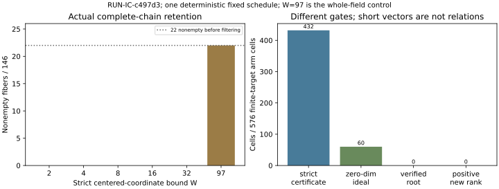

# Combined isogeny-chain and polynomial-lattice observations

This report describes an executed finite synthetic schedule. It is not independent scientific review, a novelty determination, a hypothesis verdict or an ECDLP speedup claim.

**EXP-IC-ab2c47 / RUN-IC-c497d3**, H-IC-a8ab20, RQ-IC-a39c7e. One deterministic seed1729 trial requested and output-validated; driver and separate checker both returned0. Native launch 2026-10-15T08:49:50.274384+00:00, finish 2026-10-15T08:51:24.603397+00:00. The sealed ten files are in [the run directory](../../runs/RUN-IC-c497d3/), producer snapshot `e06e1407960a549d9e7f1f622fb01f0e6e504f60`. No failed attempt of this combined experiment preceded these outputs. The earlier original polynomial attempt remains a separate retained MemoryError, not a mathematical outcome or a completed trial.

## Exact instance and compared interfaces

Target E/F97: y²=x³+2, recorded full order117=9×13, subgroup r=13, P=(7,32), and certified alpha(x,y)=(35x,y) acting by lambda3. The target representation ID is `EC1P7Cauxfbh68a87019e50a`, full UID `urn:ec-record:1:sha256:68a87019e50a564eeb3407096b8b22d033e6883e99fa027423c57015119ed8e4`. The full exact field/model/subgroup/generator preimage is retained in [curve-identities.json](curve-identities.json), reusing the factor-base report's exact metadata. Hashing does not mathematically certify the maps. The run rebuilds all auxiliary curves C_j: y²=x³+(-4)^j x, rational fibers, complete kernels and subgroup-admitted membership; it does not consume earlier result files.

Depths0,1,2,3; strict centered-coordinate bounds W=2,4,8,16,32,97; m2/3/5 density and fixed addition-tree diagnostics. The reduction comparison is actual m2, t1,L0 using two finite chain systems versus explicit membership polynomials over the identical filtered final base. The chosen first nonempty fiber at each depth is fixed before height filtering: depth0: fiber32, depth1: fiber10, depth2: fiber8, depth3: fiber0. It is never replaced when filtering removes its base. All12 nonzero subgroup targets receive both arms at every selected depth/bound. O has no finite S3 x-coordinate and is retained separately, including its density branches. There is no expanded m5 summation-polynomial or m5 lattice solver.

## Retention and actual extraction observations

The rebuilt catalog has146 finite fibers,22 nonempty before filtering and124 empty. All876 fiber/bound height cases remain present. A target point survives only if at least one complete rational path satisfies max absolute centered x < W; terminal, source and intermediate coordinates all matter. The sums below count base entries over distinct fibers, not distinct group points or independent relations.

| Bound W | Fibers | Nonempty before | Nonempty after | Sum of retained base sizes |
|---|---|---|---|---|
| 2 | 146 | 22 | 0 | 0 |
| 4 | 146 | 22 | 0 | 0 |
| 8 | 146 | 22 | 0 | 0 |
| 16 | 146 | 22 | 0 | 0 |
| 32 | 146 | 22 | 0 | 0 |
| 97 | 146 | 22 | 22 | 44 |

Every tested bound through32 leaves all146 filtered bases empty. The W97 whole-field control retains the original22 nonempty fibers, with44 base entries over fibers. This is an observation about these exact fibers and prescribed bounds, not a theorem about auxiliary-isogeny factor bases. W97 must not be called low height. Exact all-target ordered m2/3/5 counts, tree-node heights and separately labeled planted cohorts remain in raw output; their DP and exhaustive construction costs are paid oracles, not inputs to candidate extraction.

Figure: labeled derived counts of recorded cases. One complete fixed toy schedule, with no statistical replicates or sampling-error estimate. The right panel counts cells satisfying different gates; those quantities are not interchangeable relation counts.

There are624 target/arm cells:576 finite-target reductions and48 explicit O inadmissibilities. Of576 finite cells,432 have at least one strict norm-certified polynomial;60 have a zero-dimensional generated ideal,288 have the unit ideal (dimension-1), and228 have positive dimension. **Zero cells produce a verified rational subgroup root, and zero cells add public-known-normalized marginal rank.** The maximum per-fixed-target cell marginal rank is0. Zero-dimensionality by itself is insufficient: integer roots in the actual boxes and the original rational y/sign/subgroup/chain/sum conditions are still required. The `finite_system_success` field requires zero-dimensionality and an accepted root; it is false in every finite cell.

Empty explicit bases can give a constant1 membership polynomial and a short certificate for the unit ideal; this has no roots and is not a usable relation. Coefficient independence or certified vanishing alone is never scored as extraction success. The actual identity/no-chain control performed one LLL call but yielded no relation. The unanchored-chain positive-dimension control is also retained as zero yield. These results do not reject other shift families, bounds, maps, curves or small-root techniques.

## Coverage and cost boundaries

All1653 cases remain:49 measured,1556 zero_yield,48 inadmissible; no derived-cap stop appears in this run. Measured census/control status does not mean successful relation generation.

| Panel | Cases |
|---|---|
| rebuild | 1 |
| kernel_poles | 4 |
| full_fiber_density | 146 |
| height_retention | 876 |
| finite_m2_reduction | 624 |
| identity_no_chain | 1 |
| positive_dimension_chain | 1 |

The two arms pay fresh source-system, shift/HNF, LLL, exact dimension/extraction, lift verification and rank work. Shared selected-filter setup is charged symmetrically; full rebuilt catalog, density, random same-size base, permuted-coordinate controls, all-target DP and addition trees are separately paid. Public-known constraints use certified scalar actions and O/±alpha^jP only, merge target/base aliases, and subtract their known rank for each fixed target. Oracle logs, DP witnesses and planted labels do not enter candidate equations. No ranks are pooled across targets.

Driver-through-result-assembly wall time is67.659073s and CPU is67.859475s, including its internal verification. Internal verification itself reports21.690468s wall and21.681267s CPU: do not add those child times to the inclusive driver timer. Its recorded process-lifetime high-water RSS is272973824bytes; this includes imports/prior phases, excludes children and is not per-arm incremental memory. Artifact I/O, the separate checker and supervisor are outside the assembly timer. Another admitted pilot ran concurrently during part of this trial, so these timings are not an isolated performance comparison.

Python allocation, serialization, hashing and arithmetic below named calls remain unpriced; HNF/LLL/Groebner internals have times and API calls rather than a full bit-operation model. Heterogeneous primitive counts and inclusive parent/child times must not be summed. With zero new rank, cost per useful independent relation is undefined, not zero or a numerical speedup. No full ECDLP recovery or Pollard-rho comparison is measured.

## Provenance, custody and limitations

Approval DEC-20261015-2c6fc5, executor TASK-20261015-9a89d5. Frozen plan SHA `868ff974aba67d652676a714be29e123558d44e91a040c05cba4553b94231770`; source/specification hashes, environment, command and exclusive claim are retained in launch/manifest/receipts. Source closure binds the repaired polynomial helper, original shared arithmetic, factor-base and combined code; scientific files were unchanged while running. Runtime Python3.12.14, Sympy1.14.0, fpylll0.6.4, Linux, native2048MiB guard. Full dirty-tree status and hostname were not sampled; no clean-tree or unknown identity claim is invented.

Raw payload 172320122bytes, SHA-256 `03991aa0f063e188a882ac30841b83ddd4bf0fe82e180525675a61c8794d9f77`. The exact raw path uses repository Git LFS; pointer verification and downloaded-payload verification are distinct. The initial producer commit's message contains the unallocated task-ID typo TASK-20261015-8ca6ca. It is not a task or archive completion. That commit and all ten files remain unchanged; the proper canonical receipt checkpoint must use actual archive TASK-20261015-2d6c86 and native Git verification. This report does not itself assert that later administrative gate passed.

The graph reads [summary.json](summary.json); [plot.py](plot.py) is editable. All displayed arithmetic is a labeled count or sum of recorded arrays; no additional scientific experiment was run to make this report. Mathematical, run-integrity and cost review remain pending. This observation does not establish novelty, generic prime-field ECDLP acceleration, a security bound or a new endomorphism ring. [Track#2174](https://github.com/aburan28/crypto-autoresearcher/issues/2174), parent[#2151](https://github.com/aburan28/crypto-autoresearcher/issues/2151); earlier finite-field map certification and mathematical review#2152–#2155 remain pending.
