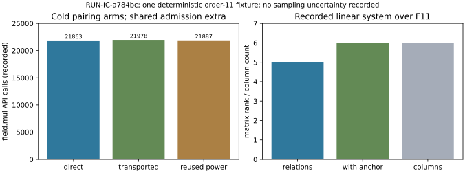

# Pairing and paired-element run observations

This is a descriptive run report, not a scientific review or a verdict. No novelty, asymptotic improvement, ECDLP speedup, or cryptographic-scale transfer is inferred. Independent mathematical and cost review remains pending.

Experiment **EXP-IC-de9929**, hypothesis **H-IC-d328c8**, question **RQ-IC-a39c7e**; run **RUN-IC-a784bc**, seed 1729. One frozen trial requested, one output-validated, zero failed or timed out. It started 2026-10-15T07:33:26.257273+00:00 and finished 2026-10-15T07:33:29.777915+00:00. Producer snapshot `92aa046ff266fde994ec772b12d38601f09565aa` contains exactly the ten sealed run files. [Raw outputs and receipts](../../runs/RUN-IC-a784bc/) remain unchanged.

## Exact curve, subgroup and field context

Source E/F43: y²=x³+x, recorded order 44, subgroup r=11 with P=(4,5). Destination E′/F43: y²=x³-4x, recorded order 44, transported generator (15,2). The degree 2 map is (x+1/x, y(1-1/x²)), with kernel O,(0,0), including projective pole handling. The recorded base-field homomorphism census and subgroup witnesses are retained in raw output.

Source E: `EC1P6Cpairsrch4fff034f1496`; full UID `urn:ec-record:1:sha256:4fff034f1496155224286057bab7370248b7d3953d88262f7eec903faa84e962`.

Destination E′: `EC1P6Cpairdsthf77a7c99ede1`; full UID `urn:ec-record:1:sha256:f77a7c99ede19228aeff17c9a4aed869efad7bc0b722bb8c86887a3864ed667f`.

These are exact base-field representation identities from recorded model/order/generator metadata, with cofactor 4 derived as 44/11. Hashing does not certify the map. The pairing evaluation uses F43²=F43[u]/(u²+1), coordinates a+b*u, and distortion point S=(39,5u). The alternative basis v=u+1 has v²-2v+2=0. All 1849 field elements have recorded round-trip basis conversion. The extension ambient curve cardinality/cofactor is not explicitly recorded, so the extension global curve UID is unresolved; no omitted identity value is supplied. Exact base-field endpoints and this limitation are preserved in [curve-identities.json](curve-identities.json).

The accepted pairing base is g=7+34u; after transport it is 11+3u. All 11 synthetic Q=aP targets including a=0 were evaluated. Direct pairing, transported pairing and powers of newly obtained direct images are three separately paid arms; reused powers do not borrow direct-arm outputs.

## Recorded relations and descent

The fixed coefficient box -16≤a,b≤16, excluding(0,0), contains 1088 tested pairs. Actual paired-element identities, including units and exact factors, yield 192 accepted relation rows on 6 deduplicated nontrivial projected generator/unit images. Unused columns remain present. The unanchored system has recorded rank 5 over F11; anchoring one relative log raises rank to 6 and gives unique relative logs. The actual descended normalization log of g is 10. Descent records recover all 10 nonzero targets; the identity target is separately recorded with log 0. No truth logarithm table enters relation solving or descent.

Both number fields are actual implemented rings: Z[i] and the order with w²-w+3=0. Their field maps, full element products, factor/unit certificates and projection exponent 168 are retained. Norm smoothness alone does not count as an accepted element identity. This is a bounded paired-element toy instrument, not a full NFS benchmark or complexity measurement.

The Gaussian special-ideal panel records lattice basis [[5,0],[2,1]], determinant 5, public congruence a-2b=0 mod5, 217 box members and 104 primitive members. The large-embedding-degree control records q=2,r=101,k=100 and refuses the degree≤2 instrument; it explicitly makes no admitted-curve assertion.

Figure: recorded field multiplication calls and exact rank/column quantities from RUN-IC-a784bc. Counts are different named quantities, not a combined work score. One deterministic fixture; no statistical replication or sampling uncertainty is recorded.

## Resources and complete cost boundaries

| Arm | Wall s | CPU s | Field multiplication calls | Shift attempts |
|---|---|---|---|---|
| direct | 0.137725 | 0.137660 | 21863 | 22 |
| transported | 0.138476 | 0.138473 | 21978 | 22 |
| reused_power | 0.139671 | 0.139589 | 21887 | 22 |

All arms have fresh fields, curves and counters. Shared setup/admission is extra and is charged to each cold-start interpretation. The powers arm pays for obtaining its own direct pairings before exponentiation. Membership/ring enumeration, failed factorizations, relation construction, rank solving, descent, basis conversion, baseline acquisition and checker work remain separately named. Baselines include exhaustive and BSGS recovery in both field bases, with 11 targets each; conversion/acquisition are extra components. These timings and API-call counts do not establish an end-to-end advantage. Overlapping field API layers are not added into one operation total, and inclusive parent/child times are not summed.

Driver-through-result-assembly wall time is 1.760127s and process CPU is 1.759608s, including its internal checker. Artifact serialization, separate checker and supervisor are outside that timer. Recorded trial process-lifetime high-water RSS is 41799680 bytes through result assembly; it includes imports/prior phases and is not per-arm memory. Python allocation/serialization and uncalibrated lower-level arithmetic remain explicitly unpriced. No Pollard-rho comparison or security-bit extrapolation is measured.

## Controls, integrity and provenance

All prescribed controls remain in the raw case: identity map; degenerate S=P pairing; annihilator zero map; excessive extension degree; random relabeling; power permutation; norm-only false identity; missing unit; corrupted projection. Their actual witnesses and rejection/retention outcomes passed the producer and separate checker, both exit 0. The eight case panels all have measured status. This is certificate/software checking, not independent scientific review. No failed or substituted scientific attempt occurred.

Exact command: `python3 tools/lattice_ic_pairing.py --seed 1729 --output-dir <run_dir>`; checker: `python3 tools/lattice_ic_pairing.py --check <run_dir>/raw-result.json`. The native supervisor launch, claim authority and hash-closed plan are retained in launch.json and execution-receipt.json. Approval DEC-20261015-6ec1c0; executor TASK-20261015-4e240d. Bound code commit `d2153ddcdd75a4be3aa08077d86bf50d09153664`; Python 3.12.14, recorded Linux. Source/dependency hashes are in manifest.yaml/environment.json. Full dirty-tree state and hostname were not sampled; unavailable metadata is not represented as clean or known.

Raw payload SHA-256: `cbf2a1b6d0a57a9b44a663b0574cb87e60c1bb5504354ced4b4877b95efc32f6`. The graph reads [summary.json](summary.json); [plot.py](plot.py) is editable. Lengths/counts in this report are labeled derived counts of recorded arrays, not new scientific trials. There is no independent sample uncertainty because this is one complete prescribed tiny schedule.

The original research-certification issues #2152–#2155 remain pending. This new track stays open in [#2171](https://github.com/aburan28/crypto-autoresearcher/issues/2171), under parent [#2151](https://github.com/aburan28/crypto-autoresearcher/issues/2151). Successful order-11 recovery does not establish a faster algorithm for secure prime-field elliptic curves. The polynomial and combined experiments must test their own relation-density, lattice, extraction and height interfaces.
