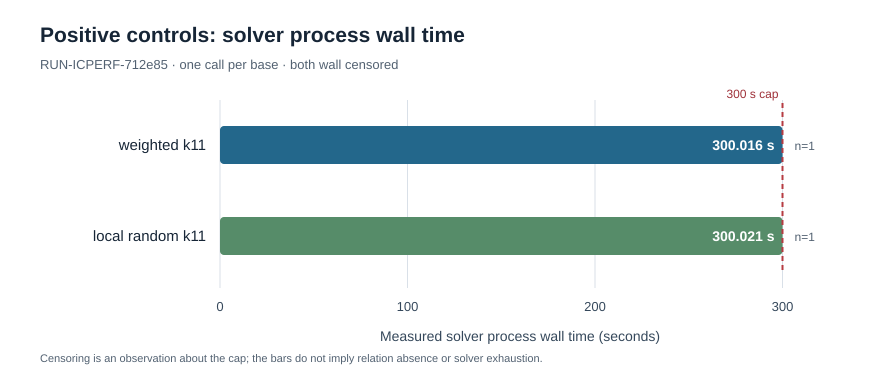

# Bounded k11 solver-to-certificate pilot: run record

This is an **observation-only** report for `EXP-ICPERF-018b0c` under `H-ICPERF-195806` and `GOAL-ICPERF-e6b6a4`. It records the two output-validated stage directories and their censored/gated calls. It makes no scientific verdict or priority decision. The independent evidence review is separate.

The first trial began at **2026-10-17 14:37:33.881131 UTC**, fixing this write-once report directory. Raw custody is bound by marker commit `72d96cc75e90db9fbe59b0b7fdb970f727beed1e` and its [snapshot receipt](../../../../coordination/goals/GOAL-ICPERF-e6b6a4/batches/BATCH-35c5a6/archives/TASK-20261017-da78be/snapshot-receipt.json). The raw files were first committed at `f5098b004f45d2ce85b38a1c6fa837d915576206` and pushed before this report. The snapshot hashes all 26 fixed files from the two runs; its receipt is a separate 27th bound file in the additive queue.

## Frozen input and execution

The [specification](../../specification.yaml) and [trial plan](../../trial-plan.json) fix one ordinary binary curve over `GF(2^61)`, prime subgroup order `576460752557211763` (60 bits), eight summands, two target-blind bases with **316 projected columns each**, one planted positive per base, and eight common natural subgroup targets with four raw channels each. The planned schedule is **2 positive + 64 natural solver calls**. The bases differ in accepted-coordinate tables; their archived per-channel CNF and XOR row counts are equal. The result therefore contains no measured static formula-size advantage of the weighted arm.

The supervisor used source commit `56be1ed09b6140fbd51aff2602b1006494a91159`, Python 3.12.8 on macOS 26.6 arm64, and CryptoMiniSat 5.14.7 at `/opt/homebrew/bin/cryptominisat5` (SHA-256 `a3f85c3709b5e2a040bf82a4a604d1c7b9f10219bbf180a9e0f72319a2e892ac`). Its [positive command](../../runs/RUN-ICPERF-712e85/command.txt) and [natural command](../../runs/RUN-ICPERF-1c8bfe/command.txt) invoke `implementation/execute.py --step positive|natural` with the fixed run directories; the natural command names the positive run as its gate input. Each solver invocation used one thread, seed `20261017`, a 300-second wall cap, an 8 GiB sampled-RSS cap, and a 64-primary-model cap. The run records bind exact source and manifest hashes. A run-time dirty-tree flag was **not recorded** by these receipts; this report does not infer one.

## Recorded calls and gate

| Stage / raw run | Arm | Solver calls attempted | Recorded process wall | Sampled process CPU user + system | Sampled peak RSS | Outcome |
| --- | --- | ---: | ---: | ---: | ---: | --- |
| Positive / [RUN-ICPERF-712e85](../../runs/RUN-ICPERF-712e85/raw-result.json) | weighted k11 | 1 | 300.015663 s | 264.025899008 + 7.005136384 = **271.031035392 s** (derived) | 207,814,656 bytes | `wall_censored`; 0 models, no point certificate |
| Positive / [RUN-ICPERF-712e85](../../runs/RUN-ICPERF-712e85/raw-result.json) | local random k11 | 1 | 300.021396 s | 237.157941248 + 6.537313280 = **243.695254528 s** (derived) | 222,822,400 bytes | `wall_censored`; 0 models, no point certificate |
| Natural / [RUN-ICPERF-1c8bfe](../../runs/RUN-ICPERF-1c8bfe/raw-result.json) | both arms, eight targets × four channels | **0 of 64** | no solver process | no solver process | no solver process | `gated_by_positive_controls`; all 64 unattempted |

The two process-wall values are from the exact `calls.tar.gz` `summary.json` files; the displayed six-decimal values are rounded from `300.0156629999983` and `300.0213959590037`. Their statuses, limits, raw stdout/stderr hashes and input hashes are retained in those summaries and [calls manifest](../../runs/RUN-ICPERF-712e85/calls-manifest.json). The chart below plots the two **recorded** process wall times against the 300-second cap. Each arm has `n=1`; no spread or uncertainty estimate was recorded. A few milliseconds past the cap reflect watchdog sampling and are not extra certified solver work.

The positive stage's [raw result](../../runs/RUN-ICPERF-712e85/raw-result.json) records **601.2394865410024 s** total driver wall, including **0.7232824589955271 s** bundle packaging wall and 12 bundled raw files; the two input decompressions took **0.005230082999332808 s** and **0.00768354200408794 s** respectively. The natural stage's [raw result](../../runs/RUN-ICPERF-1c8bfe/raw-result.json) records **0.0026677079949877225 s** driver wall, **0.0005297500028973445 s** bundle packaging wall, and zero raw call files. The process CPU numbers above are per solver process samples. A full stage CPU total and a complete preparation-to-target wall cost were not recorded here. Base generation, formula preparation and their earlier checks are separately archived inputs; their costs cannot be silently omitted from a later complete-cost `S`.

Both [positive independent check](../../runs/RUN-ICPERF-712e85/independent_check.json) and [natural independent check](../../runs/RUN-ICPERF-1c8bfe/independent_check.json) say `validated: true` for the **exact raw output and gate classification**. They report two checked raw positive calls, zero checked natural calls, and zero distinct projected rows. This validates preservation and classification of the observed stage outputs; with no completed positive model, it supplies no positive point certificate. The gate in the frozen protocol then blocked every natural call. Neither stage measured natural relation yield, useful rank, solver degree of regularity, linear algebra, unknown-target recovery, matched rho, or complete end-to-end `S`. The two timeouts do not establish solver exhaustion or absence of relations.

## Reproducibility and visual source

[`plot-data.json`](plot-data.json) contains the two raw process-wall values and source member paths. [`chart.py`](chart.py) regenerates [`diagram.svg`](diagram.svg) from that data using only the Python standard library. [`report.typ`](report.typ) is the editable PDF source, with the same graph embedded in [`report.pdf`](report.pdf). The PDF was rendered and visually inspected before the six-file report package was committed. Scientific interpretation remains reserved for the independent review and Coordinator decision.
