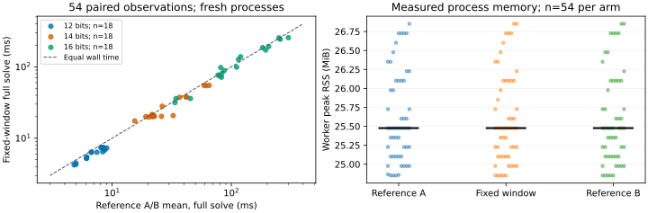

# Fixed-base targets: recorded toy-IC run

Observations only. This report records the frozen experiment and derived statistics; independent evidence review determines any claim.

EXP-ICPERF-3065f9; H-ICPERF-a2284c; GOAL-ICPERF-e6b6a4. RUN-ICPERF-842b51 is archived at bc5514cf8ae037f2bd365017a94df5ede595d3e6, with explicit content custody a45755108d7d88277bba93b379515d2e78085628 (CORR-20261023-f73c58).

The supervisor launched `.venv/bin/python tools/experiment_execution.py run --plan experiments/EXP-ICPERF-3065f9/trial-plan.json --owner coordinator-ic-window --epoch 1`. Source commit: bfc2e0b4c25ff1748872a3d4dd9af2d040ec3699; bound sources were committed and unchanged at launch. The workload is nine public prime-order toy curves at 12/14/16 bits, curve seeds 0/1/2, solver seeds 0/1, target seed 0, three repetitions, m=2, small_x, mitm, scalar decomposition, harvest off, window 4. All 162 workers completed; none failed, timed out or was censored.

The external full-solve timer includes each arm's factor base, decomposition table, target-cache setup, missed decompositions, elimination and final solver verification. Public instance generation, process startup, trace hashing and independent checking are outside this timer; the driver harness timer ends before independent checking. Measured driver harness time: 25.985350 seconds. Wall seconds, CPU seconds and operation counts are separate units.

| Field bits | Reference geometric mean (ms) | Candidate geometric mean (ms) | Derived paired ratio |
|---|---:|---:|---:|
| 12 | 7.0707 | 6.1325 | 1.1530 |
| 14 | 29.1614 | 26.9108 | 1.0836 |
| 16 | 107.0015 | 103.8080 | 1.0308 |

Across 54 pairs, the derived geometric paired ratio is 1.087983; the predeclared clustered 95% bootstrap interval is [1.061369, 1.118266]. Each reference observation is the arithmetic mean of A and B. The A/A geometric factor is 1.026405. Bootstrap: 5000 resamples, seed 3065; resample three curve clusters within each bit-size stratum, retaining both solver seeds and all repetitions. The frozen numerical criterion is recorded as True; this is not an independent review verdict.

The checker independently counted curve points, checked prime field/order and every recovered kP=Q, regenerated every seeded target, and matched factor-base points/signs, target/relation digests and deterministic work counters. The known-wrong logarithm and identical-timings performance controls were rejected. All raw arm records remain in `arms.jsonl` and `raw-result.json`; validation is `validation.json`.

Host: Linux 6.18.55 x86_64/glibc2.41, AMD EPYC 9V74 host, five visible logical CPUs, CPython 3.12.14, NumPy 2.3.5. Recorded load averages after the grid: [1.0361328125, 0.57470703125, 0.24951171875]. Worker peak RSS spans 24.85–26.85 MiB across arms; packed target-coordinate payload is 304–480 bytes for the candidate and excludes Python/container overhead. The graph plots every recorded row; the horizontal marks are medians.

Limits: scalar decomposition only, one host, nine toy instances. These measurements do not compare Pollard rho, vectorized decomposition, deployed curves or asymptotic exponents. No official frontier is updated; canonical frontier graphs remain unchanged. Final mathematical certificate checks do not establish a release-contract execution proof.

Independent review found C-target not isolated: the candidate always occupies the middle execution slot. The observed timing ratio is descriptive only; it cannot support a causal wall-time speedup claim. A separately frozen balanced-slot successor on unseen curves is required.
