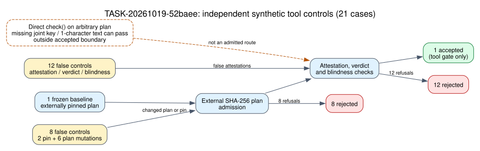

# Operational checker review: DEC-20261019-3bf0cd

**Experiment:** EXP-ICPERF-515ae3 · **Goal:** GOAL-ICPERF-e6b6a4 · **Decision:** `accept_tool_gate_scoped` · **Evidence strength:** independent, bounded mutation review of a frozen tool boundary · **Claim tier:** operational checker admission only.

The accepted claim is exact: `tools/check_review_independence.py` may gate a later retrospective P1–P4 composition when its CLI receives the external SHA-256 pin `1242a62527951bd0f2bb7f908fd2be50e85dcd79cf7a0db0dd09d69de64a29db` for the frozen P1–P4 plan and only the archived Red Team attestation and original-session Validator addendum. [DEC-20261019-3bf0cd](../../../../ledger/decisions/DEC-20261019-3bf0cd.yaml) does not decide any P1–P4 scientific joint. Its reviewer is [TASK-20261019-52baee](../../../../coordination/review/icperf-postrun-independence-tool-v2-20261019/TASK-20261019-52baee/report.md), with [attestation](../../../../coordination/review/icperf-postrun-independence-tool-v2-20261019/TASK-20261019-52baee/attestation.yaml), completed [release](../../../../coordination/goals/GOAL-ICPERF-e6b6a4/batches/BATCH-5bfb57/claims/TASK-20261019-52baee.1.release.json), verified [review snapshot receipt](../../../../coordination/goals/GOAL-ICPERF-e6b6a4/batches/BATCH-5bfb57/archives/TASK-20261019-a0ad65/snapshot-receipt.json) and [decision receipt](../../../../coordination/goals/GOAL-ICPERF-e6b6a4/batches/BATCH-5bfb57/archives/TASK-20261019-a0ad65/ledger-receipt.json). There is no EV record or solver-derived performance measurement for this tool decision.

## Observation

The independent reviewer reported 21 synthetic tool cases: one genuine frozen baseline accepted and 20 false mutations rejected. Eight refusals occurred at external pin or plan admission (two pin mutations and six plan mutations). Twelve occurred during attestation, verdict or blindness composition. The diagram below renders these counts from the sealed report; counts are cases, not seconds, relations, trials of an ECDLP solver, or attack outcomes. The reviewer also called `check()` directly: empty, whitespace and ID-only explicit statements rejected, while an omitted `joint` key or one-character nonempty text could pass on an arbitrary untrusted plan. [Source: TASK-20261019-52baee report and attestation, internal, reviewed by the Coordinator after the verified snapshot.]

## Comparison

The earlier [DEC-20261019-da1c84](../../../../ledger/decisions/DEC-20261019-da1c84.yaml) refused the prior checker version because three false cases could pass. The corrected checker rejects those exact classes at the combined pinned CLI boundary: empty or swapped P3/P4 plan text fails the external digest, and a scalar verdict for the two-joint owner fails per-joint verdict admission. The root session reran the exact pinned P1–P4 command and the separately pinned V1/V2 attestation command; both returned `PASS`. This comparison establishes a scoped tool correction, not an end-to-end IC comparison.

## Inference

The Coordinator accepted this exact combined CLI as an admission gate for a future P1–P4 composition. The generic direct `check()` function remains outside the accepted boundary. The corrected checker does not independently authenticate reviewers' read histories, model identity or scientific conclusions. The sealed attestation labels the role `validator` while its handoff says `reviewer`; this label discrepancy remains recorded. The reviewer model and effort came from parent dispatch metadata and were not independently resolved by that runtime.

## Limitation and next action

Historical RUN-ICPERF-eb0d88 remains `invalid_output`: two frozen top-level outputs are missing, and the three positive solver calls remain timeout-censored. Natural relation yield, useful rank, linear algebra, complete IC cost and rho gap remain unmeasured. The 20 false fixtures were temporary and their exact bytes were not archived; their classes and diagnostics are in the sealed report. The reviewer claim required approved escalated Git publication after the tool's internal `git add` hit a sandbox index-lock error. The visual sidecar is published after the decision because the frozen TASK-20261019-a0ad65 scope lacked visual paths; this is the timing deviation declared in DEC-20261019-3bf0cd.

Next, archive this sidecar under TASK-20261019-ffb51e. Only after its receipt and the checker decision receipt are verified should a new additive queue admit TASK-20261019-6398fb for retrospective P1–P4 composition with the exact external plan pin. A future scientific run belongs to the separate `run` entry point.

## Graph maintenance check

I inspected the ICPERF run graph source and rendering at `experiments/EXP-ICPERF-515ae3/reports/run-20261019T2113Z/{draw.py,graph.svg}`, the prime63 diagnostic integration rendering at `research/icperf_prime63_m2_diagnostic_integration_20261018/diagram.svg`, `knowledge/frontiers/ecdlp/README.md`, and the `knowledge/frontiers/ecdlp/index-calculus/` inventory. This decision changes checker admission only; it supplies no new mathematical frontier, measured run value or integration route. Those existing graph sources and renderings are unchanged. The new diagram's editable source is [diagram.dot](diagram.dot).
