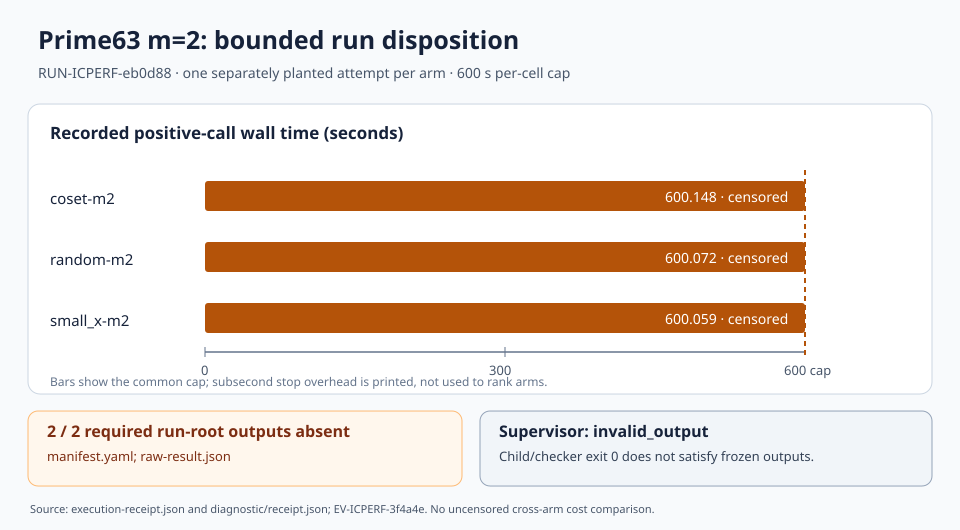

# Prime63 m=2 retrospective evidence review

**Decision:** [DEC-20261019-471fe2](../../../../ledger/decisions/DEC-20261019-471fe2.yaml) records an inconclusive scientific result and a retrospective `running -> invalid` disposition for [EXP-ICPERF-515ae3](../../specification.yaml), limited to the frozen supervisor output contract. [DEC-20261019-cf7e51](../../../../ledger/decisions/DEC-20261019-cf7e51.yaml) separately records the earlier execution start as `approved -> running`. Both decisions are dated when recorded; neither rewrites the original specification, plan or run. The supporting evidence is [EV-ICPERF-3f4a4e](../../../../ledger/evidence/EV-ICPERF-3f4a4e.yaml), with strength **inconclusive** and claim tier **medium** for one 63-bit prime-field instance. H-ICPERF-05021b remains approved and GOAL-ICPERF-e6b6a4 remains active.

## Observation

The standard [supervisor receipt](../../runs/RUN-ICPERF-eb0d88/execution-receipt.json) for RUN-ICPERF-eb0d88 records `invalid_output`: two frozen, required run-root outputs, `manifest.yaml` and `raw-result.json`, are absent. The child and its narrower raw-diagnostic checker both exited zero. The checker reported `integrity_pass` for files it inspected, but did not produce the two required supervisor outputs. The run directory and frozen trial plan remain unchanged.

The [raw diagnostic receipt](../../runs/RUN-ICPERF-eb0d88/diagnostic/receipt.json) records the expected injected monitor fault and three separately planted positive calls. Each positive call reached the 600-second cap and recorded `timeout_censored` without a response or certificate. Measured wall seconds were 600.148084 for coset-m2, 600.072356 for random-m2, and 600.058805 for small_x-m2, one attempt per arm. Sampled process-tree RSS maxima were 4,295,540,736; 375,980,032; and 242,696,192 bytes respectively. Those sampled maxima do not bound unseen peaks.

The [blind Validator report](../../../../coordination/review/icperf-prime63-m2-postrun-20261019/TASK-20261019-bb87e3/report.md) independently inventoried 15 original raw archive members and checked archived planted witness equations and signed group sums. The [Red Team report](../../../../coordination/review/icperf-prime63-m2-postrun-20261019/TASK-20261019-02a5c2/report.md) matched 26 candidate custody entries to original bytes and source blobs, checked chronology, and preserved both missing-output and censor classifications. Four original report/attestation files are bound by the [snapshot receipt](../../../../coordination/goals/GOAL-ICPERF-e6b6a4/batches/BATCH-5bfb57/archives/TASK-20261019-6398fb/snapshot-receipt.json). P1–P4 hold only for those stated joints.

The editable SVG shows the three measured durations against their common 600-second cap and the two missing required outputs. It is a disposition diagram, not a performance ranking. Its source values come from the two immutable receipts above.

## Comparison

The frozen three-arm protocol varies factor base, planted target, encoder and equation shape together. All three calls are censored at the cap, so the small differences in observed stop overhead cannot isolate any base or method. The archived planted witnesses show that the input instances have satisfying assignments; they are separate from a returned solver certificate. No natural relation yield, useful rank, linear algebra, target descent, cold or online total, matched rho, or setup-excluded Bernstein–Lange comparison was measured.

The original Validator supplied a separate, original-session [P1/P2 schema clarification](../../../../coordination/review/icperf-prime63-m2-postrun-20261019/TASK-20261019-7b08c1/attestation-addendum.yaml) after its first seal. That timing is a procedure deviation. The corrected review checker accepted the original Red Team attestation and this addendum only through the [externally pinned exact-plan CLI diagnostic](../../../../coordination/goals/GOAL-ICPERF-e6b6a4/batches/BATCH-5bfb57/admission/TASK-20261019-6398fb-pinned-gate.json), under [DEC-20261019-3bf0cd](../../../../ledger/decisions/DEC-20261019-3bf0cd.yaml). The tool checks declared joint ownership, verdict format, blindness fields and controls on those bytes; it cannot authenticate read history or scientific correctness.

## Inference

The independently reviewed custody and raw observations support the narrow conclusion that this attempt failed the frozen top-level output contract. The experiment state advances retrospectively from approved through running to invalid. This is an implementation and trial-output disposition. The three positive calls remain timeout-censored, and the hypothesis gains neither support nor negative scientific evidence from them. The [output-contract problem](../../../../problems/icperf-prime63-m2-output-contract-mismatch.md) remains open for a prospective, fresh-ID correction.

## Limitation and next action

The exact field is `p = 9223372021248595841`, subgroup order `r = 9223372018953067627`, factor-base size `B = 475`, and arity `m = 2`. The three targets were separately planted; there was one fixed attempt per arm. These observations do not transfer to other prime curves, Koblitz curves, ordinary binary curves, larger arities or natural targets. Hash-bound custody and checker PASS are not an end-to-end execution proof. The original full-output review chain did not complete.

Rank a prospective output-contract repair with a fresh plan/launcher/checker mapping. Require a standard-supervisor no-science censored fixture, a canned positive fixture, negative artifact controls and an approvable frozen packet before any later scientific execution. Keep solver/formulation work and natural relation, useful rank, full-cost and matched-rho measurement as separately controlled follow-ups.

Canonical graph candidates checked: the earlier [run graph](../run-20261019T2113Z/graph.svg) and source `draw.py`, the [prime63 integration diagram](../../../../research/icperf_prime63_m2_diagnostic_integration_20261018/diagram.svg), and `knowledge/frontiers/ecdlp/README.md` plus its index-calculus inventory. Their supported scientific content does not change: the new finding classifies the already archived output failure and review custody, without adding a verified cost comparison or curve relation. They remain unchanged; this diagram records the new retrospective decision.
