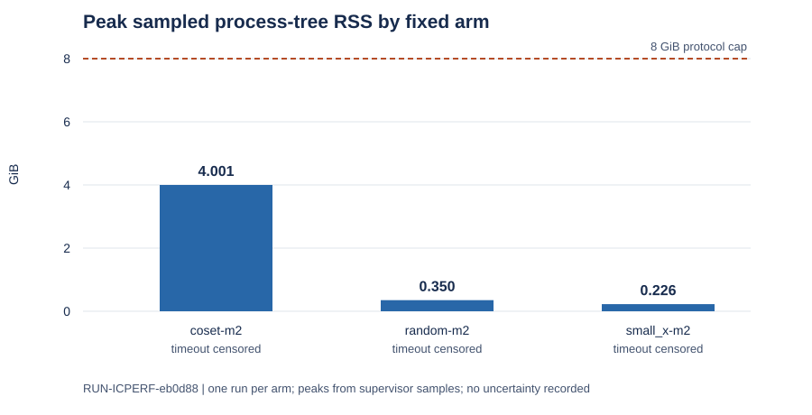

# EXP-ICPERF-515ae3 execution report

This report describes recorded execution outputs only. It makes no scientific verdict, hypothesis transition, factor-base ranking, or end-to-end speedup claim.

- Goal: `GOAL-ICPERF-e6b6a4`; hypothesis: `H-ICPERF-05021b`.
- Run: `RUN-ICPERF-eb0d88`, trial `prime63-m2-three-arm-diagnostic`, raw directory [`../../runs/RUN-ICPERF-eb0d88`](../../runs/RUN-ICPERF-eb0d88).
- Frozen plan: [`../../trial-plan.json`](../../trial-plan.json), SHA-256 `08f32f02a191dfd16f5342540716a327da73f5091528bac07cf5ee77cdb7cbc9`; code commit recorded at launch: `4b197051008fa9abd87ad29c259e553252d196e0`. The run environment did not record a dirty-state field.

## Recorded execution

One trial was launched; zero trials satisfied the supervisor's required-output check. The supervisor recorded `invalid_output` and selector state `needs_reconciliation`: `manifest.yaml` and `raw-result.json`, required by the frozen trial plan, were absent. The child exited 0 after writing the diagnostic receipt and raw archive. The independent checker exited 0 and reported `integrity_pass`, with three positive cells censored and none verified. The checker result does not override the supervisor's missing-artifact classification.

The injected unreadable-live-root control recorded `infrastructure_monitor_error` with fault `unreadable_live_root`; that was its specified behavior. All three positive cells were attempted. Each reached its 600-second cap and recorded `timeout_censored`; none emitted a response or a full-point certificate. The last solver phase seen was Gröbner computation for `coset-m2` and root enumeration for the other two arms. These are bounded observations from this run.

| Cell | Recorded stop | Measured wall (s) | Peak sampled process-tree RSS (GiB) | Last solver phase |
| --- | --- | ---: | ---: | --- |
| monitor-null | infrastructure_monitor_error (expected injection) | 0.004162 | missing by injected fault | synthetic control |
| coset-m2 | timeout_censored | 600.148084 | 4.000534 | groebner |
| random-m2 | timeout_censored | 600.072356 | 0.350159 | root_enumeration |
| small_x-m2 | timeout_censored | 600.058805 | 0.226028 | root_enumeration |

Wall seconds and peak RSS bytes come from [`../../runs/RUN-ICPERF-eb0d88/diagnostic/receipt.json`](../../runs/RUN-ICPERF-eb0d88/diagnostic/receipt.json). GiB values are derived as peak sampled bytes divided by 2^30 and rounded to six decimals. The three-armed panel has one execution per arm; no spread or uncertainty estimate was recorded. CPU time was not recorded. Overall supervisor wall time, derived as `finished_at - started_at` in its receipt, was 1803.422275 seconds, including launcher and checker overhead. The fixed per-cell caps were 600 seconds, process-tree RSS and scratch caps 8 GiB, and model cap 64.

The graph draws recorded sampled RSS peaks; its source is [`draw.py`](draw.py). It is a resource plot, not a speed comparison. All three positive calls were censored, and the arms used separately planted targets. Matched rho time, Bernstein–Lange time, natural relation yield, useful rank, linear algebra, target DLP time, setup amortization, and a complete IC total were not measured in this run; their gaps are therefore unavailable.

## Inputs and environment

The archived short-Weierstrass prime-field instance has `p = 9223372021248595841` and subgroup order `r = 9223372018953067627`. Each arm used its frozen 475-point factor base, arity `m = 2`, and its own planted target. The three request hashes are `9a172c65375c2d2dc2d73f6232fa52fa281afade4fcb76e00fbbbf32f35ecb91` (coset), `04e7668f12afb5769ce9f6c8b2e25eb052854c28a846e5e92ab4d19c39291c01` (random), and `88258142099602ebfe156af11f9843e25411b49b6db5675950c4192de27347ee` (small-x). No in-run random seed field was recorded; inputs were hash-bound.

Supervisor command: `python3 tools/experiment_execution.py run --plan experiments/EXP-ICPERF-515ae3/trial-plan.json --owner executor-prime63-m2-science --epoch 1`. The child command and checker command are in [`../../runs/RUN-ICPERF-eb0d88/launch.json`](../../runs/RUN-ICPERF-eb0d88/launch.json). The recorded platform was Darwin with Python 3.13.1; the receipt did not record a host name. Start was `2026-10-19T21:13:44.520872+00:00`; finish was `2026-10-19T21:43:47.943147+00:00`.

The raw run commit is `1f857554d6`; the failed lane release is commit `10b962aed4`. The run directory preserves the supervisor receipt, checker output, the diagnostic receipt, all phase traces, empty raw streams, request objects, and `raw.tar.gz`. The required `manifest.yaml` and `raw-result.json` are absent exactly as recorded. No canonical scientific graph was changed because this session produced no reviewed finding.
