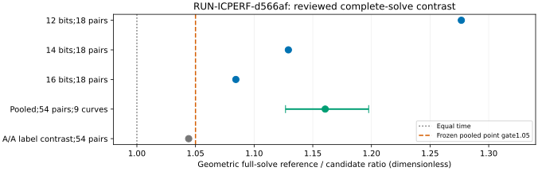

# Scoped acceptance of the balanced native target generator

Decision: DEC-20261023-122e32 accepts EV-ICPERF-92c130 as moderate empirical toy evidence for the optional native fixed-window target generator. This is a complete instrumented native solve API observation on a specified host/session. Reference defaults, official frontiers, measured bounds and hypothesis statuses do not change.

Observation: EXP-ICPERF-6c546e / RUN-ICPERF-d566af completed all162 workers,54 matched pair-repetitions,18 distinct curve/solver streams and nine new public12/14/16-bit curves. The raw snapshot is ed0d34e276149b30d137448f22b0fb17cdd4cf28; executable/input commit e9f89202f5977ad5e39cc42311cfa781a24d41f7. Parameters: curve seeds3/4/5, solver seeds0/1, three repetitions, m2/small_x/mitm, accelerate=false, harvest=off, target window4; target seed0. No missing, failed, invalid or timed-out row. All targets, relation streams and recovered logarithms match.

Comparison: within every exact curve/solver cell every arm occupies every slot once, and all six permutations occur per curve. Baseline per pair is the arithmetic mean of reference A/B. The geometric paired reference/candidate ratio is **1.16058236**, against max(1.05,A/A) =1.05. A/A is1.04417082; it is an observed geometric label contrast, not an upper noise bound. The stratified9-curve clustered bootstrap (5000 resamples, seed3065) gives95% interval **[1.12675198,1.19766091]**, with sorted zero-based order statistics124/4875. The blinded independent derivation initially used floor indices124/4874 and gives upper1.19741213; linear interpolation gives upper1.19741834. Frozen empirical-percentile wording did not settle endpoint rounding; all conventions and the unchanged positive gate are disclosed, not retroactively rewritten.

The pooled whisker is the curve-clustered interval; per-size and per-slot ratios are descriptive, without new significance or independent replications. Per-bit ratios12/14/16:1.27665, 1.12918, 1.08440. Candidate-slot0/1/2 ratios:1.15831, 1.18018, 1.14355. Five of54 candidate pairs are slower. Full group-operation sums per54 solves are200856 reference versus50490 candidate; target-generation sums193698 versus43332 include per-solve table construction. Counts and seconds are separate units.

Inference: independent fresh xhigh TASK-20261023-6562b0 owns J-integrity and J-inference; both hold within this conditional scope. The reviewer independently rederived raw statistics before reading successor source or historical audits, preserved permanent semantic blindness to producer summaries/base analysis, and reused the prior committed unchanged-base-worker audit plus blind native algebra TASK-20261023-5301b1. It independently counted nine prime curve orders, replayed18 seeded target/relation/elimination streams and checked all162 kP=Q witnesses. Actual scratch checker controls reject the old always-middle schedule, wrong logarithm, target/config digests, missing row, wrong/missing affinity, wrong environment and missing load. Identical candidate times produce ratio1 and fail the strict gate. The exact-plan independence checker passes. Opaque protected-path hashing and imported checker execution are explicitly disclosed in the review; no protected semantic summaries were read.

The timer surrounds the entire instrumented solve API call, including factor base, decomposition and target tables, unsuccessful attempts, relations, elimination/recovery, final certificate and result construction. Trace recording is inside both arms; trace hashing, public fixture construction, startup/imports, environment/affinity/load telemetry, separate checker and supervisor are outside. Internal historical seconds_total/group_ops end before final verification and are not substituted. Setup is a subset of the relation phase and is not added twice. Driver harness40.32456s overlaps the40.64248s process and41.21535s supervisor envelope: never sum them. No separate checker phase is inferred by subtraction.

Limitation: one AMD EPYC9V74 host/session, CPython3.12.14, scalar native mitm, all workers CPU0. Nine held-out curves provide only three independent curve groups per bit stratum;54 repetitions are not54 independent curves. The interval is descriptive/conditional. The Coordinator launched no known scientific competitor during17:06:26–17:07:07UTC, but visible process/load census cannot prove host-wide or transient isolation. Lock/affinity are verified for every row. Worker peak RSS29,749,248–31,322,112 bytes includes interpreter/imports and is not an incremental memory saving;304–440-byte packed coordinate payload excludes Python overhead. Full-solve CPU observations span0.001137276–0.174347187 CPU seconds and are not added to wall time.

No production-curve, vectorized, universal per-instance, asymptotic, best-known-baseline, rho, Bernstein–Lange or attack-cost-bound conclusion follows. Matched rho/BL gaps are unmeasured. Hash-bound custody and certificates do not provide a zkVM execution proof or official ECBND measured bound. The prior confounded EXP-ICPERF-3065f9 remains preliminary and is never pooled with this run. CORR-20261023-d33e18 records its earlier sparse local lane-census limitation separately from scientific validity.

Next action: land and document the optional generator and structured claims/ic-target-balanced-6c546e.json; keep GOAL-ICPERF-e6b6a4 active. Larger/vectorized and best-known IC/rho comparisons need separately frozen prospective protocols. The original slot-confound problem is resolved only for this successor by the linked evidence. Existing canonical official ECDLP frontier/bound graphs were checked for applicability: no sealed bound or frontier transition is authorized, so no graph edge changes. Earlier experiment report graphs remain immutable. This decision adds the measured scoped graph above and the native README evidence link.

Sources: coordination/tasks/TASK-20261023-6562b0/review_report.yaml and derivation.md; prior dependency audits TASK-20261023-5301b1 and TASK-20261023-18b489; the frozen specification/trial plan, sealed run artifacts and matched structured claim. Sources are internal artifacts read by the Coordinator; no new external citation is asserted.
