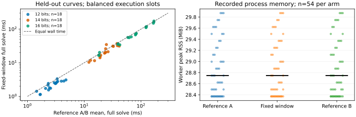

# Held-out balanced target-generation run

Observations only. This report records the frozen experiment and derived statistics; independent review determines any performance claim.

EXP-ICPERF-6c546e; H-ICPERF-a2284c; GOAL-ICPERF-e6b6a4; RUN-ICPERF-d566af. The prior timing run remains preliminary because of its middle-slot confound; its observations are not pooled with this held-out grid.

The supervisor ran `.venv/bin/python tools/experiment_execution.py run --plan experiments/EXP-ICPERF-6c546e/trial-plan.json --owner coordinator-ic-window --epoch 1`. Source commit: e9f89202f5977ad5e39cc42311cfa781a24d41f7, bound sources committed and unchanged at launch. Raw snapshot: ed0d34e276149b30d137448f22b0fb17cdd4cf28.

Nine new public prime-order curves: bits12/14/16, curve seeds3/4/5; solver seeds0/1, target seed0; three repetitions; m2, small_x, mitm, accelerate=false, harvest off, target window4. In every curve/solver-seed cell, every arm occupies every execution slot exactly once. Across the two solver seeds the schedule uses all six permutations. All162 workers completed and independently checked; none failed, timed out or was censored.

The full-solve timer includes each solve's factor base, decomposition table and target-cache construction, failed attempts, elimination/recovery and final verification. Public-instance generation, imports/process startup, environment inspection, affinity selection, trace hashing and independent checker are excluded from that API-call timer. Driver harness wall time: 40.324564 seconds (measured), ending before checker execution. Overlapping timers and units are not summed.

| Bits | Reference geometric mean (ms) | Candidate geometric mean (ms) | Derived paired ratio |
|---|---:|---:|---:|
| 12 | 2.7098 | 2.1226 | 1.2767 |
| 14 | 24.2610 | 21.4855 | 1.1292 |
| 16 | 65.3346 | 60.2494 | 1.0844 |

Across54 pairs: derived geometric ratio 1.160582, clustered95% percentile interval [1.126752, 1.197661], A/A factor 1.044171. Each reference observation averages both recorded reference arms. Bootstrap5000, seed3065: resample three curve groups within each bit stratum and retain all solver seeds/repetitions. The frozen numerical gate is True; this is not an independent-review verdict.

The bound environment file records 166 dependency-version entries, CPython 3.12.14, Linux-6.18.55-x86_64-with-glibc2.41, AMD EPYC 9V74 80-Core Processor, 5 visible CPUs and allowed affinity [0, 1, 2, 3, 4]. All measured workers report affinity [0]. The environment digest is 5942b6cb769e35025a447275c3ff1ea667c4654b6b37ace28a73c4f32f5e973d. Per-worker before/after load and before/after process names/CPU ticks are retained; process context is diagnostic and does not prove host-wide isolation. Peak worker RSS spans 28.37–29.87 MiB. Packed coordinate payload304–440 bytes excludes Python/container overhead.

The arithmetic checker independently verifies curve point counts, prime orders, all kP=Q witnesses, every seeded target, factor-base points/signs, paired relation digests and counters. Schedule validation confirms every treatment/slot crossing; the original middle-only schedule is rejected by a known-confounded control. Wrong-log and zero-advantage controls are rejected. Every row is retained in arms.jsonl and raw-result.json; validation.json and balance-validation.json are sealed alongside the supervisor receipt.

Limits: one host, nine new toy curves, scalar decomposition only. No claim for vectorized decomposition, the default mode, rho, deployed curves, asymptotic scaling or an official frontier. Independent review remains necessary.

Full-solve CPU observations span0.001137276–0.174347187 CPU seconds; wall and CPU time are separate measured units. The empirical percentile implementation selects zero-based sorted bootstrap indices124/4875; the frozen wording did not specify rounding. Later independent endpoint sensitivity is documented in the separate decision report.
