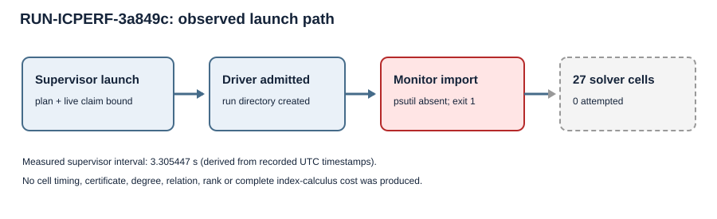

# Prime63 panel launch: infrastructure observation

EXP-ICPERF-f839ca · H-ICPERF-05021b · GOAL-ICPERF-e6b6a4  
RUN-ICPERF-3a849c · 2026-10-17 23:00 UTC

This run report describes the output of the frozen program. It makes no
scientific status decision or factor-base performance claim.

## Requested trial and exact boundary

One trial was requested on an arm64 macOS host from code commit
`130c1559cb6f73857fef1f2736d9826f2fa5c691`, with a clean working tree
before the supervisor created the run directory. The exact launch command was
`python3 tools/experiment_execution.py run --plan
experiments/EXP-ICPERF-f839ca/trial-plan.json --owner
executor-prime63-science --epoch 1` through the Conductor session wrapper.
The plan SHA256 was
`6b6284d482527985821890a66fdac96aff87be5c466380aa75f5a9bc1df1a715`.

The frozen schedule contains six separate planted controls and 21 natural
common-target cells for coset, random and small-x bases of size 475 at
arity m=2 through 8 over the selected 63-bit subgroup. Each cell's planned
limit was 300 seconds, 8 GiB sampled process-tree RSS and 8 GiB scratch,
with one worker, a 64-model guard and a four-hour panel ceiling. The inputs
and any target scalar were fixed in the approved plan; no adaptive seed or
base selection occurred in this launch.

## Observed output

The supervisor created [the run directory](../../runs/RUN-ICPERF-3a849c/)
and wrote its launch, environment, command, stdout/stderr and
`execution-receipt.json` files. Its receipt reports `infrastructure_error`,
driver return code 1 and no checker return code. The driver traceback ends at
`execute.create_panel` importing `psutil`: `ModuleNotFoundError: No module
named 'psutil'`. That import precedes the panel's Sage work and raw output
creation. No cell-level request, response, raw archive, manifest or
`raw-result.json` was produced. The requested trial count was 1; completed
trials 0, failed infrastructure trials 1, timed-out trials 0. All 27 cells
remain unattempted by this run, with no solver status assigned to them.

The receipt timestamps run from 23:00:20.885149 to 23:00:24.190596 UTC;
their difference is **3.305447 seconds, derived** from those two recorded
timestamps. The supervisor did not record a comparable cell wall/CPU time,
memory peak, scratch peak, degree, relation count or certificate. The
[receipt SHA256](../../runs/RUN-ICPERF-3a849c/execution-receipt.json) is
`80595df1532ca6de4efc260c1a520621bb7b2621d01fe5d75cae41d43d3ffb8d`;
the stderr SHA256 is
`3bb2272a215b08396227aa34a0484c10a8797ca1db68bde0b1b2a178e1d485fe`.

There are fewer than two comparable measured solver values, so the diagram
below shows where execution stopped. This artifact contains no natural
relation yield, useful rank, linear algebra, held-out target work, matched
rho, Bernstein–Lange comparison or complete index-calculus `S`.

