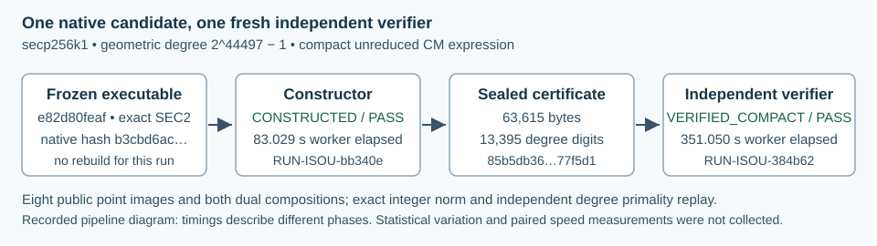

# Native compact isogeny: degree 2^44497 - 1

This report records observations only. Independent postrun evidence review and any admission remain separate. One new candidate was constructed and its exact certificate was checked by one fresh native verifier. The report covers both run directories written for this experiment in this session.

- Goal: GOAL-ISOU-f30a07; hypothesis: H-ISOU-ffa8b0; experiment: EXP-ISOU-0c7e60.
- Approval: DEC-20261016-4c28d0; producer: TASK-20261016-6db186; report: TASK-20261016-6239ad.
- Constructor: RUN-ISOU-bb340e; independent verifier: RUN-ISOU-384b62.
- First constructor invocation and OS worker start: 2026-10-16T12:05:37Z. Both adapters terminal: 2026-10-16T12:12:51Z.

The native constructor reports CONSTRUCTED. The separate native verifier reports VERIFIED_COMPACT, degree_bits=44497 and source ICV1 icv1-fp256-t432420386565659656852420866390673177327-76dadd18. Both native resource receipts report PASS, exit 0 and zero unavailable memory samples. There were two requested native operations, two completed operations, zero native failures/censors/nonstarts, one candidate and no retry.

The source is the exact registered SEC2 secp256k1 model y^2=x^3+7. The artifact represents the unreduced integer expression [a]+[b]phi, phi(x,y)=(beta*x,y), whose degree is a^2-a*b+b^2. The certificate has 13,395 decimal degree digits and 6,698 characters in each coefficient. Its prime degree is 2^44497-1; its 63,615 bytes remain sealed. This is the compact known-endomorphism category. Expanded rational-map challenge scoring and worldwide comparisons are separate obligations.

The figure is a diagram because construction and verification are different phases of one instance. They are not paired performance arms. Sample size is one per operation; variation and uncertainty were not measured.

| Native operation | Worker elapsed, s | Supervisor elapsed, s | OS real, s | OS user, s | OS system, s | User+system, s (derived) | Sampled worker peak, bytes |
| --- | ---: | ---: | ---: | ---: | ---: | ---: | ---: |
| Construction | 83.029 | 83.051 | 83.06 | 57.73 | 0.93 | 58.66 | 5,406,720 |
| Independent verification | 351.050 | 351.076 | 351.04 | 237.36 | 3.92 | 241.28 | 5,341,184 |

Derived CPU is 57.73+0.93=58.66 seconds and 237.36+3.92=241.28 seconds. The sum of the two disjoint public-command CPU receipts is 299.94 seconds; their OS real values sum to 434.10 seconds. These sums exclude build, setup, publication, orchestration, report generation and other trials. Those phases' CPU was not measured here. Enclosing/nested worker and supervisor durations are not summed. The original stderr prints supervisor display timers 83052/351076 ms; canonical resource JSON retains 83051/351076 ms. All clocks and original bytes are preserved without forcing them to agree.

Sampled worker peaks convert to 5.15625/5.09375 MiB by division by 1,048,576. The distinct OS maximum-RSS fields are 5,996,544/5,521,408 bytes for the public command accounting scope. Sampling is 25 ms, with 100 ms unusable-sampling grace and 8 GiB sampled worker cap, not an OS hard limit. Construction/verification watchdogs are 1,800/3,600 seconds. No aggregate application-peak memory or speed ratio is inferred.

Host at constructor start: Apple M4 Pro, 14 logical CPUs, 51,539,607,552 bytes (48 GiB), Darwin arm64, macOS 26.6, shared host, load averages 41.70/46.42/48.93. These are operational timings under that recorded environment.

The native verifier reports passing exponent-primality, 44,495 Lucas-Lehmer transitions with terminal 0 and matching recurrence digest, Cornacchia, exact integer/evaluated identity supplement, unreduced norm, separability, beta/lambda pairing, subgroup invertibility, 8 public point images and both dual compositions. Field/subgroup primality is explicitly TRUSTED_STANDARD from SEC2, without self-contained p/n primality certificates. The producer uses BigUint/Mersenne folding/Jacobian evaluation; the verifier uses independent Int/general modular LL, independent Cornacchia and fixed-limb affine point replay. Prescribed public cases are fixed; no new seed argument is used.

Existing clean installed-byte-equivalent native controls were reused from the frozen 94-pass suite, including composite/rejection, norm/alias/point/dual mutations, real missing/zero-RSS child controls and fresh-path refusal. They were not rerun as additional scientific trials for this instance.

Frozen implementation and exact inputs:

- Source: aburan28/crypto at e82d80feaf82d3730576ccd9137911b336f9dab8; build source dirty=false. No build occurred in this experiment.
- Installed binary: /Volumes/SSD990-2/crypto/isogeny-degree-challenge-builds-20261015/compact-final-e82d80feaf/isogeny.
- Binary SHA256:  b3cbd6ac5d457a0f6d6398d1fcefc408f627e60be52c81c9009406486b61587b.
- Standards SHA256: 22b2ffef99720f2b2c7396a267412d2241a868e038a835c4fb1fd12209b102bf.
- Execution harness commit: 4b2ebf2956eda0c038252aa461173c7c16428418, branch codex/isogeny-world-frontier-20261015.
- Trial-plan SHA256: fb453554fb217b39458c3c9cad1ca0959a13f878184d90d1097f67a4cba8a416.
- Native adapter SHA256: 2650dbf6025f6de8b5c8ceee101170735b216e252a0e948b188af9f06cdce78b.
- Execution queue SHA256: d1e7c11947053727752934c8018a13282bc9ffa7e1e81bd888026d06fe3f3371.
- Bound report queue SHA256: 36753b33f6e527975de572f123ce830b4007d5424848f79673e1ed7d7263d288.
- Actual served model/effort are unexposed and remain null in original environment metadata.

From the HA checkout, the frozen adapter was invoked exactly once for each operation:

~~~sh
/bin/sh coordination/goals/GOAL-ISOU-f30a07/m44497/native-command.sh construct /Volumes/SSD990-2/crypto-autoresearcher-isogeny-frontier-20261015/experiments/EXP-ISOU-0c7e60/runs/RUN-ISOU-bb340e
/bin/sh coordination/goals/GOAL-ISOU-f30a07/m44497/native-command.sh verify /Volumes/SSD990-2/crypto-autoresearcher-isogeny-frontier-20261015/experiments/EXP-ISOU-0c7e60/runs/RUN-ISOU-384b62
~~~

Those commands directly execute the frozen native binary under /usr/bin/time -l, with compact-cm construct --exponent 44497 --timeout 1800, then compact-cm verify --input EXACT_CERT --timeout 3600, each with its declared fresh --out. Python was used only for metadata, hashes and report work. The native verifier's bounded input snapshot SHA256 matches the sealed constructor certificate.

- Certificate SHA256: 85b5db3665a52a8fd04554964c03a6ed208bbb7ad1749770f5fa9d528b77f5d1; 63,615 bytes.
- Raw archive SHA256: 9abc49de038066691ff20d2c83a46a5b260ca116ac69739f9c2d43e4b13c354d; 96,856 bytes.
- Lucas-Lehmer states SHA256: 71bcb12e23c41e4a4fbd3d14498c96d9fbdcce3c778d48dd1c90506f2844fb35.
- Canonical run companions: 13410eae9e. Raw archive/observation: f1d5bbb476. Producer release: 8ea5cb8658, epoch 1, completed, was_expired=false, 14 artifact hashes.
- Archive path: coordination/goals/GOAL-ISOU-f30a07/m44497/execution/TASK-20261016-6db186/native-evidence.tar.gz. It retains 47 original raw files, per-file hashes, full terminal metadata, collector source and a labelled wrapper-prefix snapshot. All 47 raw hashes and both certificate/input identities were checked as metadata, with zero mismatches.
- Native results and certificates are observations pending TASK-20261016-4bad89. The mandatory 22-path terminal snapshot follows this four-file report. The canonical graphs/frontier/season catalogue were checked for this report's scope and remain unchanged because this observational delivery performs no promotion.

Publication and housekeeping failures remain separate from native outcomes. The first goal-claim push was refused when the own remote branch auto-updated. The existing epoch 1 claim was preserved, the own-branch file diff was empty, a nonrewriting merge/push published before any native start, and no candidate was repeated. Two JavaScript metadata-preparation requests failed parsing before any tool command/file write (Unexpected token '(' and Unexpected identifier 'json'); the corrected metadata collector passed syntax and executed once. The wrapped Conductor release freed T3264 and its process exited. A redundant explicit release refused the already-stale epoch; no reclaim followed. The wrapper's /bin/sh checkpoint was unsupported after release. These events changed no native result or frozen artifact.

[GIMPS candidate-selection source](https://www.mersenne.org/primes/) lists exponent 44497. Degree primality above is the native verifier's replay observation. [SEC2 parameters](https://www.secg.org/sec2-v2.pdf) provide the stated trusted domain assumptions. The next step is the declared archive and independent evidence review, with any claim-tier decision separate.

Initial report-render failure retained in full

The initial Typst compile exited1 because literal asterisk footnote labels were parsed as unmatched emphasis delimiters. It executed no scientific work. Initial sourceSHA256 93b31705217ddfd27016a466bcd09fd57d5ce7dbf83e0eef883434d3702e65b3. The repair replaces those labels with letters and adds this failure to the final report.

~~~text
error: unclosed delimiter
   ┌─ experiments/EXP-ISOU-0c7e60/reports/run-20261016T1205Z/report.typ:23:45
   │
23 │  [Operation], [Worker s], [OS real s], [CPU s*], [Worker RSS MiB**],
   │                                              ^

error: unclosed delimiter
   ┌─ experiments/EXP-ISOU-0c7e60/reports/run-20261016T1205Z/report.typ:28:1
   │
28 │ ** Derived from sampled 5,406,720 and 5,341,184 bytes divided by 1,048,576.]
   │  ^

warning: no text within stars
   ┌─ experiments/EXP-ISOU-0c7e60/reports/run-20261016T1205Z/report.typ:23:64
   │
23 │  [Operation], [Worker s], [OS real s], [CPU s*], [Worker RSS MiB**],
   │                                                                 ^^
   │
   = hint: using multiple consecutive stars (e.g. **) has no additional effect

~~~

~~~typst
#set page(paper: "us-letter", margin: (x: 0.52in, y: 0.46in))
#set text(font: "Libertinus Serif", size: 9.4pt)
#set par(leading: 0.58em)
#set heading(numbering: none)
#text(size: 18pt, weight: "bold", fill: rgb("#17364a"))[Native compact isogeny verification]
#text(size: 12pt)[Degree $2^44497 - 1$ · secp256k1 · 16 October 2026 UTC]

This is an observation report. Independent postrun evidence review and any admission remain separate. One candidate and one fresh native verifier completed; no mathematical retry or substitution occurred.

#text(size: 8.4pt)[Goal GOAL-ISOU-f30a07 · H-ISOU-ffa8b0 · EXP-ISOU-0c7e60 \
Producer TASK-20261016-6db186 · report TASK-20261016-6239ad · approval DEC-20261016-4c28d0]

#image("flow.svg", width: 100%)

The constructor reports *CONSTRUCTED* and the independent native verifier reports *VERIFIED_COMPACT*, degree_bits=44497, on the exact registered source. Both native resource receipts report PASS, exit 0 and zero unavailable memory samples. Two native operations were requested and completed; none failed, timed out or remained unstarted.

The unreduced expression is $[a] + [b] phi$, where $phi(x,y) = (beta x,y)$ and its geometric degree is $a^2 - a b + b^2$. The certificate stores a 13,395-digit degree and two 6,698-character coefficients in 63,615 bytes. This is the compact known-endomorphism category; the expanded-map challenge score remains unassigned.

#text(weight: "bold", fill: rgb("#17364a"))[Recorded phase costs]
#table(
 columns: (1.6fr, 1fr, 1fr, 1.1fr, 1.2fr),
 inset: 4pt, stroke: 0.5pt + rgb("#b7c6cd"),
 [Operation], [Worker s], [OS real s], [CPU s*], [Worker RSS MiB**],
 [Construction], [83.029], [83.06], [58.66], [5.15625],
 [Verification], [351.050], [351.04], [241.28], [5.09375],
)
#text(size: 8.4pt)[* Derived user+system: 57.73+0.93=58.66 s and 237.36+3.92=241.28 s. \
** Derived from sampled 5,406,720 and 5,341,184 bytes divided by 1,048,576.]

The distinct supervisor timers are 83.051 and 351.076 seconds. OS maximum-RSS fields are 5,996,544 and 5,521,408 bytes, with a different public-command accounting scope. Original clock values remain preserved. Nested intervals are not summed. The two disjoint public-command OS receipts sum to 434.10 s real and 299.94 s CPU; setup, build, publication, report work and other trials are excluded and their CPU was unmeasured here.

Construction and verification used 1,800/3,600-second watchdogs and an 8 GiB sampled worker cap, 25 ms sampling and 100 ms unusable-sampling grace. This is not an OS hard memory limit. The diagram shows different phases of one instance; sample size is one per operation, with no measured spread or paired speed comparison.

First constructor invocation and OS worker start: *12:05:37 UTC*. Both adapters terminal: *12:12:51 UTC*. Host: Apple M4 Pro, 14 logical CPUs, 48 GiB, Darwin arm64, macOS 26.6, shared; initial load averages 41.70/46.42/48.93.

#pagebreak()
#text(size: 16pt, weight: "bold", fill: rgb("#17364a"))[Checks, immutable custody and boundaries]

The native verifier reports passing exponent primality; 44,495 Lucas–Lehmer transitions, terminal zero and matching recurrence digest; Cornacchia; exact integer and evaluated identity supplement; unreduced norm; separability; beta/lambda pairing; subgroup invertibility; eight public point images and both dual compositions. The source is the exact SEC2 model $y^2=x^3+7$:
#text(size: 8pt)[icv1-fp256-t432420386565659656852420866390673177327-76dadd18]

The producer uses BigUint, Mersenne folding and Jacobian evaluation. The verifier uses independent Int/general modular Lucas–Lehmer, independent Cornacchia and fixed-limb affine point replay. Prescribed public cases are fixed. SEC2 field/subgroup primality is TRUSTED_STANDARD, without self-contained p/n primality certificates.

Existing clean installed-byte-equivalent controls were reused from the frozen 94-pass native suite, including composite/rejection, norm/alias/point/dual mutations, real missing/zero-RSS child controls and fresh-path refusal. Those controls were not extra scientific trials in this instance. No build occurred for this experiment.

#text(weight: "bold", fill: rgb("#17364a"))[Exact provenance]
Source aburan28/crypto, clean build e82d80feaf82d3730576ccd9137911b336f9dab8. The native executable remained unchanged. Harness execution commit: 4b2ebf2956eda0c038252aa461173c7c16428418. Actual served model/effort are unexposed and remain null.

#text(size: 8.1pt)[Binary SHA256: \
b3cbd6ac5d457a0f6d6398d1fcefc408f627e60be52c81c9009406486b61587b \
Certificate SHA256 (63,615 bytes): \
85b5db3665a52a8fd04554964c03a6ed208bbb7ad1749770f5fa9d528b77f5d1 \
Raw archive SHA256 (96,856 bytes): \
9abc49de038066691ff20d2c83a46a5b260ca116ac69739f9c2d43e4b13c354d \
Lucas–Lehmer states SHA256: \
71bcb12e23c41e4a4fbd3d14498c96d9fbdcce3c778d48dd1c90506f2844fb35]

The frozen thin shell adapter invoked the installed executable directly under /usr/bin/time -l: compact-cm construct --exponent 44497 --timeout 1800, then compact-cm verify --input EXACT_CERT --timeout 3600, each with its declared fresh output. Full absolute argv and plan/queue/adapter/standards hashes are in report.md and the original run records. Python handled metadata, hashes and report work only.

Run companions were published first at 13410eae9e, then raw archive/observation at f1d5bbb476, then the completed nonexpired epoch-1 producer release 8ea5cb8658 with 14 artifact hashes. All 47 raw-file hashes and the fresh verifier's exact sealed certificate input were checked as metadata with zero mismatches. The archive retains the complete certificate/native trees, OS logs, collector and an explicitly labelled wrapper-prefix snapshot.

#text(weight: "bold", fill: rgb("#17364a"))[Publication and housekeeping receipts]
The initial goal-claim push refused a remote auto-update before any mathematical work. The existing epoch was retained; the own-branch file diff was empty; a normal merge/push completed before launch. Two JavaScript metadata-preparation requests failed parsing before any tool command or file write. The corrected metadata collector passed syntax and executed once.

The wrapped Conductor release freed T3264 and exited. A redundant explicit release refused the already-stale epoch; no reclaim followed. Its /bin/sh checkpoint was unsupported after release. These are publication/housekeeping events and changed no native result or frozen artifact.

The declared 22-path terminal snapshot follows this report, then independent review TASK-20261016-4bad89. Canonical frontiers/graphs and the season catalogue remain unchanged by this observational delivery. Worldwide comparison and expanded-map scoring remain separate.

#text(size: 8.2pt)[Sources: GIMPS candidate selection, https://www.mersenne.org/primes/; trusted SEC2 domain, https://www.secg.org/sec2-v2.pdf. Raw runs: experiments/EXP-ISOU-0c7e60/runs/RUN-ISOU-bb340e and RUN-ISOU-384b62. Archive: m44497/execution/TASK-20261016-6db186/native-evidence.tar.gz under this goal.]

~~~

