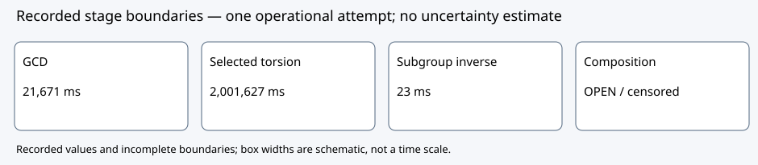

# P-192 degree 50,341: independent review

Decision DEC-20261016-30a54b: revise the process; GOAL-ISOU-f30a07 remains active. Evidence strength bounded diagnostic; claim tier process revision. No EV is promoted.

Observation: RUN-ISOU-93b2b3 ended CENSORED/TIMEOUT at 3,600,033 ms, sampled peak RSS 250,052,608 bytes, no unavailable samples. The exact original map SHA25682e3951488c793c5901ecf1dfeb3ab072b7cda16730899330df7caa9832a170c was reused; one eigenline remains PARTIAL.

Comparison: nine stages have matching begin/end records. Kernel GCD 21,671 ms, selected torsion 2,001,627 ms and subgroup inverse23 ms are end-minus-begin wall differences (n=1, millisecond resolution; spread unavailable). Composition has a begin only; no completed duration or final replay score exists. Trace and public-command clocks have different origins.

Inference: the independent integrity joint holds only for these bytes, nesting and bounded resource/trace observations. This supports process revision, not map admission, a bottleneck ranking across all phases or a speedup. No paired A/A control exists and the host was shared.

Limitation: all downstream map and point predicates remain unfinished. OS printed real3600.05/user1716.81/system62.75 seconds gives derived displayed CPU1779.56 seconds for the public command and accounted children, not per-stage or complete campaign cost. Original canonical cpu_seconds:null is preserved.

Next action: separate reviewed fresh compact candidate, followed by the already proposed source-only fixed-modulus investigation; no larger expanded-map construction is approved by this decision.

Independent task TASK-20261016-66f447, report SHA25652d001abaf2e2aab1aeb169937ae8ba43c5460e6a71ad86ec74a8440a552ee19. All55 listed raw member hashes match; this is not a computation proof or collector completeness proof. Source e82d80feaf82d3730576ccd9137911b336f9dab8; executable SHA256b3cbd6ac5d457a0f6d6398d1fcefc408f627e60be52c81c9009406486b61587b. Original producer and descriptive report bytes unchanged.

Graphs checked: historical run flow.svg files and source-study graphs remain unchanged because this decision changes no supported claim or coverage. This fresh SVG is an editable schematic of recorded stage boundaries; timing values have units and n=1. No canonical frontier graph changes.

Source references: `coordination/goals/GOAL-ISOU-f30a07/batches/BATCH-9924e2/final-e82/reviews/TASK-20261016-66f447/report.md`; `ledger/decisions/DEC-20261016-30a54b.yaml`; original snapshot receipts TASK9f5b51 and TASK19d9a7. Exact curve p/a/b and subgroup identities remain in original run reports and sealed artifacts; no curve equivalence is inferred from labels.

PDF generation and visual inspection completed before archival. Metadata-only Git publication first hit an index.lock collision from concurrent publishers; the existing claim was preserved and published sequentially (7e3dac433b). No forced lock deletion, claim reset or scientific rerun occurred.
