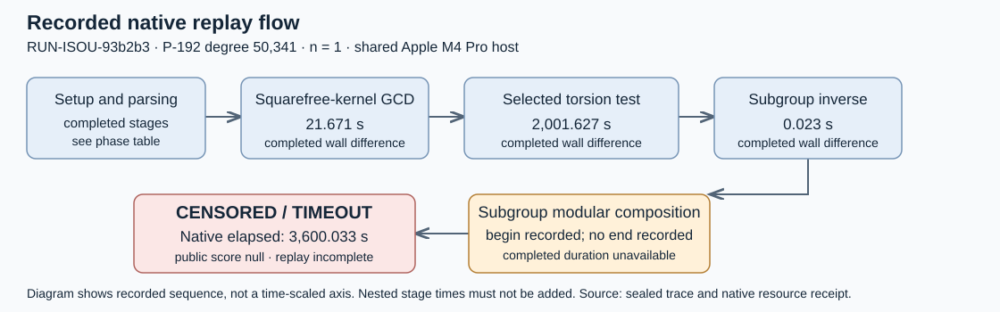

# P-192 degree 50,341: terminal native replay profile

This is a descriptive run report for EXP-ISOU-32a530, RUN-ISOU-93b2b3, and GOAL-ISOU-f30a07. It records outputs and measured resource costs, including a timeout. It makes no evidence-review decision or frontier promotion. Hypothesis ID: null (instrumentation of an existing sealed map).

## What ran

Exactly one replay was requested and started. Zero independent verifications completed; one timed out. No constructor, adaptive seed selection, degree expansion, or scientific rerun was performed in this experiment. Native fixed-point/20-transport checks were planned; final transport results are unavailable because the verifier stopped within kernel validation.

First start: 2026-10-16T09:12:21Z. Adapter terminal: 2026-10-16T10:12:21Z. Approval: DEC-20261016-34a9e9. Scientific producer: TASK-20261016-d481d6. Original claim epoch: 1.

Exact frozen launch:

```sh
/bin/sh coordination/goals/GOAL-ISOU-f30a07/batches/BATCH-9924e2/final-e82/native-command.sh \
  profile /Volumes/SSD990-2/crypto-autoresearcher-isogeny-frontier-20261015/experiments/EXP-ISOU-32a530/runs/RUN-ISOU-93b2b3
```

The thin shell adapter invoked the native executable under `/usr/bin/time -l`, with `ISOGENY_REPLAY_TRACE` set to the fresh run's `replay-trace.jsonl`:

```sh
/Volumes/SSD990-2/crypto/isogeny-degree-challenge-builds-20261015/compact-final-e82d80feaf/isogeny \
  challenge judge \
  --input /Volumes/SSD990-2/crypto-autoresearcher-isogeny-frontier-20261015/experiments/EXP-ISOU-e7eeb5/runs/RUN-ISOU-f9546d/native/construction \
  --out /Volumes/SSD990-2/crypto-autoresearcher-isogeny-frontier-20261015/experiments/EXP-ISOU-32a530/runs/RUN-ISOU-93b2b3/native \
  --timeout 3600
```

Native resource bounds: 3,600-second timeout, sampled worker RSS limit 8,589,934,592 bytes, 25 ms sampling interval, and 100 ms monitoring grace. These are the recorded worker-monitor bounds, not an operating-system hard memory cap or a live disk quota. Concurrency was one scientific worker.

## Native result and measured costs

The native public entry has status **CENSORED**, reason **TIMEOUT**, and score **null**. The resource receipt likewise records TIMEOUT. Worker exit code is null after supervisor termination; native public-command exit is 3; adapter exit 0 indicates delivery of the observation. The immutable outer manifest records `status: failed` and `cpu_seconds: null`. Those fields are preserved; the separate terminal OS receipt below supplies the available CPU measurements. An unfinished replay is not an algebraic counterexample.

| Quantity | Recorded value | Provenance and scope |
|---|---:|---|
| Native elapsed wall time | 3,600,033 ms | Worker resource receipt; operational |
| Public-command real wall time | 3,600.05 s | Terminal OS receipt; measured |
| Public-command user CPU | 1,716.81 s | Terminal OS receipt; measured |
| Public-command system CPU | 62.75 s | Terminal OS receipt; measured |
| Public-command CPU sum | 1,779.56 s | Derived: 1,716.81 + 62.75 |
| Sampled worker peak RSS | 250,052,608 bytes | Native resource receipt; measured |
| Unavailable RSS samples | 0 | Native resource receipt; measured |
| Original sealed map size | 7,656,861 bytes | Frozen input identity |
| Raw archive size | 3,594,206 bytes | Terminal evidence package |
| Trial count | 1 | One frozen diagnostic |

The OS time receipt covers the public native judge and its waited descendants. It excludes compilation, orchestration, and historical attempts, and is not a whole-campaign cost. Host: Apple M4 Pro, 14 logical CPUs, 51,539,607,552 bytes RAM (48 GiB), Darwin arm64, macOS 26.6. The launch environment recorded load averages 41.25 / 44.40 / 45.45 and explicitly identified a shared host. No isolated-host speed ratio or between-CPU comparison is computed. One run provides no between-run spread or uncertainty estimate.

## Recorded trace



The diagram shows the sequence recorded for RUN-ISOU-93b2b3 and its unfinished stage. It is not a scaled time axis. There are fewer than two comparable completed trial measurements, so a flow diagram is used. Blue indicates a recorded stage end; amber indicates a begin without an end; red indicates the native resource timeout.

Completed durations below are labelled arithmetic on recorded monotonic timestamps: `end.elapsed_ms_operational_only - begin.elapsed_ms_operational_only`. Parent stages nest and must not be summed with their children. Zero milliseconds means both timestamp readings were equal at the trace's resolution.

| Stage ID | Parent ID | Stage | Recorded terminal state | Derived completed duration, ms |
|---|---|---|---|---:|
| 1 | 0 | setup/loading/parsing | end | 5 |
| 2 | 0 | setup/field_parsing | end | 1 |
| 4 | 3 | source_loading_and_registry | end | 10 |
| 5 | 3 | source_generator_subgroup_order | end | 0 |
| 7 | 6 | coefficient_parsing | end | 32 |
| 9 | 8 | kernel_degree | end | 0 |
| 10 | 8 | squarefree_kernel_gcd | end | 21671 |
| 11 | 8 | selected_division_polynomial_torsion | end | 2001627 |
| 12 | 8 | subgroup_inverse | end | 23 |
| 0 | None | total | no end recorded | unavailable |
| 3 | 0 | attempt_0 | no end recorded | unavailable |
| 6 | 3 | map_0 | no end recorded | unavailable |
| 8 | 6 | kernel_validation | no end recorded | unavailable |
| 13 | 8 | subgroup_modular_composition | no end recorded | unavailable |

There are 23 parseable trace records, zero parse errors, and zero terminal trace records. Subgroup modular composition began at 2,023,380 ms, and no matching end was recorded. Its completed duration is unavailable. Total, attempt, map, and kernel-validation parent stages likewise remain unfinished. No core terminal or public acceptance event is inferred from the completed prefix.

## Curve and representation identities

Source curve is the exact registered P-192 short-Weierstrass model over the prime field with:

- `p = 6277101735386680763835789423207666416083908700390324961279`
- `a = 6277101735386680763835789423207666416083908700390324961276`
- `b = 2455155546008943817740293915197451784769108058161191238065`
- source subgroup order `n = 6277101735386680763835789423176059013767194773182842284081`
- source slug `icv1-fp192-t31607402316713927207482677199-52e4af59`.

The sealed artifact reports degree 50,341, one constructed Frobenius eigenline out of two, and PARTIAL degree coverage. Its representation contains the kernel polynomial and rational x-map. Constructor self-checks and its internal `verified` flag remain constructor observations.

Claimed codomain uses the same field and equation form, with:

- `a = 1143143525500427689577680842383664988290178584799998217510`
- `b = 2237330099652874498904657549180606413695502614049792789480`
- codomain slug `icv1-fp192-t31607402316713927207482677199-0af73cab`.

This run has not completed independent map or subgroup-transport admission. Conductors are not certified by this report. It introduces no volcano classification, worldwide record, novelty, or curve-security conclusion. The separately planned compact CM certificate is a different representation track and is absent from this experiment's trials.

## Provenance and immutable sources

Scientific source: [crypto e82d80feaf82d3730576ccd9137911b336f9dab8](https://github.com/aburan28/crypto/commit/e82d80feaf82d3730576ccd9137911b336f9dab8), dirty=false. Harness at launch: `4a5fb8913f15077c7cac853c3ca2b0e8c512629f`. Tool standards SHA256: `22b2ffef99720f2b2c7396a267412d2241a868e038a835c4fb1fd12209b102bf`.

| Identity | SHA256 |
|---|---|
| Executable, before and after | `b3cbd6ac5d457a0f6d6398d1fcefc408f627e60be52c81c9009406486b61587b` |
| Sealed degree-50,341 map | `82e3951488c793c5901ecf1dfeb3ab072b7cda16730899330df7caa9832a170c` |
| Original search.json | `a4046e312f4110bcabc000ce282e106b3dae80c3e362bc26abdb893296f5c99d` |
| Original map stderr | `487d94e8bfeba3515cd756a0e6c590b1f04c755af8a090c7659d12f5877f16fb` |
| Frozen trial plan | `c5233504c96f10858911c4aa2e0ffda83985f0d1b37514fce96967d7bfa63735` |
| Frozen thin adapter | `2f416cf59443a334a271557ab6573b3974652c8023bd9e86388b0c1497a9ca59` |
| Terminal raw archive | `55c1c18440109a8c1e87c266a67e6d366cbfd64c988a86b5e52ff528126be0ae` |

All three original sealed inputs and native snapshot copies retained their expected hashes. The executable also retained its expected hash. A metadata-only collector sealed 21 original raw files, exact per-file hashes, parsed terminal metadata, its own source, and an explicitly labelled Conductor wrapper-prefix log. The prefix log is not a final session-close receipt. Raw bytes were unchanged before/after packaging. The parent separately rechecked all 8 released artifacts and all 21 raw file hashes before report production.

Published preparation controls (not rerun here): 94 native tests passed, zero failed; one helper definition was ignored by default but invoked separately by its parent interruption control. These cover valid/adversarial trace equality, output freshness/error/interruption behavior, and fail-closed resource-monitor controls. The source/custody package is distinct from this measured trial. Actual served model and reasoning effort were not exposed; both remain null.

Canonical run companions are in [RUN-ISOU-93b2b3](../../runs/RUN-ISOU-93b2b3/). Original execution sources are under `coordination/goals/GOAL-ISOU-f30a07/batches/BATCH-9924e2/final-e82/execution/TASK-20261016-d481d6/`. The raw archive contains `metadata/files.sha256`, `metadata/terminal-summary.json`, `metadata/collector.py`, and the original native entry/resource/log/trace bytes.

| Original released source path | SHA256 |
|---|---|
| `coordination/goals/GOAL-ISOU-f30a07/batches/BATCH-9924e2/final-e82/execution/TASK-20261016-d481d6/native-evidence.tar.gz` | `55c1c18440109a8c1e87c266a67e6d366cbfd64c988a86b5e52ff528126be0ae` |
| `coordination/goals/GOAL-ISOU-f30a07/batches/BATCH-9924e2/final-e82/execution/TASK-20261016-d481d6/observation.md` | `b95c639b99d740f92884e54751e4013b66bc2b2e6201e33eac48d5c172d0a8fe` |
| `experiments/EXP-ISOU-32a530/runs/RUN-ISOU-93b2b3/command.txt` | `0eedfe03a4e30f111d0401fe82b92f831dbf5cd8b6b1cb4bd1701961a14d1473` |
| `experiments/EXP-ISOU-32a530/runs/RUN-ISOU-93b2b3/environment.json` | `d79c9f87b1908c02a3bec6822635df8b5a5f3f8a1582ce3399faa3a93fd75a57` |
| `experiments/EXP-ISOU-32a530/runs/RUN-ISOU-93b2b3/manifest.yaml` | `46bdad80c48ae1d9d65dc52b9312f50a3a6ac7b9ac453a0b0ff5fb2d99d17d44` |
| `experiments/EXP-ISOU-32a530/runs/RUN-ISOU-93b2b3/raw-result.json` | `28c31de5a6f9bf25f6b2880158cef8384ebc7187b4e5bba63fbdc5fd66cff906` |
| `experiments/EXP-ISOU-32a530/runs/RUN-ISOU-93b2b3/stderr.log` | `e3b0c44298fc1c149afbf4c8996fb92427ae41e4649b934ca495991b7852b855` |
| `experiments/EXP-ISOU-32a530/runs/RUN-ISOU-93b2b3/stdout.log` | `e3b0c44298fc1c149afbf4c8996fb92427ae41e4649b934ca495991b7852b855` |

Run companions were committed/pushed in `d1ed095ea0`; raw evidence in `273d04b556`; original epoch-1 eight-artifact release in `8ee00e9a4c953cc7cae66e7ee804b60bbab29071`, with `was_expired=false`. This report is produced by the separate report-only task bound in the additive continuation; the original frozen queue, claim and scientific inputs are unchanged.

## Report build and inspection

Report-only task: TASK-20261016-88c12b; owner executor-primary-report; goal claim commit 1229d76ae5. Conductor T-3249, epoch1/attempt1, adopted by session 4409e1c8. No scientific process was launched for this report.

Compiler: Typst 0.15.1. Rendering: native pdftoppm, PNG at130DPI, longest dimension1500px. Final PDF: one A4 page, 79,634bytes. Every page of every inspected layout was viewed: initial1page, spacing2pages, compact-intermediate2pages, final1page. Final inspection checked readable labels, corrected connector geometry, complete tables, all run IDs, provenance and absence of clipping.

All four compiler invocations exited0 with empty stderr. Initial inspection identified an implicitly filled SVG connector and crowded provenance paragraphs; the connector was changed to fill=none and paragraphs separated. The next two layouts produced orphan lines on a second page; both pages were inspected each time. Body size9pt, leading0.45em and a shorter repeated custody summary yielded the final inspected one-page PDF. Full scientific details remain above.

Operational setup receipts: automatic review initially rejected reservation registration as duplicating the goal card. Direct Conductor lookup of TASK-20261016-88c12b returned404, and the filtered live reservation list had no matching task or output scope. Registering the exact existing goal ID as the external_ref then passed automatic review and produced T-3249. The first detacher invocation used an incorrect path and exited127 before any process/report file was created; the already existing /private/tmp/isogeny-frontier-detach then adopted the same live epoch1 claim. No reclaim, reset, scientific retry or new experiment occurred.

Intermediate report sources/PDFs and local render logs are retained in /private/tmp/isou-primary-report-0912. Their identities and complete compiler result metadata are recorded here:

| Local report build artifact | SHA256 |
|---|---|
| `initial-flow.svg` | `dcf77375cfc74ef7c7645d132d66b86eeebba23546b7c6678bc27c57d0204cf0` |
| `initial-report.typ` | `94e6f948ad84c2bee632dbde942f17a56cce7bad54602f29fb63f9f3bb48e8b6` |
| `initial-report.pdf` | `3ebf2254814359ce9e23337b9061d177bca225b0c6d4bff926456176b57965ee` |
| `spacing-report.typ` | `17bcf0672b87f63602089e65685b225b5c36a0b4a90431be7ff820b32482ab7b` |
| `spacing-report.pdf` | `77f887a0bb01748076d3ae57a0343115823b842ba899f0ecd836a4cb8e4aa38b` |
| `compact-intermediate-report.typ` | `14fb53638217abca557729cc8a1c5161c0acdee8b07482131895aaa3041bf61a` |
| `compact-intermediate-report.pdf` | `97853e849d608a256156cb38607a156556fc325a8db35e9a2980ee4139ab537a` |

`compile-result.json`:

```json
{
  "argv": [
    "/opt/homebrew/bin/typst",
    "compile",
    "experiments/EXP-ISOU-32a530/reports/run-20261016T0912Z/report.typ",
    "experiments/EXP-ISOU-32a530/reports/run-20261016T0912Z/report.pdf"
  ],
  "exit_code": 0,
  "elapsed_seconds_reporting_tool_only": 0.5826023750014429
}
```

`final-compile-result.json`:

```json
{
  "argv": [
    "/opt/homebrew/bin/typst",
    "compile",
    "experiments/EXP-ISOU-32a530/reports/run-20261016T0912Z/report.typ",
    "experiments/EXP-ISOU-32a530/reports/run-20261016T0912Z/report.pdf"
  ],
  "exit_code": 0,
  "elapsed_seconds_reporting_tool_only": 0.5891889159993298,
  "correction": "Initial visual inspection found implicit fill on a bent SVG connector and adjacent provenance paragraphs; preserve initial PDF/source and correct these before publication."
}
```

`compact-compile-result.json`:

```json
{
  "argv": [
    "/opt/homebrew/bin/typst",
    "compile",
    "experiments/EXP-ISOU-32a530/reports/run-20261016T0912Z/report.typ",
    "experiments/EXP-ISOU-32a530/reports/run-20261016T0912Z/report.pdf"
  ],
  "exit_code": 0,
  "stdout": "",
  "stderr": "",
  "elapsed_seconds_reporting_tool_only": 0.46741087500049616,
  "correction": "Both pages of second layout inspected; reduce body text 9.2pt to9pt and paragraph leading0.5em to0.45em to avoid three orphan lines on page2."
}
```

`publication-compile-result.json`:

```json
{
  "argv": [
    "/opt/homebrew/bin/typst",
    "compile",
    "experiments/EXP-ISOU-32a530/reports/run-20261016T0912Z/report.typ",
    "experiments/EXP-ISOU-32a530/reports/run-20261016T0912Z/report.pdf"
  ],
  "exit_code": 0,
  "stdout": "",
  "stderr": "",
  "elapsed_seconds_reporting_tool_only": 0.6795678340004088,
  "correction": "Both pages of third layout inspected; shorten repeated custody summary and retain full details in Markdown to fit a single-page report."
}
```

Final PDF SHA256: `1427b30179ce9a6a2b5af9daadc793c0765f179fd299fd984eb112cb836b5b8a`.
Final SVG SHA256: `5bbfb78e272f004de63b05771c3901ed97d865324992a3d81ad0154503201927`.
Final Typst SHA256: `ed4c909fbd41d5863835ff2fa2463333b1133c02461a4858ff4f679f4b3a9b3a`.

The report and diagram restate recorded values and explicitly labelled arithmetic only. Independent evidence review and terminal snapshot are separate work. No mathematical run was launched to create this report.

Publication check observation: the first whole-artifact git diff --cached --check exited2 after treating compressed PDF bytes and required PDF cross-reference records as text whitespace. No commit/push ran in that failed command. Its raw stdout is retained locally (SHA256 658992b0a5300c5c59538fb8e84cc4dd2bf544dab7a4fc7a537551eb5143f103, 14582bytes); stderr was 0bytes. The exact three textual report sources passed their scoped whitespace check with exit0. Native pdfinfo parsed the unchanged PDF, and its sole final page was visually inspected. PDF bytes were preserved.
