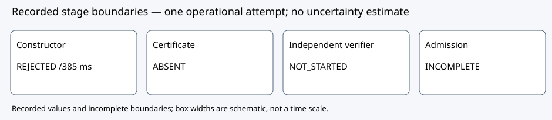

# M8191 compact attempt: independent review

Decision DEC-20261016-30a54b: revise the process; GOAL-ISOU-f30a07 remains active. Evidence strength bounded diagnostic; claim tier process revision. No EV is promoted.

Observation: constructor RUN-ISOU-bdbf5d recorded REJECTED with a preserved nonzero Lucas-Lehmer terminal. No certificate was emitted. Native worker385 ms; inner arithmetic record372 ms; sampled peak RSS2,932,736 bytes, zero unavailable samples. Dependent RUN-ISOU-2b2372 is NOT_STARTED with construction_not_passed_or_certificate_hash_changed.

Comparison: the frozen verifier gate requires CONSTRUCTED, resource PASS, an emitted certificate and its exact sealed hash. The antecedent failed; there is no verifier subprocess, receipt, CPU or mathematical verification result. Constructor and verifier are distinct stages, not comparable timing samples.

Inference: the independent completion joint is inconclusive. Retain the failed candidate and nonstart. This review did not independently execute LL and does not infer compositeness, an LL source defect or an impossibility result. A prime exponent alone does not establish Mersenne primality.

Limitation: known-CM compact representation remains separate from expanded rational maps. SEC2 p/n primality is trusted-standard, not a new self-contained proof. OS printed real0.40/user0.32/system0.01 seconds gives derived displayed CPU0.33 seconds for the constructor public command; canonical cpu_seconds:null remains. The old nonstart native_exit_code:0 is an initialized adapter value, not a native exit measurement.

Next action: independently review a fresh M44497 parameter packet against the primary GIMPS listing and unchanged e82 code; fresh constructor plus conditional fresh independent verifier required. No retry, LL fix, result or global-record claim is approved here.

Independent task TASK-20261016-66f447, report SHA25652d001abaf2e2aab1aeb169937ae8ba43c5460e6a71ad86ec74a8440a552ee19. All55 listed raw member hashes match; this is not a computation proof or collector completeness proof. Source e82d80feaf82d3730576ccd9137911b336f9dab8; executable SHA256b3cbd6ac5d457a0f6d6398d1fcefc408f627e60be52c81c9009406486b61587b. Original producer and descriptive report bytes unchanged.

Graphs checked: historical run flow.svg files and source-study graphs remain unchanged because this decision changes no supported claim or coverage. This fresh SVG is an editable schematic of recorded stage boundaries; timing values have units and n=1. No canonical frontier graph changes.

Source references: `coordination/goals/GOAL-ISOU-f30a07/batches/BATCH-9924e2/final-e82/reviews/TASK-20261016-66f447/report.md`; `ledger/decisions/DEC-20261016-30a54b.yaml`; original snapshot receipts TASK9f5b51 and TASK19d9a7. Exact curve p/a/b and subgroup identities remain in original run reports and sealed artifacts; no curve equivalence is inferred from labels.

PDF generation and visual inspection completed before archival. Metadata-only Git publication first hit an index.lock collision from concurrent publishers; the existing claim was preserved and published sequentially (7e3dac433b). No forced lock deletion, claim reset or scientific rerun occurred.
