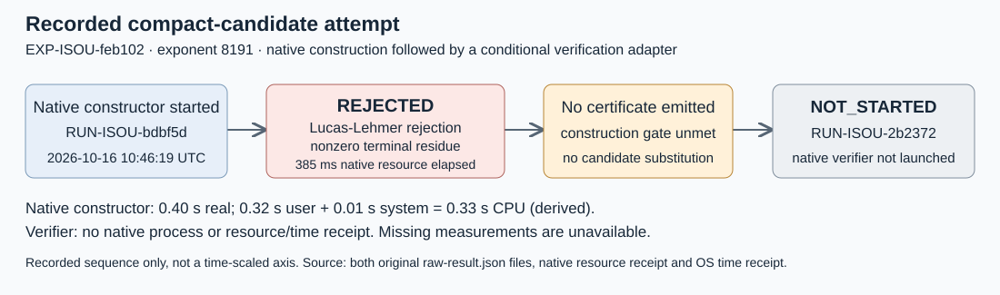

# Native compact candidate: exponent 8191

This is a descriptive run report for EXP-ISOU-feb102 and GOAL-ISOU-f30a07. It covers every run directory this session wrote for the experiment: constructor RUN-ISOU-bdbf5d and dependent verification nonstart RUN-ISOU-2b2372. It reports observations only, without an evidence-review decision or scientific promotion. Hypothesis: H-ISOU-d1a4a5.

## Actual attempt and conditional nonstart

Two phases were planned. One native constructor started and returned REJECTED at its Lucas-Lehmer gate. It emitted no certificate. The second frozen adapter recorded NOT_STARTED because construction/certificate admission was unmet, and launched no native verifier. No candidate was substituted, and neither run ID was repeated. One native rejection and one nonstart are retained; zero compact certificates or maps were admitted.

Constructor trial started2026-10-16T10:46:19Z and its adapter ended10:46:20Z. The verification adapter was invoked and ended at10:46:20Z; those timestamps are not a native verification start. The single report directory is dated from the actual constructor first start. Scientific producer TASK-20261016-145d29 was approved by DEC-20261016-34a9e9.

Exact frozen adapter commands:

```sh
/bin/sh coordination/goals/GOAL-ISOU-f30a07/batches/BATCH-9924e2/final-e82/native-command.sh construct /Volumes/SSD990-2/crypto-autoresearcher-isogeny-frontier-20261015/experiments/EXP-ISOU-feb102/runs/RUN-ISOU-bdbf5d
/bin/sh coordination/goals/GOAL-ISOU-f30a07/batches/BATCH-9924e2/final-e82/native-command.sh verify /Volumes/SSD990-2/crypto-autoresearcher-isogeny-frontier-20261015/experiments/EXP-ISOU-feb102/runs/RUN-ISOU-2b2372
```

The constructor adapter invoked the pinned native executable under /usr/bin/time -l:

```sh
/Volumes/SSD990-2/crypto/isogeny-degree-challenge-builds-20261015/compact-final-e82d80feaf/isogeny compact-cm construct --exponent 8191 --out /Volumes/SSD990-2/crypto-autoresearcher-isogeny-frontier-20261015/experiments/EXP-ISOU-feb102/runs/RUN-ISOU-bdbf5d/native --timeout 1800
```

The planned native verify --timeout3600 command was not invoked. Its frozen gate requires CONSTRUCTED, a PASS resource receipt and an unchanged sealed certificate. The actual record reason is construction_not_passed_or_certificate_hash_changed; the constructor rejection and missing certificate identify which prerequisite was unmet. ISOGENY_REPLAY_TRACE was unset for this compact experiment.

Constructor error prefix: `Lucas-Lehmer rejects M8191; terminal 103...`. The complete nonzero terminal residue is retained in the original native construction JSON and raw archive. Full error string UTF-8 SHA256: `9b41fb403b439a9fe5daf5d10f6cef8c5148f07b9f9111ef6b9ffd2997ad491f`; character count: 2502. This descriptive report does not replace independent arithmetic review.

## Recorded resource and OS measurements



The diagram depicts the actual sequence for both run IDs; it is not a scaled time axis. Only one native phase ran, so fewer than two comparable completed measurements exist. A diagram is used instead of a comparison plot.

| Quantity | Native constructor | Native verifier |
|---|---:|---|
| Public native status | REJECTED | NOT_STARTED |
| Worker resource status / exit | FAIL /1 | unavailable |
| Worker arithmetic-record elapsed |372ms | unavailable |
| Worker resource elapsed |385ms | unavailable |
| OS public-command real |0.40s | unavailable |
| OS user CPU |0.32s | unavailable |
| OS system CPU |0.01s | unavailable |
| OS CPU sum, derived |0.33s | unavailable |
| Sampled worker peak RSS |2,932,736bytes | unavailable |
| Unavailable RSS samples |0 | no native process |
| Emitted certificate | absent | no input certificate |

CPU sum is labelled arithmetic:0.32+0.01=0.33seconds. It covers the public native constructor and waited descendants, excluding compilation, orchestration, historical attempts and other trials. Worker arithmetic elapsed, worker monitoring elapsed and public-command OS real time have different scopes and precision; none is relabelled as the other. No per-iteration timing was measured.

The native public constructor exited1. Both adapters exited0 to acknowledge observation delivery. Original manifests remain failed for construction and not_started for verification; their cpu_seconds:null fields remain unchanged alongside the available terminal constructor OS receipt. The verification manifest native_exit_code:0 is an adapter-local default, not a measured native verifier exit. Missing verifier CPU, elapsed and resource receipts are unavailable, not measured zero. No worker-monitor failure was recorded: the constructor receipt reports zero unavailable RSS samples.

Host metadata:

```json
{
  "cpu_model": "Apple M4 Pro",
  "memory_bytes": 51539607552,
  "logical_cpus": 14,
  "kernel_arch": "Darwin arm64",
  "macos_version": "26.6",
  "load_average": "{ 56.90 59.69 59.56 }",
  "shared_host": true
}
```

This is one observation on a shared host. Between-run spread and uncertainty were not measured. No performance ratio, comparison with the expanded-map timeout, or all-CPU performance claim is made. Native bounds were retained: constructor1800s, verifier3600s,8,589,934,592bytes sampled worker RSS,25ms sampling and100ms monitoring grace. Reader bound2MiB and post-run output-admission bound256MiB are separate from a live disk quota.

## Intended source and representation

Candidate degree expression was 2^8191-1; it was a candidate, not an established prime degree. Intended source was exact SEC2 secp256k1, short-Weierstrass y^2=x^3+7 over the prime field:

- p=115792089237316195423570985008687907853269984665640564039457584007908834671663
- a=0, b=7
- n=115792089237316195423570985008687907852837564279074904382605163141518161494337
- h=1
- Gx=55066263022277343669578718895168534326250603453777594175500187360389116729240
- Gy=32670510020758816978083085130507043184471273380659243275938904335757337482424
- source slug: icv1-fp256-t432420386565659656852420866390673177327-76dadd18

The tool fixes those trusted SEC2 p/n parameters; their primality was not independently certified in this attempt. Its compact representation is an unreduced signed-coefficient combination of known endomorphisms, in a track separate from expanded rational maps. This run produced no coefficient certificate, geometric map degree, codomain artifact or subgroup-transport result. Planned point/dual/norm checks after the primality gate were not observed as completed.

## Provenance and immutable delivery

Source: [crypto e82d80feaf82d3730576ccd9137911b336f9dab8](https://github.com/aburan28/crypto/commit/e82d80feaf82d3730576ccd9137911b336f9dab8), clean-build source binding. Executable SHA256 before and after: `b3cbd6ac5d457a0f6d6398d1fcefc408f627e60be52c81c9009406486b61587b`. Actual launch harness claim commit: `8dc3051bfc128f80dd43885eb1de2891e93324be`. The single scientific wrapper49487701 adopted only ConductorT3252.

Frozen trial plan SHA256: `76e6cedc60c78b9d4553058934d0aed06270c3958a5ff98b04a233f70ffabc98`. Thin adapter SHA256: `2f416cf59443a334a271557ab6573b3974652c8023bd9e86388b0c1497a9ca59`. All source/input/protocol and original/selected queue bindings rehashed unchanged by the terminal collector. The primary snapshot995eba7e4f6d1eaf2842ec67369d55f785dba618 had been independently checked from Git at all13bound paths before this launch.

Raw archive `native-evidence.tar.gz`:14,903bytes, SHA256 `52301500bbeaa1d6bce211746657b6d66968cd4efd4c6fff6bbbb5ed5901c4f6`. It preserves34 original raw files, exact per-file hashes, both original run trees, full native residue/error, launcher/admission/timestamps, terminal metadata and the metadata-only collector. It also includes an explicitly labelled Conductor wrapper-prefix snapshot; that is not a final session-close receipt. Original raw bytes matched before/after packaging. All34raw archive hashes and all14released source hashes were checked. Collector anomalies:none detected at its descriptive scope; independent validation is pending.

Preparation controls, not rerun here:94 native tests passed,0 failed,1 helper definition ignored by default and invoked by its parent interruption control. Source review/control/custody records remain bound by inputs.json; this attempt does not promote their scope into an accepted candidate. Actual served model and reasoning effort were unexposed and remain null.

Run records were committed/pushed in fe1f90627f; raw package in fc27383475; completed epoch1 producer release5e23dc9a3c binds14artifacts with was_expired:false. The original declaration and all original raw bytes remain unchanged. Report-only task TASK-20261016-f959f1 has maximum scientific runs0; report claimc4ab229be5 and ConductorT3256 separately authorize this derived communication artifact.

| Original source path | SHA256 |
|---|---|
| `coordination/goals/GOAL-ISOU-f30a07/batches/BATCH-9924e2/final-e82/execution/TASK-20261016-145d29/native-evidence.tar.gz` | `52301500bbeaa1d6bce211746657b6d66968cd4efd4c6fff6bbbb5ed5901c4f6` |
| `coordination/goals/GOAL-ISOU-f30a07/batches/BATCH-9924e2/final-e82/execution/TASK-20261016-145d29/observation.md` | `14c3bb2b7bbb09a07e99df9cf6dee40011de79814711dd9bb6590b9a67669841` |
| `experiments/EXP-ISOU-feb102/runs/RUN-ISOU-2b2372/command.txt` | `6874bb9af6413778b6adfcf05c8c9bebdd841d0dc47ef442954d2200cd163a8b` |
| `experiments/EXP-ISOU-feb102/runs/RUN-ISOU-2b2372/environment.json` | `f7ca430d1ded6ec59d441b29102e95d17045444a7bf6a8c481bc122b9e8b110a` |
| `experiments/EXP-ISOU-feb102/runs/RUN-ISOU-2b2372/manifest.yaml` | `705dc278ef1d35ea0278c0c67f709fc1137d0bef3dc0eaac00a710cf13a6a0d4` |
| `experiments/EXP-ISOU-feb102/runs/RUN-ISOU-2b2372/raw-result.json` | `1c9a71d6f288432f87b1e97183edfac8a0c902a5e268f7745d184ec884b1e8f9` |
| `experiments/EXP-ISOU-feb102/runs/RUN-ISOU-2b2372/stderr.log` | `e3b0c44298fc1c149afbf4c8996fb92427ae41e4649b934ca495991b7852b855` |
| `experiments/EXP-ISOU-feb102/runs/RUN-ISOU-2b2372/stdout.log` | `e3b0c44298fc1c149afbf4c8996fb92427ae41e4649b934ca495991b7852b855` |
| `experiments/EXP-ISOU-feb102/runs/RUN-ISOU-bdbf5d/command.txt` | `c44d5e74720a055633611861fb1da9b42b4b37a48e4bb0d1fe15bc208dcea521` |
| `experiments/EXP-ISOU-feb102/runs/RUN-ISOU-bdbf5d/environment.json` | `c2dbed823440a2f71542a43b323ded0f213572cb2159810bb981047df344ba4c` |
| `experiments/EXP-ISOU-feb102/runs/RUN-ISOU-bdbf5d/manifest.yaml` | `8cacf4a0fc387584696d9c36ff3f3355b249fcd4d27fa89248e64218e7da7cd5` |
| `experiments/EXP-ISOU-feb102/runs/RUN-ISOU-bdbf5d/raw-result.json` | `5770327bf0fb75d7360c1a210d38ee9976b59a54b6fdf25c167614d61eb7121f` |
| `experiments/EXP-ISOU-feb102/runs/RUN-ISOU-bdbf5d/stderr.log` | `e3b0c44298fc1c149afbf4c8996fb92427ae41e4649b934ca495991b7852b855` |
| `experiments/EXP-ISOU-feb102/runs/RUN-ISOU-bdbf5d/stdout.log` | `e3b0c44298fc1c149afbf4c8996fb92427ae41e4649b934ca495991b7852b855` |

The original run roots are [constructor](../../runs/RUN-ISOU-bdbf5d/) and [verification nonstart](../../runs/RUN-ISOU-2b2372/). Original execution sources are under coordination/goals/GOAL-ISOU-f30a07/batches/BATCH-9924e2/final-e82/execution/TASK-20261016-145d29/. The pending terminal snapshot will bind these14original sources, this report's4files and its receipt:19paths.

## Report rendering and operational receipts

Typst0.15.1 compiled both initial and final layouts with exit0 and empty stderr. Both PDFs were one A4 page. Their sole pages were rendered with native pdftoppm at130DPI/1500px longest dimension and visually inspected. Initial inspection found a tight rejection label and joined provenance paragraph; the label was split into two rows, provenance separated and candidate exponent typeset. Final inspection checked all result labels, missing-data distinctions, tables, IDs, arrow geometry and clipping. The final PDF is78,741bytes.

Initial source/PDF identities retained in /private/tmp/isou-compact-report-1046:

| Build artifact | SHA256 |
|---|---|
| `initial-flow.svg` | `c5631f38f6cf113a6f7bb0ae8781feea9d1c9b81ff31072d27243b61f745408d` |
| `initial-report.typ` | `ceac4d5d627893a8d89c60a428009bd15aac1ffa1d38dd0f2ac8751d1dc83d94` |
| `initial-report.pdf` | `b00b1b06eac39af22ddcf1538160e79d52d0c8cd237579363c9bad18050645e8` |

`compile-result.json`:

```json
{
  "argv": [
    "/opt/homebrew/bin/typst",
    "compile",
    "experiments/EXP-ISOU-feb102/reports/run-20261016T1046Z/report.typ",
    "experiments/EXP-ISOU-feb102/reports/run-20261016T1046Z/report.pdf"
  ],
  "exit_code": 0,
  "stdout": "",
  "stderr": "",
  "elapsed_seconds_reporting_tool_only": 0.7327340829979221
}
```

`final-compile-result.json`:

```json
{
  "argv": [
    "/opt/homebrew/bin/typst",
    "compile",
    "experiments/EXP-ISOU-feb102/reports/run-20261016T1046Z/report.typ",
    "experiments/EXP-ISOU-feb102/reports/run-20261016T1046Z/report.pdf"
  ],
  "exit_code": 0,
  "stdout": "",
  "stderr": "",
  "elapsed_seconds_reporting_tool_only": 0.5489142920014274,
  "correction": "Initial one-page visual inspection identified a tight single-line rejection label and joined provenance paragraph; split label, separate paragraph and typeset the candidate exponent."
}
```

Final PDF SHA256: `8457c376d207cf5475fc504a8745f4c122390ee6390942bfa432e06fa08a7892`.
Final SVG SHA256: `0c8b40a20261e7a0ec76e0ca6d7c96d04a6a07e334b3f70513988adc1c49dbcd`.
Final Typst SHA256: `308c8f6b3ca78e4f2995e1200ba2f69ac7002987b784a3e568cb9405e61a098c`.

Operational publication note: the GitHub connector initially failed with a transport error after the scientific package was already committed/pushed. A fresh read found no open branch PR; the structured GitHub CLI API then created PR2231 successfully. This caused no native rerun or raw mutation. Scientific records and this descriptive report remain distinct from future candidate selection or source changes.
