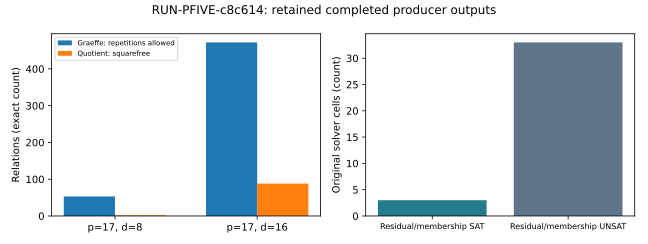

# Interrupted first attempt: five prime-field leads

Observations only. This report covers an interrupted local experiment and does not adjudicate any hypothesis. Completed producer outputs survived; the original native independent check did not run. A failed or interrupted process is not a mathematical refutation.

Experiment EXP-PFIVE-3ca920; hypothesis H-PFIVE-6510c2; goal GOAL-PFDR-fd09e0. One native trial was requested and launched. Its terminal status is interrupted. Geometry and SAT payloads completed; algebra has no durable completed payload. Console progress is not an algebra result.

The two inverse coefficient searches each exhaust 17^4 = 83,521 assignments. Their Graeffe relation counts are 53 and 472; squarefree quotient counts are 2 and 88. The predicates differ in repeated-root coverage; these counts do not measure a speed or yield advantage.

The original SAT payload contains 36 cells: 3 SAT and 33 UNSAT. It records 252 learned clauses, 251 from prefixes shorter than a full assignment. All three SAT results use targets without rational curve lifts; they are not point decompositions. The cvc5 native finite-field backend is unsupported because this build lacks CoCoA.

The geometry payload also contains 429 complete ordered group-pair checks and 17 symbolic saturation cells. Producer checks report no mismatches. Saturated output basis degrees are smaller in these tiny fixtures, but neither solving degree nor degree of regularity was measured.

The original export preserves all eight aggregate arms as not completed because the native checker did not finish. The corrective experiment EXP-PFIVE-e26798 binds and independently rechecks these original payloads; it does not rewrite this interrupted record.

Started 2026-10-29T04:21:39.875002+00:00; finished 2026-10-29T04:36:08.186866+00:00. Derived elapsed duration is available from these timestamps but is not a benchmark. CPU time, peak memory and host-isolated timing were not recorded.

Code authority aeb4a2cd19e46b7c9f86b62d31d79e8bab00a0b7; platform linux; Python 3.12.8 (main, Jan 14 2025, 22:49:14) [Clang 19.1.6 ]. Dirty-tree state and detailed CPU host identity were not recorded by the native environment payload. Instrument source hashes are retained there.

Exact argv: ["/home/ec2-user/prime-sat-research-venv/bin/python", "research/prime_sat_five_tests_20261029/driver.py", "--config", "experiments/EXP-PFIVE-3ca920/config.json", "--output", "/home/ec2-user/crypto-prime-sat-ideas-20261029/experiments/EXP-PFIVE-3ca920/runs/RUN-PFIVE-c8c614"]

Fixed inputs: geometry primes 17,97,193,257 and declared cosets; SAT primes17,97,257, digit widths2,3, targets0,1,2 and both membership arms; algebra planned78 fixtures. Seed17; fixed deterministic ordering. Source/config hashes, controls and bounds are in protocol.json and config.json.

The operational interruption followed slow repeated monomial-order construction in eight-variable elimination. A new experiment preserves all78 algebra fixtures, caches an exhaustively equivalent ordering and saves every cell. A source-checker stale-iterator defect was found by static review before the new experiment froze and corrected additively. No before/after timing claim is made.

A/A, known SAT/UNSAT and corrupted-certificate controls exist in the retained producer payloads; the original umbrella independent checker has no output. Missing independent verification at this run is explicit. Exact finite counts have no sampling uncertainty; no population extrapolation is made.

Canonical graph review: the proposal report and knowledge/frontiers/ecdlp were considered. No hypothesis status or frontier changes are justified by this interrupted run, so canonical graphs remain unchanged. This new graph is an observational view only.

Evidence: ../../runs/RUN-PFIVE-c8c614/{geometry.json,sat.json,raw-result.json,execution-receipt.json,environment.json,launch.json}; ../../protocol.json; export.json. Native receipt artifact hashes bind the archived payloads. Raw archive commit ba3febcbc1 preceded this report.
