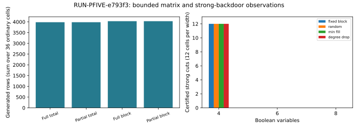
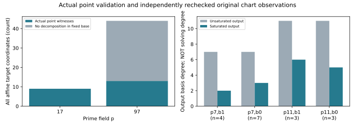

# Five prime-field leads: completed finite tests

Observations only. This report records finite implementation tests and independent certificate/model checks. It does not promote a hypothesis, establish a degree-of-regularity reduction, or claim an ECDLP speedup.

EXP-PFIVE-e26798; H-PFIVE-6510c2; GOAL-PFDR-fd09e0. One requested native trial, RUN-PFIVE-e793f3, completed with status output_validated, process return 0 and checker return 0. The first attempt RUN-PFIVE-c8c614 remains interrupted, with its completed geometry/SAT rechecked here as immutable inputs.

Lead 1, coefficient membership: two genuine inverse searches each enumerate 17^4=83,521 assignments. Graeffe gives 53 and 472 relations with repetitions allowed; squarefree quotient membership gives 2 and 88. Independent oracle agreement holds for each predicate. These distinct predicates and exhaustive loops establish exact finite model sets, not early pruning or faster relation generation.

Lead 2, certified SAT: all 106 residual/membership cells across 53 valid target coordinates were independently checked. The membership arms yield 22 actual point witnesses and 31 factor-base UNSAT targets. Curves are y^2=x^3+2x+2 over F_17 of order 19 and y^2=x^3+x+4 over F_97 of order 89. All domain point pairs are checked independently, including doubling and identity handling.

Lead 3, partial and block-filtered matrices: all 78 fixtures contain 390 matrix arms. Ordinary residual fixtures number 36, with 36 matched-support null fixtures and 6 controls. Matrix statuses across all arms: {'UNSAT': 230, 'SAT_COMPLETE': 160}. Every retained basis row carries an original-equation certificate. Both partial variants generated the same number of rows as their full counterpart in all 36 ordinary cells. Their counted field-operation subset was higher in 24 and equal in 12; neither reduced these counters. The Boolean quotient and differing filtrations do not identify intrinsic regularity.

Lead 4, public-syntax strong backdoors: all 390 arms and 1,560 branch assignments were retained. Aggregate statuses: {'COMPLETE': 150, 'UNKNOWN': 240}. Every branch must finish for a strong-cut certificate; any UNKNOWN leaves the cut unproved. Each of the four policies certified all 12 four-variable cells but none of the 12 six-variable or 12 eight-variable cells. Every branch at those larger widths remained UNKNOWN under the fixed residual cap. Selection uses syntax/public hash order and never a witness or solution oracle.

Lead 5, complete charts: independent verification covers 429 ordered group pairs and 17 symbolic saturation cells. Artificial cleared-denominator slope components are removed from the generic chart, and exceptional additions are handled separately. The observed output basis degree changes are 7 to 2 or 3 and 11 to 5 or 6. They are not solving-degree or regularity measurements.

| Matrix arm | Cells | Rows generated | Counted field operations (subset) |
|---|---:|---:|---:|
| full_total | 36 | 3984 | 1066003768 |
| partial_total | 36 | 3984 | 1983521123 |
| full_block | 36 | 4032 | 486818466 |
| partial_block | 36 | 4032 | 1430626423 |

Additional exact derivation: for a nonsingular short Weierstrass curve in characteristic greater than three and a fixed rational target R=(r,s) with s nonzero, S3(x1,x2,r)=0 already guarantees rational summand lifts. The explicit formula lambda=(x1*x2-r*(x1+x2)-2*r*r-a)/(2*s), yi=lambda*(xi-r)-s removes square-root extraction. Two denominator-cleared polynomial identities were checked exactly with SymPy, separately from the frozen trial. See two-summand-lift-lemma.md and lift-identity-check.json. An equivalent lift uses two quadratic equations: lambda^2=x1+x2+r and 2*s*lambda=x1*x2-r*(x1+x2)-2*r*r-a, with one extra field variable. This concerns projected model sets; sign/subgroup restrictions remain, and no lower regularity or faster solver follows. The implication fails for two-torsion targets and for three summands in general.

Custody status: raw bytes are published through the repository artifact store with independent HEAD/GET/hash readback receipts. The native snapshot verifier does not yet resolve .artifacts.json manifests, so the snapshot/review dependency chain remains incomplete. See problems/native-snapshot-artifact-manifest-resolution.md and coordination/prime_sat_five_tests_20261029/transport/. This is a metadata integration gap, not a failed mathematical check.

The matrix experiment implements selected Boolean monomial spans and block filtrations. Four homogeneous calibration matrices follow the author construction, but neither the full rank predictor from Smoothing the degree of regularity nor published Multi-homogeneous XL is implemented. The current public MinRankSolver targets GF(16), so applying it here would require a field port and a valid model transformation.

The finite-field SAT loop is a sound bounded stored-row polynomial-calculus strategy. It is not complete degree-D proof search. PySAT and Z3 results were checked; cvc5 native finite fields remain explicitly unsupported because the installed build lacks CoCoA. A/A, affine SAT/UNSAT, planted gate and deliberate certificate corruption controls were checked.

Four-variable backdoor successes leave only two variables after the cut, within the residual enumeration allowance. Such successes alone do not demonstrate special elliptic-curve structure. All six- and eight-variable outcomes remain visible, including UNKNOWN branches.

Counted field operations cover the declared instrumented subset. They exclude some inverse, evaluation, restriction and extraction costs; generated rows, matrix entries and those counters are observations of these programs. None is a complete end-to-end cost or a cryptographic-scale result. Exact enumerations have no sampling uncertainty; transfer beyond these parameters is unmeasured.

The experiment was designed after seeing the original residual SAT gap and operational interruption. It is not a performance holdout. All 78 original algebra fixtures were preserved. The order cache checks all 65,536 monomial comparisons; the independent source-rank checker repairs a stale-row iteration defect and passes six integrity regressions. A concurrent review added exact oracle-count and curve-selection checks before freeze.

The run has independent mathematical checkers, but no independent scientific adjudication or official hypothesis transition has been recorded. Canonical frontier graphs remain unchanged because this report makes no frontier claim. The displayed graphs are derived from the immutable payloads only.

Frozen protocol 50187fcbb072d8b7483ae5410114e702dd2bdd4234306c362d04be556324dde0 at 04:51:26Z on 2026-10-29; source commit f1f876f25c8554ebd13fe0e260fa9ca0fb2ee8d8. Native authority commit 56d1907ed04b24f9808f7a367173d85e8e601620. Every source and input digest is retained in protocol.json, trial-plan.json and environment.json.

Started 2026-10-29T04:54:23.868546+00:00; finished 2026-10-29T05:28:37.415881+00:00. The timestamp difference describes elapsed execution only, with no timing comparison. Host platform linux; interpreter 3.12.8 (main, Jan 14 2025, 22:49:14) [Clang 19.1.6 ]. The native environment does not record dirty-tree state, CPU identity, CPU time or measured peak memory. CPU identity was observed separately below; the other fields remain unavailable. Runtime caps were 4 GiB and 7,200 seconds.

Additive same-host observation at 2026-10-29T05:14:55.778723+00:00: Intel(R) Xeon(R) 6975P-C, 32 logical CPUs, dependencies {'sympy': '1.14.0', 'python-sat': '1.9.dev17', 'z3-solver': '5.3.2.0', 'cvc5': '1.4.2'}. This was recorded while the algebra producer was active and is not a native launch attestation. See runtime-observation.json.

Exact argv: ["/home/ec2-user/prime-sat-research-venv/bin/python", "research/prime_sat_five_tests_20261029/sat/corrective_driver.py", "--config", "experiments/EXP-PFIVE-e26798/config.json", "--output", "/home/ec2-user/crypto-prime-sat-ideas-20261029/experiments/EXP-PFIVE-e26798/runs/RUN-PFIVE-e793f3"]

Reproduction: hydrate policy-managed artifacts with tools/artifacts/artifacts.py pull on this run directory, then use the frozen Python environment and corrective_driver.py --verify <run>/raw-result.json. The native check log already records the completed independent check; rerunning a producer requires a new admitted run record.

Evidence: ../../runs/RUN-PFIVE-e793f3/{raw-result.json,point.json,algebra.json,execution-receipt.json,check.stdout.log,environment.json,launch.json}, all 78 cell checkpoints, ../../protocol.json and export.json. The export includes all original retained input files and binds stored-byte hashes. Storage publication may use .artifacts.json while retaining receipt-bound hydrated files; sealed receipts are never rewritten.

Primary literature checked 2026-10-29: https://eprint.iacr.org/2026/408 and https://github.com/LarsMath/monomial-of-regularity; https://eprint.iacr.org/2025/2060 and https://github.com/kcning/MinRankSolver. The two-summand derivation uses the summation-polynomial property in Proposition 2.1 of https://arxiv.org/html/1503.08001 (HTML inspected). Abstract/author-source review for the regularity papers only; the full 408 PDF was inaccessible with HTTP 403. No unavailable theorem is treated as reproduced.
