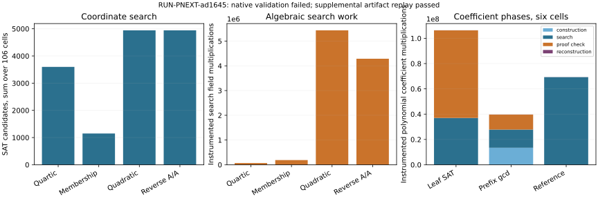

# Certified SAT follow-up: retained observations
Observations only. The single native trial completed data collection but its frozen checker failed on an explicit-zero versus absent census counter. The original invalid_output receipt is preserved. A separate post-data checker changed only sparse counter equality and passed all retained model, certificate, witness and declared chart checks. This is exploratory replay, not a successful native run, independent scientific review, or hypothesis promotion.

Experiment `EXP-PNEXT-624f41`; hypothesis `H-PNEXT-8f9166`; goal `GOAL-PFDR-fd09e0`; run `RUN-PNEXT-ad1645`.
Native flow: one trial attempted, producer return 0, checker return 1. Ten aggregate export rows remain failed/excluded with verification_pass=0. Supplemental replay: 424 encoding arms (406 complete searches, 18 censored), 24 coefficient arms, 14,324 encoding certificates, 29,478 coefficient prefix certificates and 500,848 leaf certificates passed. The nine original synthetic controls and five sparse-counter integrity controls passed. Raw S3 objects were verified by fresh HEAD/GET/hash; native snapshot archival and scientific review remain pending.

Encoding inputs: E/F_17:y^2=x^3+2x+2 (order 19), E/F_97:y^2=x^3+x+4 (order 89); two- and three-bit x domains; all affine target x representatives with least nonzero y. Each arm has 106 cells and the same complete projected census, 85 coordinate pairs in aggregate. Search is separately bounded at degree 2, 256 rows, 128 SAT candidates, 512 PC calls. Quadratic input degree does not establish lower degree of regularity. These previously seen finite fixtures provide no held-out or cryptographic-scale inference.

| Encoding | Complete/censored | SAT candidates | Search field multiplications | Online certificate multiplications | Final certificate multiplications | Full-census assignments |
|---|---:|---:|---:|---:|---:|---:|
| quartic | 106/0 | 3,599 | 69,422 | 6,630 | 6,630 | 4,240 |
| membership | 106/0 | 1,149 | 189,611 | 13,814 | 13,814 | 4,240 |
| quadratic | 97/9 | 4,944 | 5,436,704 | 362,242 | 362,242 | 473,600 |
| quadratic_aa | 97/9 | 4,944 | 4,286,333 | 362,242 | 362,242 | 473,600 |

Construction adds 22,908 field multiplications for each quartic arm or 10,729 for each quadratic arm. Membership additionally uses 8,480 field-power calls and 23,744 transform subtractions. Every arm reconstructs all 85 census witnesses, with 170 inverse calls and 85 group additions. Other primitive counters are retained in report-data.json; they are not discarded or converted into a mixed cost total.

Coefficient inputs: F_17, the same curve, d=8 and 16, c=1, targets (0,6),(3,1),(5,1). All four arms complete all six cells with 278 coefficient models. Recovered relations partition as 155 generic plus 123 target-overlap fallback relations. Completeness is for five distinct affine x coordinates with U dividing X^d-1. Repeated x coordinates and identity summands are outside this predicate.

| Coefficient arm | Full assignments checked | Prefixes | Construction mult. | Search mult. | Proof-check mult. | Reconstruction mult. |
|---|---:|---:|---:|---:|---:|---:|
| leaf_sat | 501,126 | 29,478 | 0 | 37,035,034 | 69,234,376 | 48,386 |
| prefix_univariate_gcd | 278 | 29,478 | 13,449,386 | 14,377,830 | 11,856,592 | 48,386 |
| exhaustive_reference | 501,126 | 0 | 0 | 69,279,657 | 0 | 48,386 |
| aa_reverse_prefix | 278 | 29,478 | 13,449,386 | 14,377,830 | 11,856,592 | 48,386 |

The prefix arm checks 29,478 three-coefficient prefixes and rejects 29,203 whole prefixes, covering 496,451 assignments. Guarded gcd clauses reject another 4,397 values; 278 full coefficient models remain. It still evaluates 501,126 univariate root candidates, so it does not remove that enumeration. Forward/reverse prefix order produces identical field-arithmetic counts; SAT decisions are 3,378 versus 3,387. The quadratic forward/reverse order changes search multiplication counts despite equal completion, showing order sensitivity.

Each coefficient arm also pays 2,240 exceptional signed-point tuple enumerations, 11,200 Jacobian group-addition calls and 2,128 inverse calls in fallback. Shared reference census and the separate supplemental checker are recorded separately. Instrumented coefficient operations omit some Python and group-formula work; these totals are not complete CPU or end-to-end costs. No timing advantage is claimed.

All table and graph values are retained integer counters or exact sums over fixed cells. No statistical uncertainty interval applies. No values are obtained by new scientific search. The frozen numerical extraction is unchanged; the failure adapter, sparse-counter correction and this renderer are explicitly post-data. Protocol/export schema validation does not turn the failed run into confirmatory evidence.

Code/launch authority: `49ccff63d2039a708c276fccb3e8cd421c397d1b`. Protocol hash: `a0a7009ad69a99ada238a5918d303ba8271e58f873d6986649691eae0c8d8cca`. Config hash: `a9ab4cef1c5557e73593092d20aca08ecec3128a74f7382e6ae14cb49db2027d`.
Started `2026-10-29T16:01:08.752061+00:00`, finished `2026-10-29T16:05:47.987399+00:00`. Exact command: `["/home/ec2-user/prime-sat-research-venv/bin/python", "research/prime_sat_followup_20261029/driver.py", "--config", "experiments/EXP-PNEXT-624f41/config.json", "--output", "/home/ec2-user/crypto-prime-sat-ideas-20261029/experiments/EXP-PNEXT-624f41/runs/RUN-PNEXT-ad1645"]`.
Producer resource telemetry: `{"boundary": "producer including its own exact checks and serialization; independent native check process excluded", "cpu_seconds": 271.154408, "peak_rss_bytes": 282861568}`. Independent checker is excluded from this producer telemetry; no matched timing inference.

Frozen parameters, source/input hashes, host metadata, certificates and journals are linked by [export.json](export.json). Supplemental checker receipt and its code are linked there separately. See [report-data.json](report-data.json) for every phase/primitive counter.

Literature context: [Kosters and Yeo, Notes on summation polynomials](https://arxiv.org/html/1503.08001); [Hader et al., MCSat over finite fields](https://arxiv.org/html/2402.17927v1). These motivate exact encodings and univariate conflicts; this run claims neither novelty of those mechanisms nor reproduction of their performance.

The prior partial-matrix and two-bit-backdoor sweeps were not expanded. No current result establishes a general ECDLP algorithm, unknown-scalar recovery, or a degree-of-regularity bound. Canonical research graphs remain unchanged because no scientific decision was made.
