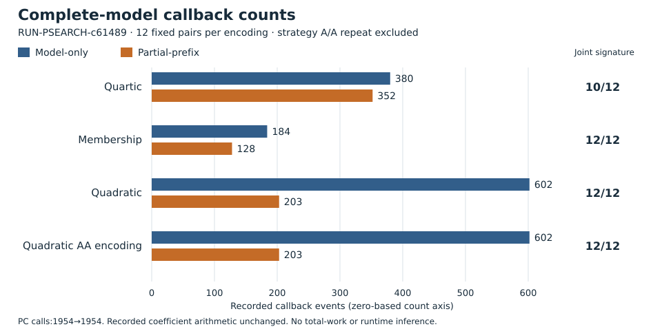

# Prefix-search comparison: scoped review decision

**The finite mechanism criterion is met; a total-cost advantage remains unestablished.** In RUN-PSEARCH-c61489, 46 of 48 matched ordinary triples produced a checked genuinely partial-prefix refutation and fewer complete-model callbacks. All 48 complete projected model sets match independently checked complementary-point references. DEC-20261030-0c834c recommends a separately admitted replication after strategy/accounting refinement; it authorizes no new execution or unchanged scaling.

EXP-PSEARCH-3ea9fe / H-PSEARCH-159d21 · reviewer TASK-20261030-ae3dc7 · Coordinator TASK-20261030-ea4f48. Source snapshot b2080b14a1; protocol-source commit 3b39d45f4e033f2bc74abc420ef133466fbe65ae. Frozen protocol hash b66fb751d2cf5ce1899970a7476df9e5dbaad1661801694204d2dc7d803c271c.

## What ran and what was checked

The inventory comprises **144 ordinary searches + 9 synthetic solver controls + 12 reference executions = 165 executions**. All 153 solver transcripts completed; none was censored or missing. The 12 public input cells use F17:y²=x³+2x+2 and F97:y²=x³+x+4, s=2,3, and the first three affine x representatives with least nonzero ordinate. Each cell retains quartic, membership, quadratic and quadratic_aa encodings, each with model-only, partial-prefix and candidate A/A strategies.

The shared backend is Cadical195/python-sat1.9.dev17. Limits are degree 2, 256 admitted rows, 512 PC calls per arm, and 20000 decisions/conflicts per solve call, with the frozen outer-call/watchdog limits. Only the timing of theory calls changes: the candidate also checks eligible contiguous LSB prefixes while assigned_count<n and depth<n. The same nonlazy propagator and external-clause delivery path are used.

The bars sum 12 matched pairs per encoding. They exclude the candidate's strategy A/A repeat; quadratic_aa is itself one of the four specified encodings. These are descriptive event counts, not time, total work or independent population samples. The two ties, c05/quartic (F17,s3,target[5,1]) and c11/quartic (F97,s3,target[4,13]), each remain64→64 with zero partial proofs.

The reviewer separately checked **5208 learned identities** (5196 ordinary + 12 controls). Candidate and strategy A/A contain 882 genuine partial proofs each; counting both gives 1764, not 1764 independent benefits. All 48 ordinary A/A comparisons match exactly; the native 51 count additionally includes three synthetic control classes. Positive-prefix, actual-empty-clause and viable-prefix controls pass; malformed multiplier, clause and model mutations are rejected. No search leaf fallback occurred. Twelve reference certificates contain 9 projections total, repeated across four encodings as 36 per strategy. This certifies projected solutions, not all auxiliary roots or a recovered scalar.

## The remaining cost gap

| Recorded unit, summed over 48 ordinary rows | Model-only | Partial-prefix |
|---|---:|---:|
| Complete-model callbacks | 1768 | 886 |
| PC calls | 1954 | 1954 |
| Search coefficient multiplications | 981664 | 981664 |
| Search coefficient additions | 695814 | 695814 |
| Evaluation-term visits | 87287 | 46532 |
| Duplicate-prefix visits | 3498 | 8111 |
| Prefix scans | 37142 | 41563 |

UNKNOWN remains 222 and row-capped calls 12 per ordinary strategy; restriction-term visits remain 94016. Arithmetic counters omit some primitives; native/Python bookkeeping, memory, serialization and fsync are not completely counted. Reference instrumentation uses separate source-event units. No weighted total, runtime ranking, new regularity result, novelty, formal proof or general ECDLP advantage follows.

## Review, correction and next action

All seven sealed joints hold. One fresh reviewer independently implemented restriction, multiplier, sparse-coverage, reference-certificate and paired-value checks, sharing frozen polynomial construction. It ran one allowed native verifier invocation and no search replay. The native independence and review-schema gates passed. Raw-before-export clock/hash ordering is attested locally, not independently timestamped; the reviewer's pre-export receipt-status correction and other development failures remain retained. Requested native Codex gpt-6.1-sol/xhigh/fork-none was prospectively admitted; actual serving model/provider/UUID/effective effort remain unverified. This is one scoped review, not a universal solver audit or execution authentication.

The first export failed because its six bundle rows used instance_id=fixed_inventory. A disclosed **post-data packaging adapter** maps that label to protocol instance string0. The reviewer checked all six actual rows: seed 0, replicate 0 and every other field are unchanged; restoring the old labels reproduces all six native errors. The frozen helper and protocol remain unchanged, native validation passes, and the original failure is retained. The entire export command is not claimed to have been frozen. Six bundles and 786 file entries are packaging units, not extra observations.

The next decision should target repeated prefix visits and avoidable arithmetic calls before a newly frozen held-out comparison, retaining the charged complementary-point baseline and all verification/setup phases. **Do not scale the unchanged experiment on the strength of callback counts.** No new launch, H/EV/KN promotion or goal completion is authorized; historical PNEXT invalid_output remains unchanged. Knowledge promotion is not warranted by this single finite observation. The general prime-field ECDLP objective remains open.

Sources: [sealed review](reviews/TASK-20261030-ae3dc7/review.md), [independent recomputation](reviews/TASK-20261030-ae3dc7/recompute.json), [attestation](reviews/TASK-20261030-ae3dc7/attestation.yaml), [input hashes and native receipts](review-inputs.json). Review publication 12e815fb4ef1abbea4c37dcedf6b48c1814884af; release 6b4d3480db; ledger claim 854ba05c27. PDF inspection and exact ten-path archive are root-owned pending steps at composition. Current native ledger-record validation is used; the separate legacy JSON decision schema cannot express current hex IDs/knowledge_promotion and is left unchanged.
