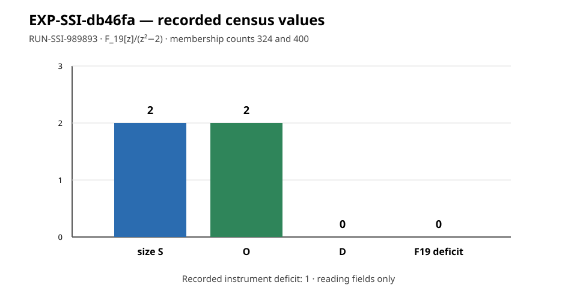

# EXP-SSI-db46fa execution report

## Scope and disposition

This is an observation-only report for the single frozen trial
`orbit-deficit-p19`, recorded as `RUN-SSI-989893`. The supervisor returned
`output_validated` and the independent checker returned code 0. This report
does not change the hypothesis, experiment, or goal status.

## Frozen inputs and custody

- Experiment: `EXP-SSI-db46fa`
- Trial: `orbit-deficit-p19`
- Run: `RUN-SSI-989893`
- Plan: `experiments/EXP-SSI-db46fa/trial-plan-v2.json`
- Plan SHA-256: `416edcd45fda23da611669907c9e87e295047bf2c4559ce3c587f90bc623fe9d`
- Execution checkout commit: `2a48c802b4f94d0d0c193b5441f79ac975a32187`
- Dispatch-plan SHA-256: `ce02ea3ab0470a145e7126fcd67cffc027840a8ef540db99433bd9876c21a1ea`
- Owner and lease: `executor-ssi-db46fa`, epoch `1`
- Execution command: `python3 tools/experiment_execution.py run --plan experiments/EXP-SSI-db46fa/trial-plan-v2.json --owner executor-ssi-db46fa --epoch 1`
- Container: `crypto-ci-python:20261008`, network disabled
- Run receipt: `returncode: 0`, `check_returncode: 0`, `status: output_validated`

## Recorded observations

The producer recorded:

- `size_S = 2`
- `O = 2`
- `D = 0`
- `deficit_F19 = 0`
- `deficit_instrument = 1`

The field was recorded as `F_19[z]/(z^2-2)`, with membership counts `[324,
400]`. Round-trip failures were empty; `roundtrip_ok`, `duplicate_ok`,
`routes_agree`, `z_squared_is_2`, and `frobenius_sends_z_to_minus_z` were all
true. The run recorded `twist_only_memberships=0` and
`attack_claimed` was not present in the producer result. The checker returned
code 0 with no stderr output.

## Interpretation boundary

These are the recorded values for one finite field and one membership census.
They do not by themselves establish a hardness result, a security reduction,
an endomorphism-ring conclusion, or behavior at another field or parameter.
The raw result, manifest, supervisor receipt, command, environment, and
checker logs remain under the run directory.
