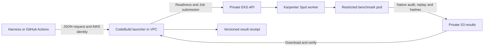

# Trigger Iso Lab from a harness or GitHub Actions

The portable request contract is [isolab.eks.request/v1](contracts/request.schema.json).
The existing host can use the registered stdio MCP tools directly. Callers on
other machines use the AWS launcher; they need no Kubernetes network route,
SSH access or permanent GitHub AWS keys.



## The request

```json
{
  "schema": "isolab.eks.request/v1",
  "job": {
    "job_name": "crypto-example-20261019-001",
    "instance_type": "c8a.2xlarge",
    "seconds": 900,
    "memory": "4Gi"
  },
  "provenance": {
    "harness": "my-harness",
    "source_revision": "caller-repository-commit"
  }
}
```

Use a unique name for each intended measurement. The Job name prevents a second
Job while the first exists, but is reusable after Kubernetes TTL deletion; it is
not a permanent idempotency key. The caller must retain its request and returned
Job UID. A submission timeout is ambiguous: inspect that name before taking any
further action. No component automatically retries a benchmark measurement.

`job.spec` optionally supplies an `ecbench.spec/v1` object; omitting it uses the
registered public validation fixture. It must request L2, at least five measured
rounds, a warmup, a reference and matching A/A control. The native parser and
audit enforce the workload semantics; the envelope schema alone is not proof of
valid cryptography or L2. `job` has the same fields as `isolab_k8s_benchmark`.
The portable wrapper defaults to C8a without SMT, 4 GiB and 900 seconds, with a
maximum deadline of 3,600 seconds. CPU count is four and measurement retries are
zero. Requests are bounded to 64 KiB.

The experiment image is digest-pinned by the deployed MCP build. Caller
`source_revision` records who requested the experiment; it does **not** mean the
pod runs newly compiled code from that commit. The result's native build-info
and binary hash identify the code actually measured. Publish/redeploy a new
image deliberately before measuring changed algorithm code. No source code or
shell command from a request is executed by this benchmark interface.

## Same-host MCP callers

Use the installed connection and call, in order:

1. `isolab_k8s_overview {}` to check access and existing jobs.
2. `isolab_k8s_benchmark` with the **job object**, not the outer envelope.
3. `isolab_k8s_status {"job_name":"..."}` until `job.state` is `succeeded` or
   `failed`; preserve `job.uid` and reject any identity change.
4. `isolab_k8s_logs` and `isolab_k8s_results` to inspect the outcome. Follow
   `next_token` when listing more than 100 objects.

The machine-readable MCP catalog is [mcp-tools.json](contracts/mcp-tools.json);
the runtime also returns it from `tools/list` or `isolab-eks-mcp tools`.
The [installation instructions](README.md#native-mcp-connector) include the
connection environment. A different MCP client on this host can spawn the same
binary. Natural-language routing belongs to that harness: when the user asks
for an EKS Iso Lab benchmark, choose `isolab_k8s_benchmark` and retain the receipt.
The legacy NATS `isolab_run` interface is separate and is not silently redirected.

## Callers anywhere with AWS access

Install AWS CLI, Bash, jq and GNU coreutils. Configure an authorized AWS
identity, then supply the deployment outputs through environment variables:

```sh
export AWS_REGION=us-east-2
export ISOLAB_BUCKET=YOUR_PRIVATE_RESULTS_BUCKET
export ISOLAB_CODEBUILD_PROJECT=YOUR_LAUNCHER_PROJECT
export ISOLAB_CLIENT_OUTPUT=/absolute/path/to/this-request-receipts
taskq/deploy/eks-karpenter/remote/launch-remote request.json
```

The script validates and normalizes the request, uploads it under its SHA-256,
starts the configured CodeBuild project, and returns a
[result receipt](contracts/result.schema.json). An SDK can perform the same
`S3 PutObject → CodeBuild StartBuild → BatchGetBuilds → S3 GetObject` sequence.
Use the normalized request hash as the StartBuild token; AWS's short-lived token
does not replace the Job-name/UID checks.

Authorized caller permissions are scoped to request upload, this project's
StartBuild/BatchGetBuilds/StopBuild, and its launcher receipts. Caller identity
setup is per environment: arbitrary machines are not automatically authorized.
The supplied GitHub OIDC role is restricted to the configured repository's main
branch. Other AWS roles/CI identity providers need their own explicit grants.
StartBuild can override project settings, so this permission is for trusted lab
operators, not a public unauthenticated service.

## GitHub Actions

[Iso Lab experiment](../../../.github/workflows/isolab-experiment.yml) is a manual
`workflow_dispatch` workflow. It checks out the trusted main revision, reads the
selected repository spec, obtains temporary AWS credentials via OIDC, then calls
the portable launcher. Workflow inputs are passed as data through environment
variables. It is not triggered by pull requests, fork code or a schedule.

Required repository Actions variables:

| Variable | Value from the deployment |
| --- | --- |
| `ISOLAB_AWS_REGION` | AWS region |
| `ISOLAB_RESULTS_BUCKET` | Private results bucket |
| `ISOLAB_CODEBUILD_PROJECT` | CloudFormation `ProjectName` output |
| `ISOLAB_TRIGGER_ROLE_ARN` | CloudFormation `TriggerRoleArn` output |

Once the workflow is on the default branch, a harness with repository Actions
write access can trigger it with GitHub's dispatch API or:

```sh
gh workflow run isolab-experiment.yml --ref main \
  -f spec_path=taskq/deploy/eks-karpenter/l2-validation.json \
  -f instance_type=c8a.2xlarge -f seconds=900
```

The workflow generates `gh-RUN_ID-RUN_ATTEMPT` as the Job name. Explicit GitHub
reruns are new experiments with separate records. Full measurements and launcher
receipts stay in private S3; the Actions summary reports the outcome. A failed
or missing receipt fails the workflow. The workflow file must be merged before
GitHub will register this new dispatch entry point; a local or PR-only file is
not a working Actions trigger.

## Readiness, results and failure semantics

Before submission the launcher verifies EKS is active, its role can create Jobs,
Karpenter has a ready replica, the NodePool and NodeClass are ready, and it can
list the results bucket. Zero worker nodes is a normal ready state: the pending
pod makes Karpenter launch a worker. Readiness cannot guarantee future Spot
capacity, so the Job deadline includes provisioning time.

Success requires Kubernetes completion **and** the exact successful Pod UID's
S3 manifest, payload hashes, zero exit code, accepted all-record L2 gate,
authenticated/regraded native audit, reproduced measured replays and admitted
A/A controls. The receipt includes Job/Pod identities, request hash and raw S3
prefix. Raw artifacts are immutable by convention and the bucket is versioned.

`failed`, `verification_failed`, `submission_unknown`, `identity_mismatch`,
`launcher_failed` and `launcher_timed_out` are distinct non-success states.
The latter states do not prove the pod stopped. Inspect status before retrying.
Stopping an Actions/CodeBuild launcher does not guarantee immediate pod
cancellation; its Kubernetes deadline still applies. For immediate cancellation,
use the native cancel tool or an authorized Kubernetes Job deletion. Cancellation
can lose artifacts that were not uploaded yet.

CodeBuild allows two concurrent launchers, with a ten-minute queue timeout and
70-minute build timeout. The EKS Spot pool retains its separate aggregate
64-vCPU limit. Native Job objects expire after a day; empty workers and their pod
logs can disappear after two minutes. S3 is the durable experiment record.

## Deploy and update the portable launcher

`remote/deploy-remote` packages the installed MCP executable, matching submit
script, kubectl and orchestration scripts into a hash-addressed, versioned S3 ZIP.
CodeBuild pins that exact source object version. It uses a small managed build
container without privileged mode, the existing private subnets/NAT and a
security group with no inbound rules. The EKS public endpoint allowlist stays
unchanged. EKS access is scoped to the lab Job role plus named readiness reads.

Set `AWS_REGION`, `ISOLAB_CLUSTER`, `ISOLAB_BUCKET`, `ISOLAB_MCP_BIN`,
`ISOLAB_REMOTE_RUNTIME` (absolute private output directory),
`ISOLAB_GITHUB_SUBJECT` (exact subject confirmed from GitHub), `KUBECONFIG` and
`ISOLAB_KUBE_CONTEXT`; run `remote/deploy-remote`. The GitHub OIDC provider must
already exist in IAM. Run this from an authorized deployment host. Repackage and
redeploy after changing the pinned image, MCP binary or orchestration scripts;
changing GitHub workflow code alone does not update the deployed launcher.

Validation: `remote/test-contract.sh`, ShellCheck, `cfn-lint remote/bridge.yaml`,
and actionlint on the workflow. The portable smoke run must retain a request,
CodeBuild status, readiness receipt, completed Job/Pod identities, native audit,
S3 hash checks and final result. Test the actual Actions/OIDC path separately
after merge; a direct AWS smoke run does not establish that GitHub authentication
or workflow dispatch has succeeded.

References: [GitHub OIDC with AWS](https://docs.github.com/en/actions/how-tos/secure-your-work/security-harden-deployments/oidc-in-aws),
[CodeBuild VPC access](https://docs.aws.amazon.com/codebuild/latest/userguide/vpc-support.html),
[CodeBuild StartBuild](https://docs.aws.amazon.com/codebuild/latest/APIReference/API_StartBuild.html).
