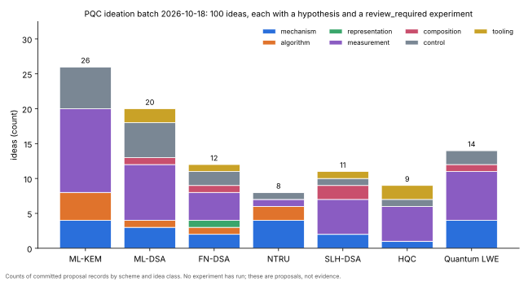
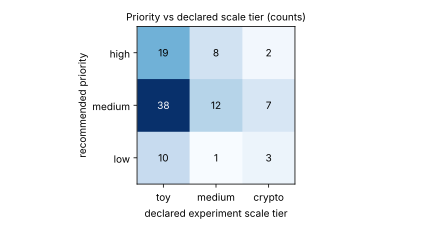

# PQC ideation batch, 2026-10-18 (PQC-100-20261018)

**Status: proposals and review_required contracts only.** No experiment in this batch has run,
none is approved, and nothing here is evidence about ML-KEM, ML-DSA, FN-DSA, SLH-DSA, HQC or
NTRU. Every instance an experiment would use is self-generated at reduced scale.

**Static review correction:** 35 draft contracts have explicit protocol holds. Read the
[entry-specific findings and qualifications](../../docs/reviews/pr2404/qualification.md)
before interpreting the original proposal claims or planning any implementation.

The batch adds 100 ideas under `ledger/proposals/`, one specified hypothesis per idea under
`ledger/hypotheses/`, and one experiment contract per hypothesis under `experiments/`. Each
contract carries a variable ledger with an A/A comparison, prediction provenance, decision impact
and an `approval_gate` block naming what blocks Coordinator approval. Shared original blockers
are: no committed launcher, no preapproval packet, no compiled runbook, and no
novelty screen. Contracts under RQ-MLKEM-003 also need a goal, because both goals that served
that question are closed at budget. The linked review adds item-specific protocol corrections
that must be resolved prospectively; the original IDEA and hypothesis records remain intact.





## Ideas per research question

| research question | ideas |
| --- | --- |
| RQ-FNDSA-001 | 12 |
| RQ-HQC-001 | 9 |
| RQ-MLDSA-001 | 12 |
| RQ-MLDSA-ffa0f5 | 8 |
| RQ-MLKEM-001 | 12 |
| RQ-MLKEM-003 | 14 |
| RQ-NTRU-9015ee | 8 |
| RQ-QLWE-1c4a3b | 6 |
| RQ-QLWE-9108dc | 4 |
| RQ-QLWE-d2d713 | 4 |
| RQ-SLHDSA-001 | 11 |

## Catalogue

| # | idea | experiment | scheme | class | priority | title |
| --- | --- | --- | --- | --- | --- | --- |
| 1 | [IDEA-20261018-045269](../../ledger/proposals/IDEA-20261018-045269.yaml) | [EXP-FNDSA-ab833e](../../experiments/EXP-FNDSA-ab833e/specification.yaml) | FN-DSA | mechanism | high | Floating-point conversion leak as a learning curve: signatures-to-key vs channel noise and tree level, simulated oracle, n=16..128 |
| 2 | [IDEA-20261018-7e72aa](../../ledger/proposals/IDEA-20261018-7e72aa.yaml) | [EXP-FNDSA-d9c29d](../../experiments/EXP-FNDSA-d9c29d/specification.yaml) | FN-DSA | measurement | high | Float-free integer Gram-root sampler vs ffSampling: is the integer sampler's covariance error aligned with the secret basis? |
| 3 | [IDEA-20261018-b12c19](../../ledger/proposals/IDEA-20261018-b12c19.yaml) | [EXP-FNDSA-8c601c](../../experiments/EXP-FNDSA-8c601c/specification.yaml) | FN-DSA | measurement | high | Weakest-key census at n=512/1024: how close does the smallest ffLDL leaf width of accepted keys come to the base sampler floor? |
| 4 | [IDEA-20261018-47251d](../../ledger/proposals/IDEA-20261018-47251d.yaml) | [EXP-FNDSA-fb8c12](../../experiments/EXP-FNDSA-fb8c12/specification.yaml) | FN-DSA | measurement | medium | Tower NTRUSolve vs exact rational Babai on the same (f,g): does approximate field-norm reduction leave slack in (F,G)? |
| 5 | [IDEA-20261018-3e25a1](../../ledger/proposals/IDEA-20261018-3e25a1.yaml) | [EXP-FNDSA-cc92c2](../../experiments/EXP-FNDSA-cc92c2/specification.yaml) | FN-DSA | composition | medium | Same fixed-KL planted defect in ffSampling, Mitaka and Antrag-keyed Mitaka: how many signatures until the basis leaks? |
| 6 | [IDEA-20261018-ad2429](../../ledger/proposals/IDEA-20261018-ad2429.yaml) | [EXP-FNDSA-d8e66a](../../experiments/EXP-FNDSA-d8e66a/specification.yaml) | FN-DSA | control | medium | Are FN-DSA's norm-bound and fixed-length-encoding restarts key-independent, and do they select on a defective sampler's leak? |
| 7 | [IDEA-20261018-17ea70](../../ledger/proposals/IDEA-20261018-17ea70.yaml) | [EXP-FNDSA-23125b](../../experiments/EXP-FNDSA-23125b/specification.yaml) | FN-DSA | representation | medium | Subfield-trace projections of signatures as public detectors: does power peak at the degree matching a defect's tree level? |
| 8 | [IDEA-20261018-574a9f](../../ledger/proposals/IDEA-20261018-574a9f.yaml) | [EXP-FNDSA-6cc547](../../experiments/EXP-FNDSA-6cc547/specification.yaml) | FN-DSA | control | medium | Score the LWE-with-hints estimator on center-exponent hints: predicted vs measured BKZ block size at n=32..128 |
| 9 | [IDEA-20261018-cc5a57](../../ledger/proposals/IDEA-20261018-cc5a57.yaml) | [EXP-FNDSA-a7649a](../../experiments/EXP-FNDSA-a7649a/specification.yaml) | FN-DSA | algorithm | medium | Maximum-likelihood trapdoor recovery from a defective sampler vs moment learners and the Cramer-Rao bound |
| 10 | [IDEA-20261018-fd1f81](../../ledger/proposals/IDEA-20261018-fd1f81.yaml) | [EXP-FNDSA-fb188f](../../experiments/EXP-FNDSA-fb188f/specification.yaml) | FN-DSA | mechanism | medium | Annular (Antrag) keys flatten the embedding spectrum: are they farther from the dense-sublattice regime than Falcon keys? |
| 11 | [IDEA-20261018-9b273e](../../ledger/proposals/IDEA-20261018-9b273e.yaml) | [EXP-FNDSA-2dab1c](../../experiments/EXP-FNDSA-2dab1c/specification.yaml) | FN-DSA | measurement | high | One randomness tape, three conforming builds: signature disagreement rates for emulated, strict and FMA-contracted FN-DSA |
| 12 | [IDEA-20261018-549844](../../ledger/proposals/IDEA-20261018-549844.yaml) | [EXP-FNDSA-9283cf](../../experiments/EXP-FNDSA-9283cf/specification.yaml) | FN-DSA | tooling | high | A shared positive-control ladder: five planted sampler defect types at exact KL, and each detector's minimum detectable KL |
| 13 | [IDEA-20261018-3eae51](../../ledger/proposals/IDEA-20261018-3eae51.yaml) | [EXP-NTRU-73f8dd](../../experiments/EXP-NTRU-73f8dd/specification.yaml) | NTRU | algorithm | high | Measured hybrid MITM vs primal BKZ on NTRU Prime-shaped rings, p=61..113: does the hybrid gain vanish past the transition? |
| 14 | [IDEA-20261018-5d92f4](../../ledger/proposals/IDEA-20261018-5d92f4.yaml) | [EXP-NTRU-267f7d](../../experiments/EXP-NTRU-267f7d/specification.yaml) | NTRU | mechanism | medium | Scaling-collapse test for matrix NTRU: is the transition a function of flattened dimension and dense-sublattice rank ratio only? |
| 15 | [IDEA-20261018-a2705d](../../ledger/proposals/IDEA-20261018-a2705d.yaml) | [EXP-NTRU-beacd1](../../experiments/EXP-NTRU-beacd1/specification.yaml) | NTRU | algorithm | medium | Symplectic BKZ vs plain BKZ on NTRU lattices of dimension 128..220: measured speedup and dense-sublattice event location |
| 16 | [IDEA-20261018-1cd7c3](../../ledger/proposals/IDEA-20261018-1cd7c3.yaml) | [EXP-NTRU-a34049](../../experiments/EXP-NTRU-a34049/specification.yaml) | NTRU | measurement | medium | Subfield norm attack vs direct dense-sublattice reduction at n=64..256: does NTRU Prime's lack of subfields buy any distance? |
| 17 | [IDEA-20261018-baf524](../../ledger/proposals/IDEA-20261018-baf524.yaml) | [EXP-NTRU-e695f9](../../experiments/EXP-NTRU-e695f9/specification.yaml) | NTRU | mechanism | high | NTRU Prime's unbalanced secret (3f,g): how the dense-sublattice transition moves with block-norm ratio, with and without rescaling |
| 18 | [IDEA-20261018-854cf2](../../ledger/proposals/IDEA-20261018-854cf2.yaml) | [EXP-NTRU-027f0b](../../experiments/EXP-NTRU-027f0b/specification.yaml) | NTRU | control | high | Is the measured fatigue point a lattice property or a reducer property? BKZ 2.0 vs G6K vs progressive sieve at matched work |
| 19 | [IDEA-20261018-3ea82c](../../ledger/proposals/IDEA-20261018-3ea82c.yaml) | [EXP-NTRU-2a95e3](../../experiments/EXP-NTRU-2a95e3/specification.yaml) | NTRU | mechanism | medium | Does hybrid guessing destroy the dense sublattice? Projected NTRU residuals vs matched random uSVP after fixing k coefficients |
| 20 | [IDEA-20261018-d23aba](../../ledger/proposals/IDEA-20261018-d23aba.yaml) | [EXP-NTRU-606596](../../experiments/EXP-NTRU-606596/specification.yaml) | NTRU | mechanism | high | Rotations in x^p-x-1 are not isometries: norm growth, orbit covolume excess, and predicted vs measured transition shift |
| 21 | [IDEA-20261018-73fed4](../../ledger/proposals/IDEA-20261018-73fed4.yaml) | [EXP-MLDSA-3625ec](../../experiments/EXP-MLDSA-3625ec/specification.yaml) | ML-DSA | mechanism | high | Rejection hides odd mask biases to second order: key recovery needs eps^-4 signatures for a linear y tilt, eps^-2 for an even bias |
| 22 | [IDEA-20261018-0eb5a3](../../ledger/proposals/IDEA-20261018-0eb5a3.yaml) | [EXP-MLDSA-20961f](../../experiments/EXP-MLDSA-20961f/specification.yaml) | ML-DSA | mechanism | high | One signature gives s1 mod 2^b from an exact b-bit LSB leak of y: c is a unit mod 2^b iff tau is odd (ML-DSA-44/65, not 87) |
| 23 | [IDEA-20261018-3e1f14](../../ledger/proposals/IDEA-20261018-3e1f14.yaml) | [EXP-MLDSA-b675fd](../../experiments/EXP-MLDSA-b675fd/specification.yaml) | ML-DSA | control | medium | Hedged entropy is load-bearing only if rho'' drops K or mu: signatures-to-s1 vs rnd entropy h for three derivations |
| 24 | [IDEA-20261018-f27cb2](../../ledger/proposals/IDEA-20261018-f27cb2.yaml) | [EXP-MLDSA-76fd1a](../../experiments/EXP-MLDSA-76fd1a/specification.yaml) | ML-DSA | algorithm | medium | Leaked aborted FSwA transcripts: edge inequalities on rejected z recover s1 far faster than ILWE regression on the same leak |
| 25 | [IDEA-20261018-0faaef](../../ledger/proposals/IDEA-20261018-0faaef.yaml) | [EXP-MLDSA-eed16d](../../experiments/EXP-MLDSA-eed16d/specification.yaml) | ML-DSA | measurement | medium | Hash arm made measurable: forge at real ML-DSA-44 against defective SampleInBall images of 2^16..2^32 and test cost = /image/ |
| 26 | [IDEA-20261018-5b48f2](../../ledger/proposals/IDEA-20261018-5b48f2.yaml) | [EXP-MLDSA-01a356](../../experiments/EXP-MLDSA-01a356/specification.yaml) | ML-DSA | control | medium | Ground truth for l-infinity MSIS: exact box-pruned enumeration at m <= 72 against the l2-sieve-pool filter and the sqrt(m) conversion |
| 27 | [IDEA-20261018-1acf81](../../ledger/proposals/IDEA-20261018-1acf81.yaml) | [EXP-MLDSA-0d773e](../../experiments/EXP-MLDSA-0d773e/specification.yaml) | ML-DSA | measurement | low | Masking order as a measured security parameter for c*s1: traces-to-key vs SNR at order d = 0, 1, 2 in a simulated Hamming-weight model |
| 28 | [IDEA-20261018-8b411e](../../ledger/proposals/IDEA-20261018-8b411e.yaml) | [EXP-MLDSA-1e2b4d](../../experiments/EXP-MLDSA-1e2b4d/specification.yaml) | ML-DSA | mechanism | low | A defective ExpandA zeroing NTT slots of A leaks s2 in those slots from pk alone: block size vs number of bad slots |
| 29 | [IDEA-20261018-417012](../../ledger/proposals/IDEA-20261018-417012.yaml) | [EXP-MLDSA-7e639e](../../experiments/EXP-MLDSA-7e639e/specification.yaml) | ML-DSA | measurement | medium | Naive threshold ML-DSA leaks through the mask sum: an Irwin-Hall shaped y makes post-rejection z regress on c s1 with gain near 1 |
| 30 | [IDEA-20261018-fb4a86](../../ledger/proposals/IDEA-20261018-fb4a86.yaml) | [EXP-MLDSA-0a3ffb](../../experiments/EXP-MLDSA-0a3ffb/specification.yaml) | ML-DSA | composition | high | Hedging priced against faults: differential recovery needs 2^{h/2} same-message queries with h-bit rnd; census of mode-independent faults |
| 31 | [IDEA-20261018-94b270](../../ledger/proposals/IDEA-20261018-94b270.yaml) | [EXP-MLDSA-26aa33](../../experiments/EXP-MLDSA-26aa33/specification.yaml) | ML-DSA | measurement | medium | Passive y leakage: deterministic mode lets an attacker average repeated signatures, hedged does not; measure the trace-count gap |
| 32 | [IDEA-20261018-4d0a02](../../ledger/proposals/IDEA-20261018-4d0a02.yaml) | [EXP-MLDSA-16ba8d](../../experiments/EXP-MLDSA-16ba8d/specification.yaml) | ML-DSA | control | low | ExpandS defect calibration: does the estimator predict measured BKZ cost for low-variance vs low-entropy skewed secrets? |
| 33 | [IDEA-20261018-0e598c](../../ledger/proposals/IDEA-20261018-0e598c.yaml) | [EXP-MLDSA-6fd719](../../experiments/EXP-MLDSA-6fd719/specification.yaml) | ML-DSA | tooling | medium | Cross-implementation differential verify: the boundary cases FIPS 204's verifier must reject, fuzzed across five open implementations |
| 34 | [IDEA-20261018-28c0c6](../../ledger/proposals/IDEA-20261018-28c0c6.yaml) | [EXP-MLDSA-e16d0c](../../experiments/EXP-MLDSA-e16d0c/specification.yaml) | ML-DSA | control | medium | Ablate each Verify check: which FIPS 204 verifier predicates are load-bearing, by the cost of a key-less forgery per ablation |
| 35 | [IDEA-20261018-072af2](../../ledger/proposals/IDEA-20261018-072af2.yaml) | [EXP-MLDSA-7a6410](../../experiments/EXP-MLDSA-7a6410/specification.yaml) | ML-DSA | measurement | high | Detection vs exploitation race for a narrowed ExpandMask: can a public auditor spot it before an attacker recovers s1? |
| 36 | [IDEA-20261018-c5cccf](../../ledger/proposals/IDEA-20261018-c5cccf.yaml) | [EXP-MLDSA-e492e6](../../experiments/EXP-MLDSA-e492e6/specification.yaml) | ML-DSA | measurement | low | What the verifier cannot check: rnd grinding embeds k bits per signature in c_tilde at cost 2^k, undetectable by public tests |
| 37 | [IDEA-20261018-3e34f5](../../ledger/proposals/IDEA-20261018-3e34f5.yaml) | [EXP-MLDSA-d52bb2](../../experiments/EXP-MLDSA-d52bb2/specification.yaml) | ML-DSA | control | medium | Weak public keys Verify accepts: t1 = 0 and sparse-s1 keys allow third-party forgery; cheap pk checks catch only part |
| 38 | [IDEA-20261018-7eb7e8](../../ledger/proposals/IDEA-20261018-7eb7e8.yaml) | [EXP-MLDSA-4d3948](../../experiments/EXP-MLDSA-4d3948/specification.yaml) | ML-DSA | measurement | low | Repudiable keys by rho grinding: cost law q^{k-l+1}/256 for a rank-deficient NTT slot of A, and its honest frequency |
| 39 | [IDEA-20261018-7d6e2c](../../ledger/proposals/IDEA-20261018-7d6e2c.yaml) | [EXP-MLDSA-e34857](../../experiments/EXP-MLDSA-e34857/specification.yaml) | ML-DSA | tooling | medium | Masked signers vs the exact signing-only predicates: boundary-forced differential testing of masked vs reference rejections |
| 40 | [IDEA-20261018-33a760](../../ledger/proposals/IDEA-20261018-33a760.yaml) | [EXP-MLDSA-965398](../../experiments/EXP-MLDSA-965398/specification.yaml) | ML-DSA | measurement | low | The integrity dual of t0 secrecy: how many low bit-planes of t0 in the secret key can be corrupted before signatures stop verifying |
| 41 | [IDEA-20261018-6a1f41](../../ledger/proposals/IDEA-20261018-6a1f41.yaml) | [EXP-MLKEM-641142](../../experiments/EXP-MLKEM-641142/specification.yaml) | ML-KEM | mechanism | high | Decryption failures as approximate DDGR hints: measured block-size drop per observed failure on reduced ML-KEM |
| 42 | [IDEA-20261018-5272db](../../ledger/proposals/IDEA-20261018-5272db.yaml) | [EXP-MLKEM-e08b88](../../experiments/EXP-MLKEM-e08b88/specification.yaml) | ML-KEM | algorithm | medium | Rotation-augmented sieve database on negacyclic module lattices: does the 2n-fold rotation orbit survive projection into BKZ blocks? |
| 43 | [IDEA-20261018-7b3a19](../../ledger/proposals/IDEA-20261018-7b3a19.yaml) | [EXP-MLKEM-de8801](../../experiments/EXP-MLKEM-de8801/specification.yaml) | ML-KEM | measurement | medium | Module-BKZ versus scalar BKZ in total counted operations at equal output profile, rank 2-3 modules over degree 8-32 cyclotomics |
| 44 | [IDEA-20261018-957273](../../ledger/proposals/IDEA-20261018-957273.yaml) | [EXP-MLKEM-343bfe](../../experiments/EXP-MLKEM-343bfe/specification.yaml) | ML-KEM | algorithm | medium | Meet-LWE with CBD-shaped representations: do eta-ary representation weights beat the ternary analysis for CBD(2)/CBD(3) secrets at n=32-64? |
| 45 | [IDEA-20261018-03bbdd](../../ledger/proposals/IDEA-20261018-03bbdd.yaml) | [EXP-MLKEM-f55221](../../experiments/EXP-MLKEM-f55221/specification.yaml) | ML-KEM | mechanism | high | Compression-error-aware failure boosting: include the attacker-known Compress_dv/Compress_du rounding errors in the weak-ciphertext score |
| 46 | [IDEA-20261018-f709ae](../../ledger/proposals/IDEA-20261018-f709ae.yaml) | [EXP-MLKEM-6f4c51](../../experiments/EXP-MLKEM-6f4c51/specification.yaml) | ML-KEM | control | medium | Multi-key failure precomputation is killed by FIPS 203's H(ek) in G: measure the amortization factor with and without key binding |
| 47 | [IDEA-20261018-0c5d75](../../ledger/proposals/IDEA-20261018-0c5d75.yaml) | [EXP-MLKEM-36f672](../../experiments/EXP-MLKEM-36f672/specification.yaml) | ML-KEM | algorithm | medium | Learned pump-and-jump scheduling for Kyber-shaped primal instances versus G6K default and two-step-mode schedules |
| 48 | [IDEA-20261018-70bd4a](../../ledger/proposals/IDEA-20261018-70bd4a.yaml) | [EXP-MLKEM-e26487](../../experiments/EXP-MLKEM-e26487/specification.yaml) | ML-KEM | algorithm | low | Empirical success model for pruned enumeration in BKZ blocks: the block's shortest vector is not uniform on the sphere |
| 49 | [IDEA-20261018-373b94](../../ledger/proposals/IDEA-20261018-373b94.yaml) | [EXP-MLKEM-0a97f8](../../experiments/EXP-MLKEM-0a97f8/specification.yaml) | ML-KEM | mechanism | medium | Noisy NTT-domain hints as extra MLWE samples: the hint-noise threshold below which they lower beta (simulated, defensive) |
| 50 | [IDEA-20261018-4940b7](../../ledger/proposals/IDEA-20261018-4940b7.yaml) | [EXP-MLKEM-3559f0](../../experiments/EXP-MLKEM-3559f0/specification.yaml) | ML-KEM | control | low | Implicit rejection leaves only a noisy key-confirmation oracle: a channel-capacity bound on failure-attack query cost, checked by simulation |
| 51 | [IDEA-20261018-da2ffa](../../ledger/proposals/IDEA-20261018-da2ffa.yaml) | [EXP-MLKEM-6dd4e2](../../experiments/EXP-MLKEM-6dd4e2/specification.yaml) | ML-KEM | control | low | Known-plaintext ciphertexts as extra, much noisier MLWE samples on s: measure that they do not lower primal beta (control) |
| 52 | [IDEA-20261018-234080](../../ledger/proposals/IDEA-20261018-234080.yaml) | [EXP-MLKEM-3c4959](../../experiments/EXP-MLKEM-3c4959/specification.yaml) | ML-KEM | measurement | medium | How fast does the failure cone narrow? Measured secret-direction cosine after F failures versus the D'Anvers-Rossi-Virdia model |
| 53 | [IDEA-20261018-ab4e4d](../../ledger/proposals/IDEA-20261018-ab4e4d.yaml) | [EXP-MLKEM-efc1c8](../../experiments/EXP-MLKEM-efc1c8/specification.yaml) | ML-KEM | measurement | high | Bytes moved per pair test in G6K's bucketed sieves at d=60-90: a measured DRAM-bandwidth floor under the core-SVP time exponent |
| 54 | [IDEA-20261018-9b3937](../../ledger/proposals/IDEA-20261018-9b3937.yaml) | [EXP-MLKEM-e9789d](../../experiments/EXP-MLKEM-e9789d/specification.yaml) | ML-KEM | measurement | medium | Non-oracle overhead at real FIPS 203 dimension: measured LLL, size-reduction and GSO-precision cost on full ML-KEM primal bases |
| 55 | [IDEA-20261018-06ab73](../../ledger/proposals/IDEA-20261018-06ab73.yaml) | [EXP-MLKEM-23faa1](../../experiments/EXP-MLKEM-23faa1/specification.yaml) | ML-KEM | mechanism | medium | Quantized sieve database (8/6/4-bit coordinates): how far the bytes-per-vector memory constant shrinks at fixed saturation time |
| 56 | [IDEA-20261018-b3837a](../../ledger/proposals/IDEA-20261018-b3837a.yaml) | [EXP-MLKEM-19e5b7](../../experiments/EXP-MLKEM-19e5b7/specification.yaml) | ML-KEM | measurement | medium | Parallel efficiency of G6K sieving from 1 to 64 threads at d=70-85: is core-SVP time a sequential fiction under shared bandwidth? |
| 57 | [IDEA-20261018-c8180f](../../ledger/proposals/IDEA-20261018-c8180f.yaml) | [EXP-MLKEM-38b27d](../../experiments/EXP-MLKEM-38b27d/specification.yaml) | ML-KEM | measurement | high | Measured success curve P(beta) of progressive primal attacks on Kyber-shaped instances versus the Postlethwaite-Virdia simulator |
| 58 | [IDEA-20261018-7ba702](../../ledger/proposals/IDEA-20261018-7ba702.yaml) | [EXP-MLKEM-af9133](../../experiments/EXP-MLKEM-af9133/specification.yaml) | ML-KEM | measurement | medium | Inside one SVP call: measured progressive-sieving overhead C_prog = pump cost / final sieve cost at d=60-90 vs the geometric series |
| 59 | [IDEA-20261018-ae2c35](../../ledger/proposals/IDEA-20261018-ae2c35.yaml) | [EXP-MLKEM-5c0e4d](../../experiments/EXP-MLKEM-5c0e4d/specification.yaml) | ML-KEM | measurement | medium | Batch-CVP after one sieve: measured per-query cost of Voronoi-slicer CVPP at d=50-70 versus the per-guess Babai cost hybrids assume |
| 60 | [IDEA-20261018-35cd77](../../ledger/proposals/IDEA-20261018-35cd77.yaml) | [EXP-MLKEM-62fa28](../../experiments/EXP-MLKEM-62fa28/specification.yaml) | ML-KEM | control | low | Does the Gaussian surrogate for CBD errors misprice primal success? Matched-variance CBD vs discrete Gaussian vs uniform beta* |
| 61 | [IDEA-20261018-7fe944](../../ledger/proposals/IDEA-20261018-7fe944.yaml) | [EXP-QLWE-13657e](../../experiments/EXP-QLWE-13657e/specification.yaml) | Quantum LWE | control | high | Calibrate a step-audit statevector simulator on Chen 2024 Step 9 before it audits any live claim |
| 62 | [IDEA-20261018-be26e5](../../ledger/proposals/IDEA-20261018-be26e5.yaml) | [EXP-QLWE-709141](../../experiments/EXP-QLWE-709141/specification.yaml) | Quantum LWE | measurement | high | Signed-C cancellation ratio in Simon 2026 Lemma 3, measured by exact simulation at reduced group size |
| 63 | [IDEA-20261018-e477ad](../../ledger/proposals/IDEA-20261018-e477ad.yaml) | [EXP-QLWE-b3e74e](../../experiments/EXP-QLWE-b3e74e/specification.yaml) | Quantum LWE | mechanism | medium | Adaptive versus fixed partition in Simon's erasure step: does the independence condition named by Guo-Yang carry the bias? |
| 64 | [IDEA-20261018-451388](../../ledger/proposals/IDEA-20261018-451388.yaml) | [EXP-QLWE-65244f](../../experiments/EXP-QLWE-65244f/specification.yaml) | Quantum LWE | measurement | high | Luo Part III Voronoi claim at small 2-power conductors: is the CVP target from a short ring element inside the origin's Voronoi cell? |
| 65 | [IDEA-20261018-cf3054](../../ledger/proposals/IDEA-20261018-cf3054.yaml) | [EXP-QLWE-386499](../../experiments/EXP-QLWE-386499/specification.yaml) | Quantum LWE | mechanism | high | Luo Part IV tower PIP descent at 2-power degree <= 32: measured length of the lifted generator against the planted one |
| 66 | [IDEA-20261018-b16a07](../../ledger/proposals/IDEA-20261018-b16a07.yaml) | [EXP-QLWE-2fdcf6](../../experiments/EXP-QLWE-2fdcf6/specification.yaml) | Quantum LWE | control | medium | Structure-blindness test for quantum enumeration: is the Montanaro tree size on ring and module bases the same as on plain LWE? |
| 67 | [IDEA-20261018-9ca075](../../ledger/proposals/IDEA-20261018-9ca075.yaml) | [EXP-QLWE-ce0230](../../experiments/EXP-QLWE-ce0230/specification.yaml) | Quantum LWE | measurement | medium | Measured approximation-factor crossover between the Stickelberger quantum Ideal-SVP pipeline and BKZ at small cyclotomic conductors |
| 68 | [IDEA-20261018-7a2a78](../../ledger/proposals/IDEA-20261018-7a2a78.yaml) | [EXP-QLWE-0221a8](../../experiments/EXP-QLWE-0221a8/specification.yaml) | Quantum LWE | mechanism | medium | Galois-orbit Fourier sampling on toy Ring-LWE: does the automorphism group leak mutual information that a random permutation group does not? |
| 69 | [IDEA-20261018-0e1671](../../ledger/proposals/IDEA-20261018-0e1671.yaml) | [EXP-QLWE-acfe75](../../experiments/EXP-QLWE-acfe75/specification.yaml) | Quantum LWE | measurement | low | Measured noise growth of the Albrecht-Deo RLWE self-reduction chain against its proven bound, and the gamma regime it lands in |
| 70 | [IDEA-20261018-cdde02](../../ledger/proposals/IDEA-20261018-cdde02.yaml) | [EXP-QLWE-ccd305](../../experiments/EXP-QLWE-ccd305/specification.yaml) | Quantum LWE | measurement | low | Rotation-orbit augmentation in a quantum-priced sieve: does the ring's n-fold symmetry gain survive QRAM charging? |
| 71 | [IDEA-20261018-7ef7dc](../../ledger/proposals/IDEA-20261018-7ef7dc.yaml) | [EXP-QLWE-19a604](../../experiments/EXP-QLWE-19a604/specification.yaml) | Quantum LWE | measurement | high | Kuperberg and Regev DHSP sieves under faulty samples: classically simulated success-vs-fault-rate tables at toy group sizes |
| 72 | [IDEA-20261018-6959bf](../../ledger/proposals/IDEA-20261018-6959bf.yaml) | [EXP-QLWE-e4d829](../../experiments/EXP-QLWE-e4d829/specification.yaml) | Quantum LWE | measurement | medium | Information per sample of extrapolated dihedral coset states versus plain DCP, as a function of extrapolation width |
| 73 | [IDEA-20261018-fd5b27](../../ledger/proposals/IDEA-20261018-fd5b27.yaml) | [EXP-QLWE-912f22](../../experiments/EXP-QLWE-912f22/specification.yaml) | Quantum LWE | mechanism | medium | Regev's quantum step read in the attack direction: how much BDD-radius shortfall does the iterative DGS-width reduction tolerate? |
| 74 | [IDEA-20261018-2f024b](../../ledger/proposals/IDEA-20261018-2f024b.yaml) | [EXP-QLWE-23c885](../../experiments/EXP-QLWE-23c885/specification.yaml) | Quantum LWE | composition | medium | LWE-to-eDCP regime map under three alpha conventions, overlaid on measured DHSP sieve fault tolerance |
| 75 | [IDEA-20261018-d449ce](../../ledger/proposals/IDEA-20261018-d449ce.yaml) | [EXP-MLKEM-35b326](../../experiments/EXP-MLKEM-35b326/specification.yaml) | ML-KEM | measurement | medium | One BKZ-simulator calibration for both ML-KEM and ML-DSA lattice shapes: per-index Gram-Schmidt residual of CN11 and sharp simulators |
| 76 | [IDEA-20261018-fdcbd0](../../ledger/proposals/IDEA-20261018-fdcbd0.yaml) | [EXP-MLKEM-663616](../../experiments/EXP-MLKEM-663616/specification.yaml) | ML-KEM | measurement | high | Measure the Grover search-space sizes a quantum sieve would actually face: instrumented G6K bucket/filter sizes priced with QRAM |
| 77 | [IDEA-20261018-42433b](../../ledger/proposals/IDEA-20261018-42433b.yaml) | [EXP-MLKEM-354cf2](../../experiments/EXP-MLKEM-354cf2/specification.yaml) | ML-KEM | measurement | medium | Measured pruned-enumeration tree sizes on reduced blocks from both schemes' lattices against the GSA prediction quantum enumeration uses |
| 78 | [IDEA-20261018-02ad4a](../../ledger/proposals/IDEA-20261018-02ad4a.yaml) | [EXP-MLKEM-aeb923](../../experiments/EXP-MLKEM-aeb923/specification.yaml) | ML-KEM | control | high | A shared A/A noise-floor registry for lattice-reduction measurements: minimum detectable effect per instrument, shape and dimension |
| 79 | [IDEA-20261018-bd3cf2](../../ledger/proposals/IDEA-20261018-bd3cf2.yaml) | [EXP-MLKEM-b702be](../../experiments/EXP-MLKEM-b702be/specification.yaml) | ML-KEM | measurement | medium | Memory-capped sieving: success and cost when G6K's database is held below the 2^{0.2075n} list size, on both schemes' lattices |
| 80 | [IDEA-20261018-ff5892](../../ledger/proposals/IDEA-20261018-ff5892.yaml) | [EXP-MLKEM-da8d4a](../../experiments/EXP-MLKEM-da8d4a/specification.yaml) | ML-KEM | control | medium | Held-out cross-shape validation of lattice-estimator residuals: fit on ML-KEM-shaped instances, predict ML-DSA key-recovery instances |
| 81 | [IDEA-20261018-eef811](../../ledger/proposals/IDEA-20261018-eef811.yaml) | [EXP-SLHDSA-9d3ed1](../../experiments/EXP-SLHDSA-9d3ed1/specification.yaml) | SLH-DSA | measurement | medium | WOTS+ chain-position grinding: per-query domination probability under base-w-plus-checksum versus constant-sum encoding at reduced w |
| 82 | [IDEA-20261018-c09848](../../ledger/proposals/IDEA-20261018-c09848.yaml) | [EXP-SLHDSA-bc381e](../../experiments/EXP-SLHDSA-bc381e/specification.yaml) | SLH-DSA | tooling | high | Depth-limited parallel Grover cost tables per FIPS 205 hash role: multi-target preimage cost under MAXDEPTH and processor count |
| 83 | [IDEA-20261018-8d765b](../../ledger/proposals/IDEA-20261018-8d765b.yaml) | [EXP-SLHDSA-e9b016](../../experiments/EXP-SLHDSA-e9b016/specification.yaml) | SLH-DSA | measurement | high | Grafting-tree fault forgery simulated at reduced h and d: faulty signatures needed for a verified universal forgery, by faulted layer |
| 84 | [IDEA-20261018-007845](../../ledger/proposals/IDEA-20261018-007845.yaml) | [EXP-SLHDSA-8ada4e](../../experiments/EXP-SLHDSA-8ada4e/specification.yaml) | SLH-DSA | control | medium | Compressed ADRS and shared SHA-256 midstate: exhaustive tweak-injectivity census of SHA2 versus SHAKE over every reachable address |
| 85 | [IDEA-20261018-0e2ae9](../../ledger/proposals/IDEA-20261018-0e2ae9.yaml) | [EXP-SLHDSA-e67a2b](../../experiments/EXP-SLHDSA-e67a2b/specification.yaml) | SLH-DSA | measurement | medium | Verification malleability census at reduced n: accepted mutations per signature field, against a planted lax verifier |
| 86 | [IDEA-20261018-cfa824](../../ledger/proposals/IDEA-20261018-cfa824.yaml) | [EXP-SLHDSA-8f310d](../../experiments/EXP-SLHDSA-8f310d/specification.yaml) | SLH-DSA | composition | medium | Cross-user batching under per-key PK.seed: measured multi-target preimage gain across U keys, distinct versus shared seeds |
| 87 | [IDEA-20261018-782c3e](../../ledger/proposals/IDEA-20261018-782c3e.yaml) | [EXP-SLHDSA-a6c6d8](../../experiments/EXP-SLHDSA-a6c6d8/specification.yaml) | SLH-DSA | mechanism | medium | Iteration-skip faults on the WOTS+ chain loop release lower chain values: forgery capability per fault versus bit-flip faults |
| 88 | [IDEA-20261018-be7ba5](../../ledger/proposals/IDEA-20261018-be7ba5.yaml) | [EXP-SLHDSA-699191](../../experiments/EXP-SLHDSA-699191/specification.yaml) | SLH-DSA | measurement | medium | Role-dependent quantum oracle cost: reversible SHA-256 and Keccak circuits sized per FIPS 205 role input length |
| 89 | [IDEA-20261018-e71929](../../ledger/proposals/IDEA-20261018-e71929.yaml) | [EXP-SLHDSA-5c7662](../../experiments/EXP-SLHDSA-5c7662/specification.yaml) | SLH-DSA | mechanism | medium | Merkle-Damgard chaining bottleneck at toy scale: multi-target second preimages via the internal state when n exceeds c/2 |
| 90 | [IDEA-20261018-c21656](../../ledger/proposals/IDEA-20261018-c21656.yaml) | [EXP-SLHDSA-37c329](../../experiments/EXP-SLHDSA-37c329/specification.yaml) | SLH-DSA | composition | low | Fault countermeasure frontier: detection by caching upper-layer one-time signatures versus memory, against grafting faults |
| 91 | [IDEA-20261018-b9e923](../../ledger/proposals/IDEA-20261018-b9e923.yaml) | [EXP-SLHDSA-316fdd](../../experiments/EXP-SLHDSA-316fdd/specification.yaml) | SLH-DSA | measurement | medium | Where the old tight WOTS+ proof broke: frequency of chain-merge forgeries without a second preimage at reduced n, versus proof terms |
| 92 | [IDEA-20261018-5eddc6](../../ledger/proposals/IDEA-20261018-5eddc6.yaml) | [EXP-HQC-f546f2](../../experiments/EXP-HQC-f546f2/specification.yaml) | HQC | tooling | high | Certified importance-sampling estimator of HQC's decoding failure rate at reduced n: weight tilting with a provable upper bound |
| 93 | [IDEA-20261018-013d6b](../../ledger/proposals/IDEA-20261018-013d6b.yaml) | [EXP-HQC-b0014c](../../experiments/EXP-HQC-b0014c/specification.yaml) | HQC | measurement | high | Failure boosting for HQC at reduced n: precomputation per ciphertext versus failure-probability gain from grinding the FO message |
| 94 | [IDEA-20261018-c8bf9b](../../ledger/proposals/IDEA-20261018-c8bf9b.yaml) | [EXP-HQC-b6e6db](../../experiments/EXP-HQC-b6e6db/specification.yaml) | HQC | measurement | medium | Weak-key classes under boosted ciphertexts: per-key DFR upper tail at reduced n and the queries needed to recognise a weak key |
| 95 | [IDEA-20261018-baf40a](../../ledger/proposals/IDEA-20261018-baf40a.yaml) | [EXP-HQC-51a90e](../../experiments/EXP-HQC-51a90e/specification.yaml) | HQC | measurement | high | Quasi-cyclic DOOM gain measured: Stern and Dumer on reduced QC syndromes with n shifts versus one instance, against the sqrt(N) prediction |
| 96 | [IDEA-20261018-169104](../../ledger/proposals/IDEA-20261018-169104.yaml) | [EXP-HQC-c048de](../../experiments/EXP-HQC-c048de/specification.yaml) | HQC | measurement | medium | Low-memory ISD re-measured: Stern, Dumer and MMT under hard memory caps at reduced HQC-like parameters, against Li-Wang curves |
| 97 | [IDEA-20261018-a4ea02](../../ledger/proposals/IDEA-20261018-a4ea02.yaml) | [EXP-HQC-e181c8](../../experiments/EXP-HQC-e181c8/specification.yaml) | HQC | measurement | medium | Multilevel amortised Gaussian elimination re-measured: Prange and Stern with and without pivot reuse at reduced sublinear weight |
| 98 | [IDEA-20261018-11917c](../../ledger/proposals/IDEA-20261018-11917c.yaml) | [EXP-HQC-afc485](../../experiments/EXP-HQC-afc485/specification.yaml) | HQC | tooling | medium | Quantum ISD cost tables for HQC under depth caps: Grover-Prange and quantum-walk variants with MAXDEPTH and QRAM as axes |
| 99 | [IDEA-20261018-a4977e](../../ledger/proposals/IDEA-20261018-a4977e.yaml) | [EXP-HQC-0fed82](../../experiments/EXP-HQC-0fed82/specification.yaml) | HQC | mechanism | low | Fixed-weight sampler bias as an ISD prior: does a measured position bias in the error sampler shorten information-set search at reduced n |
| 100 | [IDEA-20261018-4cd7b8](../../ledger/proposals/IDEA-20261018-4cd7b8.yaml) | [EXP-HQC-465cc3](../../experiments/EXP-HQC-465cc3/specification.yaml) | HQC | control | medium | Calibrating the syndrome-decoding estimator against counted ISD at reduced n: measured constant offsets per algorithm on QC instances |

## How this was produced

Five drafting sessions each wrote twenty ideas against a shared brief, after reading the
existing 229 PQC proposals for deduplication and the knowledge corpus for citations. A
generator minted every id with `tools/allocate_id.py --check` and wrote the records. Citations
to `KN-LIT-*` entries are `kb` provenance (the file was opened); every other reference is
`recalled` and is a pointer only. All ideas are `novelty_status: unverified`.

Rebuild the graphs, TSV and PDF from the manifest with:

```
python3 ideas/catalogue-20261018-pqc/build_catalogue.py ideas/catalogue-20261018-pqc/manifest.json ideas/catalogue-20261018-pqc
```

## Next step

Resolve the linked design findings and exact parameter/control contracts first. Then rank
the high-priority reduced-scale proposals. For each, commit a launcher, build the
preapproval packet, compile the runbook, and have the Coordinator record approval under the
standing authorization. Only then does `run` execute it.
