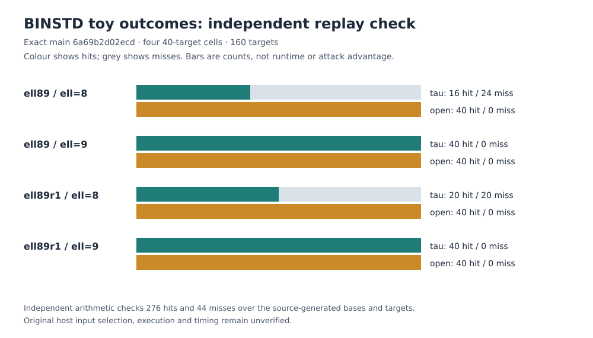

# BINSTD archived toy outcome and theorem-premise audit — 2026-10-26

**Scope.** At crypto-autoresearcher main
`6a69b2d02ecd53f1649bcf56e23e4ffe91d953ad`, this read-only check tests
four existing BINSTD `n=17`, `ell=8/9` Stage-1 replay receipts. Their archived
source pin is `4647b1d072ffaebbbb85127bdc60343bbd372ec4`. It adds no new
scientific run or performance measurement and does not change a hypothesis,
finding or archive record.

## Sources and method

The [historical coverage problem](../../problems/historical-experiment-lean-and-execution-coverage.md)
selects `EXP-BINSTD-8bdf86` as the first end-to-end claim row. I read its
frozen experiment specification, the four [sheriff per-target replay
receipts](../sheriff/SHF-20261024-46b7da/scripts), the
[`YieldCeiling.lean`](../../formal/CryptoResearch/Binstd/YieldCeiling.lean)
and [`Factorization.lean`](../../formal/CryptoResearch/Binstd/Factorization.lean)
sources and their target specs, and [SEC 1 v2 §2.2.2](https://www.secg.org/sec1-v2.pdf)
for the characteristic-two curve and addition law. SEC 1's curve model is
`y² + xy = x³ + ax² + b`; here `a=0`, `b=1`.

Run `python3 research/binstd_end_to_end_20261026/check.py` from this exact
main checkout. The [checker](check.py) rehashes the six source and archive
paths named by each per-target receipt, retrieving runner and field source
bytes from the run receipt's historical authority commit and archived data
from the pinned main commit. It separately checks receipt-to-raw-result and
raw-result-to-yield-matrix digest bindings. It validates every target and
reported triple witness on the curve using interleaved binary-field
multiplication and polynomial-Euclid inversion, separately implemented from
the archived worker. It rejects a deliberately negated, still-on-curve witness
point. For the later source-bound replay, the checker loads only the archived
seeded input generator at each run's recorded authority commit. It matches all
160 generated targets to the frozen per-target receipt, reconstructs the four
tau/open factor bases, and independently computes every ordered base-pair sum
and every target-minus-base-point membership test with its separate field and
curve arithmetic. It checks factor-base membership of each positive witness,
all 276 hit flags, all 44 miss flags, and the four archived pair-sum
cardinalities. A deliberately flipped false-hit flag is rejected in each of
the two cells that contains a miss. The complete machine-readable output is
[evidence.json](evidence.json).

The checker also trials every monic divisor through half degree: 510 for
`t^17+t^3+1` and 30 for each archived degree-eight factor. This finite
calculation verifies irreducibility of those three integer-encoded
polynomials under the checker, the exact `X^17+1` product, and the listed
subset-sum dimensions `0,1,8,9,16,17`. It is **not a Lean theorem** about
factor irreducibility or a bridge from the actual field Frobenius to the
normal-basis cyclic module.

The companion [Lean encoded-divisor certificate](../../formal/CryptoResearch/Binstd/EncodedDivisors.lean)
now proves, by kernel-checked `decide`, that the exact masks `131081`, `313`
and `471` survive the 510, 30 and 30 monic bitmask divisor trials defined in
that file. Direct compilation with the pinned Lean 4.35.0-rc1 toolchain
passed; `#print axioms` found only `propext`, which the workspace permits.
The [direct Lean validation receipt](lean-encoded-divisors-validation.json)
binds the source and evidence SHA-256 values, exact command, exit status and
per-theorem axiom output.
This certifies the finite *encoded* computation. It does not prove that the
XOR reduction implements Euclidean remainder in `(ZMod 2)[X]` or connect the
masks to the polynomial declarations in `Factorization.lean`.

## Observations

| Archived cell | Tau hits / misses | Open hits / misses | Independently checked triple witnesses |
| --- | ---: | ---: | ---: |
| ell89 / ell=8 | 16 / 24 | 40 / 0 | 56 |
| ell89 / ell=9 | 40 / 0 | 40 / 0 | 80 |
| ell89r1 / ell=8 | 20 / 20 | 40 / 0 | 60 |
| ell89r1 / ell=9 | 40 / 0 | 40 / 0 | 80 |

All 160 target coordinates pass the curve equation and match the source-bound
seeded generator. All 276 reported hit triples sum to their target and belong
to the corresponding reconstructed factor base. The independent exhaustive
pair-sum oracle finds exactly the archived 276 hits and 44 misses. Each cell's
observed count matches its archived yield matrix; the on-curve mutation is
rejected in each cell, and a false-hit mutation is rejected where applicable. Every cell
satisfies the **premises** `targets > 0`, `openHits = targets`, and
`tauHits ≤ targets` of
`CryptoResearch.Binstd.YieldCeiling.saturated_open_below_band`. Thus the
conditional arithmetic inequality `4*tauHits < 5*openHits` follows for the
four receipt count pairs. The [graph](hits.svg) plots checked hit and miss
counts, not timing or attack advantage.

## Meaning and remaining checks

The independent checker validates **positive witnesses and negative outcomes**
for the exact factor bases and targets produced by the pinned historical input
generator. Its curve arithmetic and pair-sum search are separate from that
generator and the sheriff replay. This is an exhaustive finite check of the
later replay, not an independent reconstruction of the original host's input
selection or execution. No original per-target execution trace has been found
in these committed records. The source and artifact hashes bind archived
bytes, not the identity or timing of the original host process. The original
host's runtime and any large-field extrapolation remain unverified.

The Lean ceiling theorem is conditional on counts, and this audit checks its
four concrete premises against the later source-bound replay. It does not
turn the measured hit counts into Lean-certified observations. The separate
`x17_factorization` theorem checks the polynomial product; the new finite
trial-division theorem closes only its encoded Boolean statement. A general
remainder-correctness and bitmask-to-polynomial bridge is still needed before
calling either degree-eight polynomial Lean-proved irreducible. The actual
field-to-Frobenius model is also open. Current-head hosted proof checks cannot
run while GitHub reports an account payment/spending-limit block; no full
Lake workspace build is claimed here.

**Next discriminating check.** Obtain an original per-target trace or an
execution certificate for both archived runs and compare it to the now
independently checked later replay. Then formalize the degree-eight factor
irreducibility and the normal-basis/Frobenius model bridge in Lean, with a
current-head build, axiom audit, and independent theorem-meaning review.
Until then, the empirical and model-bridge rows remain open in the
[historical coverage problem](../../problems/historical-experiment-lean-and-execution-coverage.md).

This report is accompanied by [report.pdf](report.pdf), rendered from
[report.typ](report.typ). The report graph was refreshed to show the checked
misses. No canonical performance dashboard metric changes: the audited hit
counts match the already archived counts, and this audit adds no new
measurement or accepted claim.
