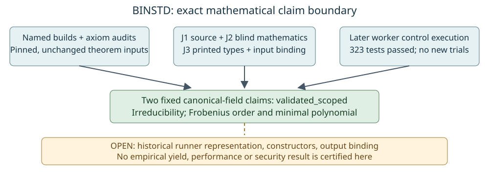

# BINSTD elaborated-type supplement

**Technical outcome, 2026-10-28: `validated_scoped` for the two fixed mathematical declarations below, under ordinary Lean/Lake trust.** The separately printed type requirement is now supplied and independently reviewed. This supplement composes the original machine and blind-review evidence with the new J3 review; the earlier inconclusive report and all failed checks remain unchanged. It makes no scientific-status transition and does not validate the archived runner or its yields.

| Fixed claim | Machine evidence | Independent fidelity |
| --- | --- | --- |
| Polynomials with binary masks 313 and 471 are irreducible in `(ZMod 2)[X]` | Exact named build and transitive axiom audit | J1 source review, J2 blind mathematics, J3 printed-type/binding review |
| Frobenius on canonical `GaloisField 2 17` has order 17 and minimal polynomial equal to the factors encoded by 3, 313 and 471 | Exact named build and transitive axiom audit | The same three independent joints, limited to the canonical field |

## Observation and binding

The original hosted run [40591043322](https://github.com/isogeny-labs/crypto-autoresearcher/actions/runs/40591043322) passed all 89 named targets and its kernel controls. The supplemental run [40636717165](https://github.com/isogeny-labs/crypto-autoresearcher/actions/runs/40636717165) supplies successful named receipts and printed types for these two unchanged targets, but failed overall: 88 verified and one nested-toolchain infrastructure failure. Its separate control job failed during setup and skipped tests. Those failures are retained as failures.

[J3's sealed report](reports/TASK-20261028-68ff01/report.md) independently matched all four receipt digests, the unchanged 65-entry workspace maps, the ten-entry verifier maps, the regenerated 49-module root, and the artifact ZIP digest. The sole verifier-map change is the worker, which adds invocation-local common build/audit reuse as well as type/axiom output. J3 inspected all those changes and separately bound the batch entry point and CI paths omitted from the ten-file map. No concrete stale-success path was found for the frozen inputs. This is a scoped source review, not an adversarial toolchain-authentication claim.

The type printouts are closed fixed declarations with the named factors and canonical field; both named axiom lists are exactly `propext`, `Classical.choice`, and `Quot.sound`. The pretty printer leaves definitions folded, so the review also checked the pinned definitions and archived factor encodings. The exact sources, receipts, hashes and limits are in [inputs.json](inputs.json) and J3's [binding-check.json](reports/TASK-20261028-68ff01/binding-check.json).

## Later runtime-control observation

After J3 sealed, the Coordinator collected an already completed [kernel-control job on PR2662](https://github.com/isogeny-labs/crypto-autoresearcher/actions/runs/40719320437/job/122925704081): real Lean4.22 was required, and pytest reported **323 passed, zero failures**. The worker, session tests and other five control-suite sources are compared byte-for-byte with the supplemental producer in [repair-kernel-controls.json](machine/repair-kernel-controls.json). Only the version-probe regression-test file differs among those listed tests. The full log is retained with its digest.

This supplies later execution evidence for the unchanged cache worker and its controls; it does not alter the older skipped-control record, certify every verifier revision, or replace the Lean4.35 named mathematics checks. J3's sealed report correctly records what was available within its own frozen inputs. The current full-workspace job and PR merge gates remain separate delivery obligations.

## Independence and procedure

The original prospective plan retains J1 and J2, including J2's false controls `X^8+1` and `GF(2)`. The [prospective addendum](../binstd_formal_review_round2_20261027/elaborated-type-addendum-20261028.yaml), pushed at `dee666eb7d9d77f0bd922a7011b735d2401d93ce` before dispatch, adds exactly J3. J3 read no sibling report, coordinator synthesis or PR discussion and makes no blind-derivation claim.

The stock checker passes the three reports after applying the already archived hash-bound serialization projection to J2: [composed result](machine/independence-composed-materialized.txt). The raw J2 YAML still fails schema discovery; [that failure](machine/independence-raw-materialized.txt) and the initial missing-sparse-module errors are preserved. The projection neither changes J2's verdict nor drops its original read objects. The checker verifies declarations, not session isolation itself.

All three J3 content hashes passed its seal. Its report discloses a short Conductor lease lapse, subsequent reclaim, default CLI route metadata discrepancy, requested independent xhigh dispatch and unverified served-model identity. The Coordinator later found that CLI `release` records `cancelled`; this was the root's own release operation, not an owner cancellation. T749 published the immutable inputs; T753 reserves this separate archive/composition step under archival task `TASK-20261028-6fe548`. Original handoffs, plans and seals were not edited.

## Limits and next work

No installed-dependency cleanliness audit or independent kernel rechecker was performed. Ordinary Lean/Lake dependency and binary trust remains. These claims have no open mathematical hypotheses, but their correspondence to the historical implementation still needs separate bridges: bit encoding and quotient-field construction; multiplication/reduction/squaring refinement; canonical-field/Frobenius conjugacy; matrix and polynomial evaluation; full invariant-subspace classification; nullspace/rank/constructor refinement including dimension zero; and exact archived-output binding. No yield, speed, security or attack-cost claim follows from this supplement.

The original BINSTD scope diagram, historical run graphs and dashboard performance values were checked for affected scope. None changes numerically: the new diagram documents proof evidence and outstanding implementation bridges. No benchmark or experiment was run. Complete source/current-head CI and delivery checks before merging; keep broader scientific and implementation obligations open.

Primary documentation checked: [Lean proof validation](https://lean-lang.org/doc/reference/latest/ValidatingProofs/) and [transitive axiom dependencies](https://lean-lang.org/doc/reference/latest/Axioms/). They inform the separate treatment of statement correspondence, axiom checks and toolchain trust. Exact pinned Mathlib sources are linked in J3's report.
