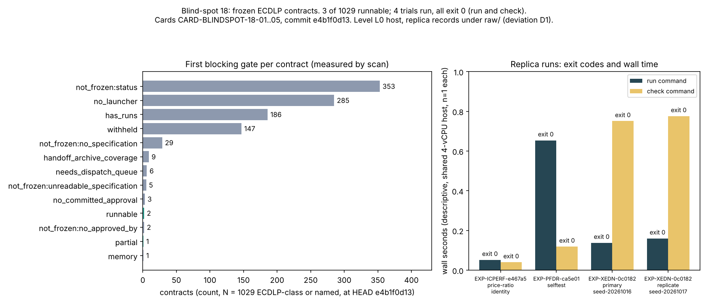

# Blind-spot 18: execute the frozen ECDLP contracts

## Verdict

**Table complete, no level. Stated as INCONCLUSIVE at no level only in the sense that no method is compared and nothing improves; the protocol's own INCONCLUSIVE trigger (a runnable contract that produced no run record) did not fire.** No ADVANCES, TRADES, MATCHES or REGRESSES applies: the item compares no method against an incumbent, so there is no gap to matched rho to report and no cross-method row to price at 0, 0.1 and 1 GAE (AGENTS.md section 5a does not engage). It is not an improvement over the index-calculus baseline and is not reported as one.

- Of 1029 ECDLP-class or review-named contracts at HEAD `e4b1f0d13`, **3 are runnable** (`EXP-ICPERF-e467a5`, `EXP-XEDN-0c0182`, and `EXP-PFDR-ca5e01` as `partial`). The other 1026 are **BLOCKED**, level none, each with its first failing gate in `table.md`.
- The 4 runnable trials were run exactly as frozen (cards 02 to 05). All 4 run commands and all 4 check commands exited 0. Every one wrote its declared artifacts. These are replica run records under `raw/runs/`, not official records (deviation D1).
- Nothing here says any contract's hypothesis is supported or refuted. The Coordinator alone adopts the replica directories.

## Method

Frozen before any measured run (`PROTOCOL.md`, commits `46b537894`, `871192fd8`; instrument `b03758ee4`; cards `e4b1f0d13`). Card-01 built a std-only Rust instrument (`instrument/blindspots_18_contracts.rs`, rustc, `prlimit --as=4 GB`), ran its 68-control selftest, scanned the live tree through gates G1 to G9, and emitted cards. Cards 02 to 05 ran the plan `argv` and `check_argv` of each runnable trial with `{run_dir}` replaced and a `prlimit --as=<memory_mb>` prefix, one thread, `PYTHONHASHSEED=0`. The assess stage rebuilt the binary with the card-01 rustc line, ran `table --scan raw/scan --receipts raw --out table.md`, then deleted it.

Read from disk by the assess stage (not from the executor text): all four receipts (every recorded output digest re-hashed, 0 mismatches over 13 files; the card-01 binary is absent by design), `raw/scan/summary.json`, each run directory, and a byte diff of `raw/emitted-cards/card-02..05.yaml` against the committed cards (identical).

## Numbers (counted, n = 1 run per trial, no intervals apply)

Scan at HEAD `e4b1f0d13` (measured, 12.07 s of one core): 2742 contract directories; 2195 without a run; 731 approved zero-run in ECC areas; 19 ECDLP-class or named with a plan; 13 past G7. By scope: ecdlp 1024, named 5, other_ecc 368 (counted only, never run), non_ecc 1345.

First blocking gate over the 1029 ECDLP-class or named rows: not_frozen:status 353, no_launcher 285, has_runs 186, withheld 147 (DEC-20261005-138b51 and DEC-20261005-98a823 and later), not_frozen:no_specification 29, handoff_archive_coverage 9, needs_dispatch_queue 6, not_frozen:unreadable_specification 5, no_committed_approval 3, not_frozen:no_approved_by 2, runnable 2, partial 1, memory 1 (`EXP-SEMBIN-d9767f`: all six trials fail memory 6144 MB and watchdog 36000 s to 50400 s).

Runs (recorded exit run/check, wall seconds run/check):
- `RUN-ICPERF-943efa`, `EXP-ICPERF-e467a5` trial `price-ratio-identity`: 0/0, 0.052/0.040 s. Records an integer price ratio 925/4 on three toy cells, `ratios_agree` true, `all_match_bsgs` true. Its own claim boundary: not a measurement of the n=83 Bernstein-Lange arm.
- `RUN-PFDR-936605`, `EXP-PFDR-ca5e01` trial `selftest`: 0/0, 0.654/0.119 s. "selftest PASS (45 kernel-vs-brute checks + plant_internal)", `CHECK OK selftest`, manifest status `completed_valid`. The other five PFDR trials fail G9 (watchdogs 3600 s to 43200 s, or a dependency) and were not run.
- `RUN-XEDN-132272`, `EXP-XEDN-0c0182` trial `primary-seed-20261016`: 0/0, 0.138/0.751 s. Checker: "VALID: 5 primes, 32 pairs, 732 accepted cells re-derived". `f1_violations_total` 0.
- `RUN-XEDN-f4d646`, same contract, trial `replicate-seed-20261017`: 0/0, 0.160/0.776 s, same checker line.

XEDN replicate comparison (computed here by a field-by-field read of the two `raw-result.json`): `accepted_by_arm`, `pairs`, `per_prime`, `historical_control`, `f1_violations_total` and every field except `run_id`, `trial_id`, `seed`, `elapsed_seconds` and `supplementary_manifest_proposal` are identical; 85 leaf values differ, all in those fields. The protocol text calls the second trial a determinism replicate, but the seeds differ (20261016 vs 20261017), so what is shown is that the seed affects only the supplementary manifest proposal, not the 732 accepted cells. It is not a same-seed determinism check.

Frozen-contract blockers and what would unblock them: the 9 `handoff_archive_coverage` contracts (`EXP-ECDLP-20ac31`, `-3c166b`, `-5f4f14`, `-903c48`, `-bfbe6f`, `-f34097`; `EXP-OAKLEY-2c0552`, `-4276c4`, `-7f73ef`) each lack 8 supervisor-written paths in the queue task, so a superseding queue listing every supervisor file is needed (`problems/ready-plans-lack-supervisor-archive-coverage.md`). The 6 `needs_dispatch_queue` contracts (`EXP-ECDLP-daee4d` binding_mismatch; `EXP-ECTD-07b200`, `-97777a`, `-cb23c5`, `EXP-FROB-ad6a6d`, `-c3bc90` queue_schema) need a valid dispatch queue. `no_committed_approval` (`EXP-FROB-5e15ed`, `EXP-IC-002`, `EXP-SEMBIN-4fa22c`) needs a Coordinator decision, which this item does not grant. `no_launcher` (285) needs an implementation, which running cannot supply.

## Controls

- Instrument negative and positive controls: `selftest` 68 controls, 0 failed (`raw/selftest.jsonl`), including one fixture per gate reason and the all-pass fixture classified runnable.
- Replica fidelity: committed cards 02 to 05 are byte-identical to the live-derived `raw/emitted-cards/`.
- Anchors: 5 of 6 matched. **`anchors_ok` is false**: `EXP-IC-002` is `no_committed_approval`, not the predicted `no_launcher` (documented in PROTOCOL.md before freezing; the anchor was left as frozen).
- Contract-level controls are the contracts' own checkers; their exit codes are recorded, not interpreted beyond the quoted lines.

## Deviations and findings that carry

- D1 (direct execution, no claim, no supervisor receipt, no non-empty-artifact or manifest schema check), D2 to D10 as listed in PROTOCOL.md.
- D4 did not bite: no trial approached the 220 s cap (largest command 0.776 s).
- D8: the selector helper `off_main_runs` passes pathspec `experiments/*/runs`, which git does not expand to files below it, so it can never report a run on another branch. The instrument used `experiments/*/runs/*`.
- **Relay checks.** Card 03, 04, 05: `check-relay` verbatim, no missing lines. **Card 02: `check-relay` reports `relay_verbatim: false`**, two output lines "missing". Cause, tested on a scratch copy and not repaired in the saved file: the executor listed the three outputs in a different order from the receipt (RESULTS.md sorts first); with the order swapped the check passes. The digests in the executor text equal the receipt and the disk files. **Card 01: `check-relay` could not run**: `task_card.py` lint now fails on card-01 ("commands[2].argv: names repository file .../raw/selftest.jsonl that binds does not pin"), because the selftest `--out` file exists on disk after the run and is not bound. Lint passed before the run; the card has a latent defect (an output path also named in argv), and its relay was verified instead from the receipt, the output digests and the stdout of each command.
- Design-time reading vs instrument: 2186 vs 2195 zero-run contracts, 724 vs 731 approved zero-run in ECC areas; the 29, 19, 13 plan counts and the 13/9/4 ready-split agree. The differences are reported, not reconciled.
- The instrument's YAML reader rejects 10 specifications and 4 decisions as unreadable where the selector skips them silently; 5 ECDLP-class contracts are `not_frozen:unreadable_specification`.

## Caveats

- Host: shared 4-vCPU container, isolation level L0. Wall seconds are descriptive, one sample each, and carry no interval; no performance claim is made and nothing is copied to `benchmarks/`.
- Toy scale: the ICPERF identity is on three toy price cells; PFDR `selftest` checks a kernel against brute force; XEDN counts accepted cells on 5 primes up to 83 (curve over p=353). None says anything about a deployed curve or the n=83 arm.
- G7/G8 are a partial re-implementation of the dispatcher (D6): a contract G7 passes could still be refused.
- The run directories are replica records; the supervisor path was not taken, and `stdout.log`/`stderr.log` are empty for three of four runs.

## Files

`PROTOCOL.md`, `card-01.yaml` to `card-05.yaml`, `instrument/`, `table.md` (1029 rows: contract, scope, runnable, run id, exit, reason), `raw/` (`scan/`, `selftest.jsonl`, `emitted-cards/`, `runs/`, `receipt-card-0N.json`, `relay-N.txt`), `report/graph.svg`, `report/graph.png`, `report/graph-data.json`, `report/make_graph.py`, `REPORT.pdf`.

