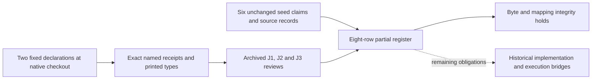

# T-794 independent register mapping and custody review

**Joint verdict: holds for additive claim-to-evidence mapping and scope preservation at `d316dffae04f9b50131c31d50a005cf7daca1061`.** No blocking defect was found in the two new mappings. This verdict concerns the register revision only. It issues no new mathematical or scientific verdict, authenticates no fresh native execution, and establishes no complete historical coverage.

The reviewed matrix SHA-256 is `85b51eee70a44ae62b148cc89a2955ef4a96b4beffb178cb75fe635b8cf6188e`. The prospective plan is `research/historical-claim-evidence-binstd-20261029/review-plan.json` at the same commit. The reviewer is the separate `/root/binstd_register_mapping_review` session, operating under requested policy `review-adversarial`. The review is explicitly source informed. The three prior sealed BINSTD reports are authorized evidence; no active sibling review, history traversal, or memory lookup was used.

## Preservation and bounded integrity

An independently written Python/Git check compared the six-row seed with the successor and checked every cited source through its exact repository, commit and path. The seed at the reviewed commit is byte-identical to the builder's seed at archive `e3fe39bed74e607855a3f6fa238ab5144b2bf232`. All six original claim objects and all 16 original source records remain structurally identical and in their original order. This includes the explicit unavailable known-label type record and each original open obligation. The seed itself was not replaced.

All 32 available source blobs match both their recorded Git blob IDs and SHA-256 digests. Their total is 602,399 bytes. All eight excerpts match the exact selected source lines and their digests. The exact immutable `tools/claim_evidence_matrix.py` was loaded in memory and its result reproduced the retained `integrity.json` in full, including the matrix digest. The source reader remained offline and bounded; no archived source file was executed other than this previously inspected integrity checker.

One initial attempt timed out during the existing crypto cover-assessment `git rev-parse`. It produced no passing result. `attempt-1-failure.json` retains the command and failure. The unchanged check was retried successfully with the same timeout. This was not treated as a source mismatch and no gate was weakened.

## Exact new row bindings

| Register row | Exact declaration | Confirmed scope |
| --- | --- | --- |
| `binstd/degree-eight-irreducibility` | `CryptoResearch.Binstd.factor8_irreducible_pair` | The fixed `factor8a` and `factor8b` over `ZMod 2` are irreducible. Their pinned supports encode masks 313 and 471. |
| `binstd/canonical-frobenius` | `CryptoResearch.Binstd.canonicalFrobenius_order_and_minpoly` | The algebra Frobenius on `CanonicalField17 := GaloisField 2 17` has composition order 17; its underlying linear map has minimal polynomial `factor1 * factor8a * factor8b`. |

The excerpt lines name these exact conjunctions. The pinned factor definitions are `X + 1`, `X^8 + X^5 + X^4 + X^3 + 1`, and `X^8 + X^7 + X^6 + X^4 + X^2 + X + 1`. The printed types preserve the same constants, coefficient field, canonical field and linear-map distinction. Neither new statement generalizes the field degree or changes a minimal polynomial of a linear map into one of a field element. No historical implementation parameter is silently supplied by either type.

Both theorem sources are pinned to the receipt checkout `8ef2a271eb45801d12b431e85165b378d3f5176b`, rather than to the later archive commit. Their SHA-256 values are respectively `72b87c818040a994930fadfc7d1a998c31c80fa638038f0622b42f3a5fe2479d` and `58b9c05f32d38c7f678bb22523804fbbf06f1536f6fac37641adbe5ca45ef24b`. Each equals its native receipt's theorem digest.

For both receipts I checked task/result identity, theorem name and file, native checkout, successful named build/audit flags, empty forbidden-construct list, absent blocking reason and absent target infrastructure failure. The separately registered type file is byte-identical to that receipt's `audit_log`, not a copied source signature. Each prints the named type and exactly `propext`, `Classical.choice`, and `Quot.sound`. The pinned toolchain is Lean 4.35.0-rc1, and the manifest pins Mathlib to `7fa22735254ddf7e11f119250a9f2d0352bc7c3a` plus its eight other listed dependencies. Toolchain and manifest digests match both receipts.

I independently compared the six source entries available in this register against each receipt's workspace map: both theorem files, `Factorization.lean`, `lean-toolchain`, `lake-manifest.json`, and `lakefile.toml`. Both complete recorded workspace maps are equal to one another and contain 65 entries; both recorded verifier maps are equal and contain ten entries. I did not reread the other workspace/verifier source paths because they are outside this task's source allowlist. Their full prior reconciliation remains evidence from J1/J3, not a new complete source audit in this report.

The supplemental `inputs.json` binds the exact new receipt digests and checkout. Native receipt `semantic_review` fields remain pending historical machine metadata; the separate archived source, blind-mathematics and printed-type reviews supply the scoped review evidence. No native receipt was rewritten to import a later review verdict.

## Review roles and historical failures

The registered reviews have distinct relevant roles. J1 holds for source/verifier correspondence and explicitly retains its then-missing printed-type obligation. J2 holds for its supplied fixed mathematical claims, records false controls for `X^8+1` and `GF(2)`, and leaves the runner representation bridge unverified. J3 holds for printed-type and binding correspondence, explicitly records the failed overall supplemental run, and makes no blind-derivation claim. The supplemental synthesis records the combined `validated_scoped` outcome for the two fixed mathematical declarations. The new register carries that existing outcome as evidence; it does not create another independent proof or status transition.

The distinction between named targets and whole-run status is preserved in both new rows' assumptions, the README, report source, supplemental input record, and existing sealed reviews. Run 40636717165 had two successful named BINSTD targets while the overall run failed with one nested-toolchain infrastructure failure; its original kernel-control job failed during setup and skipped tests. The later controls are explicitly a separate observation on run 40719320437: 323 passing controls on Lean 4.22.0. Their recorded worker digest equals the worker entry in both new receipts. They support the instrument behavior within the archived comparison; they do not replace Lean 4.35.0-rc1 named checks or change the older failed/skipped record. The raw hosted logs and their authenticity were not freshly retrieved in this offline review.

## Independent controls and limits of the reader

The bounded controls retained in `checks.json` reject a changed excerpt, a changed source digest, and a false complete-coverage flag. A deliberately swapped native receipt still passes the generic integrity reader, as its documented contract permits; the independent declaration/file/receipt binding check rejects it. An unsupported statement asserting all historical execution and timing also passes the generic reader, whose stated role excludes semantic validity; source/type/scope review rejects that statement. These controls demonstrate why full evidence-role slots cannot supply a scientific verdict. They do not establish a new mathematical result or run any archived experiment.

The actual mappings pass the separate binding checks. The broad controls role correctly links instrument controls and the prior blind mathematical controls as distinct evidence. Reading their records does not constitute rerunning them.

## Remaining obligations and procedure

No mapping revision is required by this review. The following broader obligations remain open and prevent interpreting the packet as full historical validation:

- Bit encoding and quotient-field construction for the actual runner; multiplication, reduction and squaring refinement.
- Canonical-field/Frobenius conjugacy; matrix and polynomial evaluation; invariant-subspace classification; nullspace/rank/constructor refinement including dimension zero.
- Original historical execution, selected inputs, complete outputs and timing, plus the unchanged protocol/execution-review gaps on the reconstruction row.
- The original unavailable known-label elaborated types, original known-label integration-scope gap, and cover assessment's original underlying-evidence obligations.
- Complete historical claim inventory and denominator; installed-dependency cleanliness and any stronger independent kernel or binary rechecking.

The source/receipt agreement uses ordinary Lean/Lake dependency and binary trust and existing archived reviews. No fresh Lean verification, whole-workspace theorem audit, mathematical rederivation, proof of hosted execution authenticity, yield measurement, timing measurement, security claim, or attack-cost claim was performed. No scientific status changed.

The plan explicitly narrows the broader formal-review workflow: native rebuilds, network access, source edits and new experiments were prohibited. The reviewer therefore returns the requested report, attestation and bounded controls rather than claiming completion of a new formal review. The diagram above describes this joint; packet-level PDF rendering and archival composition remain with the Coordinator. The existing packet's report source and diagram were checked for the same scope boundary; no historical numerical graph was changed or revalidated here.

All writes stayed under the assigned review directory. No new capacity, installation, external job or cloud request was made; the $25/day cap and another owner's heavy slot were left in force. Exact served-model identity was not probed. `attestation.json`, `sources-read.json`, `checks.json`, the independent check source and `seal.sha256` bind this report and its stated limits.
