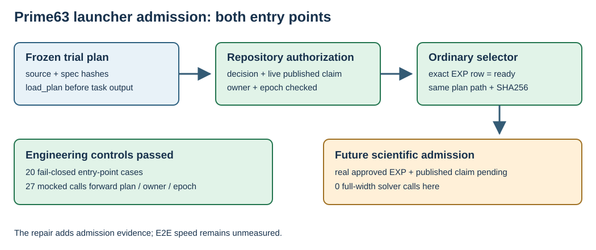

# Prime63 prospective admission repair

TASK-20261017-37ebda · GOAL-ICPERF-e6b6a4 · 2026-10-17

This report records engineering observations only. It changes no experiment
status and includes no full-width solver call. Exact file hashes, commands,
environment, and all control outcomes are in `input_manifest.json`,
`command.txt`, `environment.json`, `test-stdout.log`, `test-stderr.log`, and
`validation.json` beside this report.

## Repair

The new `execute.py` preserves the archived 27-cell schedule and the 300 s
per-call, 8 GiB sampled process-tree RSS, 8 GiB scratch, 64-model, and 4 h
panel guards. It does not change the archived 18-file launcher. Its frozen
source hash remains `8fb47e68209947d5d6a7490cafde5921c2b2156c10cf9d97b961f4e555598854`.

Both parent and child entry points now call
`experiment_execution.load_plan`, then `experiment_execution.authorize` with
the requested owner and epoch. They next require the exact experiment row
from `newest_experiments.newest_runnable(repo=root,
experiment_ids={experiment_id})`, the same selector core used by
`newest_experiments.py --experiment <ID> --json`. That row must be `ready` and
bind the same plan path and SHA256. The frozen plan must bind the new launcher,
manifest, public/witness inputs, independent verifier, backend, and archived
natural systems. Caller-supplied approval or ready strings are not accepted.

The parent checks these gates before creating its task scratch or run output.
The child independently checks them before reading a request, writing a
response, or entering the Sage worker. `authorize` itself renders the
dispatcher using a temporary directory and subprocess as part of the
repository admission API; those internal operations precede any task
scratch, output, or Sage process.

## Controls

The latest nine tests passed. Mocked failure injection covered ten refusal
conditions at both entry points: forged approval strings; wrong decision,
plan, specification, or source binding; `review_required` selector; absent or
expired published claim; and wrong owner or epoch. All 20 entry-point
refusals left no task scratch, run output, or worker spawn. Three plan/spec/
source errors stopped before `authorize`; five decision/claim errors stopped
before selector use. The real CLI rejected an unfrozen plan for both entry
points before output creation.

A mocked positive path forwarded the exact plan path, owner, and epoch through
all 27 worker commands. A bytewise canonical comparison showed the 27
scheduled requests match the frozen launcher. This positive path used mocked
authority: a real ready selector and published scientific executor claim do
not yet exist. An intermediate test attempt failed because its invalid-plan
fixture sat outside the checkout; the API correctly rejected that location.
The failure and later corrected pass remain in the raw stderr log.

## Boundary and next gate

The [recorded admission problem](../../problems/icperf-prime63-launcher-self-attested-approval.md)
remains open until the source snapshot and a future runnable approved
experiment provide a real published-claim positive test. The subsequent
scientific plan must pass `experiment_preapproval.py --packet` for its exact
frozen bytes, then the ordinary selector must report `ready` before dispatch.
Observed solving degree, natural relation yield, useful rank, linear algebra,
target discrete log, matched rho, and end-to-end speed delta remain
unmeasured.

