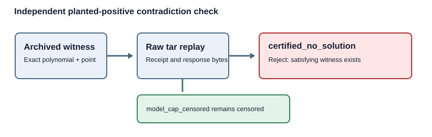

# Prime63 planted-positive contradiction guard

GOAL-ICPERF-e6b6a4 · 2026-10-17 · engineering control, no scientific trial

The archived producer marks a planted positive as `invalid_positive_control` if
its Sage response says `certified_no_solution`. It then stops the remaining
panel. The archived independent checker rejects that producer record because
the receipt and response statuses differ. However, a self-consistent raw
archive labeling the same planted cell `certified_no_solution` passed the
checker and was counted as censored. This is a checker acceptance defect at
the evidence boundary, even though the normal producer takes the safe path.

`guard.py` is an additive checker entry point. It first runs the archived
independent archive and full-point checker, then independently re-evaluates
each planted witness against its exact polynomial system, base membership,
signed lifts and target point. It replays the responses from the canonical
raw tar and raises on any planted `certified_no_solution` response. The
approved trial plan must hash-bind this file, the archived checker and its
inputs, and must use this file as its `check_argv` entry point. No archived
source bytes were changed.

The focused synthetic Git fixture uses a 101-element prime field and zero
Sage calls. Its deliberately self-consistent contradictory response passes
the archived checker as censored and is rejected by this guard. A model-cap
positive remains censored. The exact command in [command.txt](command.txt)
ran eight tests, including the inherited admission and raw-archive controls;
stdout and stderr are retained. The stderr contains an unrelated existing
`ResourceWarning` from `tools/validate_ledger.py`.

This control establishes the guard's behavior on the stated fixture. It does
not measure a full-width solve, degree of regularity, natural relation yield,
useful rank, target work, matched rho or a complete index-calculus runtime.
The scientific protocol remains `review_required` until the exact successor
source, trial plan, handoff, queue and preapproval packet are archived.

