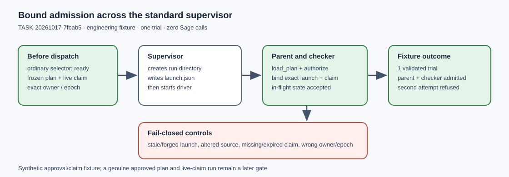

# Prime63 in-flight admission engineering record

TASK-20261017-7fbab5 · GOAL-ICPERF-e6b6a4 · 2026-10-17

This report records engineering observations only. It makes no experiment-status,
solver-performance, relation-yield, or end-to-end claim. The approved scientific
plan and a genuine live-claim positive run remain later work.

## Frozen scope and implementation

The committed [handoff](../../ledger/handoffs/TASK-20261017-7fbab5.yaml)
assigned a successor to the two archived launchers. `execute.py` retains the
exact 27-cell schedule: six planted public controls and 21 natural systems,
with coset, random and small-x arms over m=2 through 8. Its constants remain
300 seconds per cell, 8 GiB sampled process-tree RSS, 8 GiB scratch, a
64-model guard, and four hours for the panel. The archived original and prior
repair sources matched their recorded SHA256 values; neither was edited.

The successor calls `tools.experiment_execution.load_plan` and `authorize`
before both pre-dispatch and in-flight acceptance. Before dispatch it requires
the ordinary `newest_experiments` selector's exact `ready` row. After the
standard supervisor creates the one trial's run directory, it accepts the
otherwise `needs_reconciliation` state only when `launch.json` binds the exact
plan SHA256, trial and run IDs, commands containing a canonical plan path
(absolute or repository-relative), current
owner/epoch, live published claim, and current authorization. It rejects a
prior execution receipt, a stale launch, or any other coverage state.

`driver.py` is the future one-trial adapter. It writes canonical
`manifest.yaml`, `raw-result.json`, and a raw archive after admission.
`check.py` independently checks raw archive bytes, exact prime-field
polynomials, base membership, lifts, signs, full target-point sums, positive
controls, response counts, and run/plan/launch bindings. Bounded positive
controls remain explicitly censored; a claimed `ok` positive must contain
the planted witness. The checker replays cell bytes from `panel/raw.tar.gz`
and `panel/receipt.json` even after individual disk cell files are removed.
Its finite-field
and curve checks are Python implementations independent of the Sage solver.

## Engineering controls

The final command in [command.txt](command.txt) passed ten tests; full
stdout and stderr are retained beside this report. A disposable local Git
fixture used a one-trial plan, synthetic approved specification and claim,
a synthetic dispatcher transport, and the real
`experiment_execution.run_plan` supervisor. Its ordinary selector was `ready`
before launch. The supervisor then created `launch.json` and ran real Python
driver and checker subprocesses. Each subprocess accepted the exact bound
in-flight `needs_reconciliation` state. The supervisor validated one fixture
trial, and a second attempt was refused. The fixture started zero Sage
processes. Its synthetic approval and claim do not establish admission for a
future approved experiment.

Seven altered launch cases were refused: wrong plan hash, trial ID, run ID,
owner, epoch, command plan path, and stale start time. A repository-relative
plan path resolved to the exact frozen plan; a changed token was refused.
Changed source,
wrong live owner/epoch, missing or expired claim, pre-dispatch selector refusal,
and a prior receipt were also refused without additional task output.
A 101-element prime field control accepted one exact polynomial/full-point
root and rejected five altered objects: polynomial, base, target point, signs,
and rounded coordinate. A raw archive control rejected altered bytes and
passed tar-only replay. A well-formed model-cap positive remained censored,
while a forged `ok` response without the witness was rejected. The driver
emitted a schema-valid manifest in a mock panel without a solver call. The
27 scheduled requests and both archived launcher SHA256 values matched the
frozen versions.

An earlier `goal_lanes.py claim --publish` created the write-once claim but
could not acquire the shared Git index lock under the sandbox. The claim was
staged, committed, and pushed as `450209b3d2` under an approved escalation;
the live-ref dispatcher then reported this task as running. The final test
stderr also carries a `ResourceWarning` from the repository's
`validate_ledger.py` helper; all ten controls passed. These operational
events are recorded in `validation.json` and do not change the scientific
status of any experiment.

## Remaining gate

The [admission problem](../../problems/icperf-prime63-launcher-self-attested-approval.md)
remains open. The Coordinator must freeze and archive the new source, a
one-trial plan, complete dynamic raw-file custody, and an exact preapproval
packet. The packet's read-only probe must return `approvable: true`; after
approval, the ordinary selector must be `ready` before dispatch. A genuine
approved plan with a live published claim must then pass this same
supervisor-order control. The checker can replay the cell archive without
scratch files, but the future experiment handoff must declare the fixed
`panel/receipt.json`, `panel/raw.tar.gz`, top-level raw archive, manifest,
raw result, supervisor files, and their exact custody paths. This record
contains no full-width system solve or
measurement of degree of regularity, natural relation yield, useful rank,
linear algebra, target work, matched rho, or end-to-end runtime.

