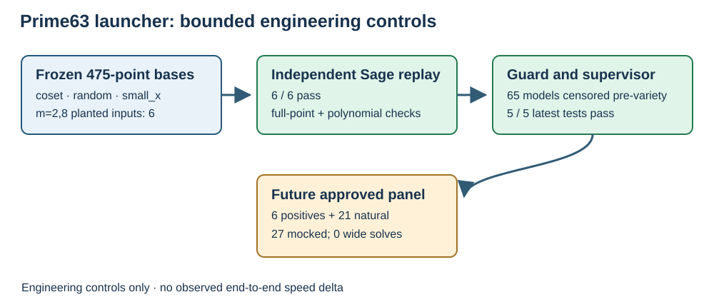

# Prime63 pilot launcher engineering record

TASK-20261017-4d8c00 · GOAL-ICPERF-e6b6a4 · 2026-10-17

This is an engineering observation, not a scientific trial or evidence review. The
source and input bindings are in `input_manifest.json`; exact commands, host
state, complete test attempts, and machine-readable outcomes are in
`command.txt`, `environment.json`, `test-stdout.log`, `test-stderr.log`, and
`engineering_validation.json`.

## Implemented

- Six deterministic SHA256 planted public systems: m=2 and m=8 for each of
  coset, random, and small_x. Every arm uses its frozen 475-point base in its
  original order. The public systems contain a full target point and sparse
  equations; signed selections and complete rejection streams live in the
  separate checker-only witness file. Coset uses quadratic_lift; the two
  controls use direct encoding.
- Independent Sage replay checked all six point sums, the complete selection
  and rejection stream, base membership, coset gates, all serialized polynomial
  zeros, and a modified-root rejection. It imports neither the input emitter
  nor the archived backend evaluator. Result: 6/6 pass.
- A pre-variety leading-ideal standard-monomial guard stops at 65. Its count
  bounds distinct roots by the quotient dimension when finite. The worker
  returned `model_cap_censored` with `variety_called=false` for a 65-distinct-
  root ideal and a repeated root of multiplicity 65 over GF(101). The latter
  is conservative censoring: it does not assert 65 distinct field roots. A
  64-standard-monomial control passed the count without censoring.
- The future panel has six positives followed by all 21 archived common-target
  systems, m=2..8 for each arm. One external process-tree supervisor applies
  300 s per cell, 8 GiB sampled RSS, 64 primary-model pre-variety bound, 4 h
  panel wall, 16 GiB start and 8 GiB continuing SSD free, and 8 GiB scratch.
  It records attempted and unattempted cells, command, hashes, UTC, CPU/wall,
  sampled resources, stdout/stderr, and exact raw/tar coverage. An approved
  experiment packet and ready selector are required to invoke this future
  panel.
- The independent run checker requires a polynomial root, every equation
  zero, base/coset membership, x lifts, signed sum to the full target point,
  consistent declared root count, and exact raw/tar manifest bytes. Tests
  rejected modified roots, wrong signs, an x-only full-point mismatch,
  changed target, nonmember x, nonlifting coset x, a point-only object, a
  missing raw file, and an altered manifest.

## Bounded controls and resources

The latest five engineering tests passed. A mocked full schedule accounted
for 27 attempted and 0 unattempted cells; a deliberately failed first call
accounted for 1 attempted and 26 unattempted. The actual small-field Sage
worker returned two roots under the external supervisor. In the latest pass,
its measured wall was 11.982 s, sampled peak process-tree RSS 204,324,864
bytes, peak scratch 214,700 bytes, and minimum SSD free 540,807,798,784
bytes. A sleeping small process stopped and was reaped at 0.618 s with
`timeout_censored`. These
figures are engineering controls on this host, not full-width solver timings.

Two earlier test attempts failed during implementation. The first exposed a
timing-metadata parser mismatch, a univariate exponent representation, and a
macOS sandbox sysctl denial. The second exposed a mock cell path error and a
univariate Sage variety API mismatch. Their raw tracebacks remain in the
append-only test stderr log; subsequent passes are also retained. The final
small-field/supervisor pass is in that same log.

## Scope and next gate

No full-width planted ideal or archived natural system was solved here.
Observed solving degree, natural relation yield, useful rank, linear algebra,
target discrete log, matched rho, and end-to-end delta remain unmeasured. This
work makes a bounded launcher and falsifiable input controls available for a
later frozen EXP. A source snapshot, complete approved plan, positive replay,
preapproval result, and ready selector are still required before that trial.

The diagram below describes actual preparation and bounded engineering
controls. Its 21 archived systems are a future schedule, not measured solves.

