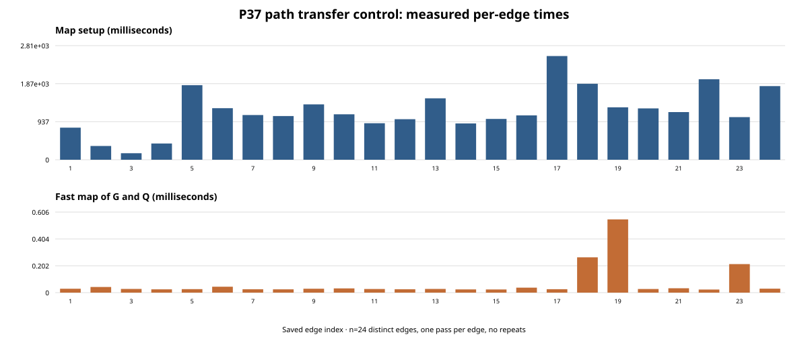
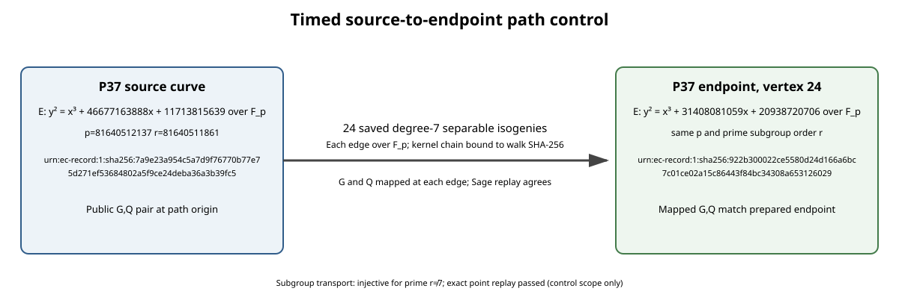

# P37 path-transfer adapter control

**Status: implementation-control observation only.** This report records a fixed-scalar P37 map-path control. It is not relation-yield, rank, or unknown-log data, and it does not authorize a graph-study trial.

## Question and scope

Does the new rootless path-transfer runner map the same public source generator and target through a saved P37 path to vertex 24, and can an independent Sage replay certify the endpoint pair? The control uses 24 of the 256 archived degree-7 edges. The scalar was fixed by the public control fixture and is not retained in output. No discovery, confirmation, collector, solver, or rho trial was run.

## Literature checked

Petit, Kosters, and Messeng, *Algebraic Approaches for the Elliptic Curve Discrete Logarithm Problem over Prime Fields* (PKC 2016), sections 3.3–3.4 and 4. The paper studies prime-field factor bases built from rational maps, including an auxiliary-curve/isogeny construction, and reports that its experiments are limited to small parameters and do not establish a practical advantage. This control measures only one path-transfer primitive needed for a later complete cost account; it does not implement or evaluate the paper's relation algorithm. [Primary paper](https://people.maths.ox.ac.uk/petit/files/16PKC_primeECDLP.pdf).

## Exact identities and map

- Source: EC1P37Cp37sourceh7a9e23a954c5; full UID `urn:ec-record:1:sha256:7a9e23a954c5a7d9f76770b77e75d271ef53684802a5f9ce24deba36a3b39fc5`; model `y^2=x^3+46677163888x+11713815639` over `F_p`, `p=81640512137`, subgroup order `r=81640511861`, generator `[2, 25752399999]`.
- Endpoint: EC1P37Cp37v0024h922b300022ce; full UID `urn:ec-record:1:sha256:922b300022ce5580d24d166a6bc7c01ce02a15c86443f84bc34308a653126029`; model `y^2=x^3+31408081059x+20938720706` over the same field, same prime subgroup order, endpoint generator `[19455745411, 46218661]`.
- Route: 24 saved degree-7 separable isogenies over `F_p`, each kernel polynomial in the archived walk. The full walk SHA-256 is `523686cad4acf24d6c54dc73e25c9527fcd6337912643053674ca5b87129d281`; the ordered kernel-chain SHA-256 is `a71ba84e6b95916bfc32c71a5e640a886e1f01dc235821b813d05bbeafa28604`.
- For prime `r != 7`, each degree-7 kernel has trivial intersection with the order-`r` subgroup, so each isogeny is injective on that subgroup. The test mapped source G and Q edge by edge; the final pair matched the endpoint manifest and an independent Sage implementation replayed all 24 point maps.

## Measured observations

One pass was recorded per distinct edge (`n=24`; no repeated path runs). The timed runner recorded edge setup, the fast map of both points, and a separate direct-Sage validation pass. The independent checker ran afterward.

| Quantity | Total | Per-edge median | Per-edge range |
|---|---:|---:|---:|
| Isogeny/map setup | 28.854436 s | 1.109505 s | 0.160616–2.554260 s |
| Fast map of G and Q | 0.001641 s | 0.000028 s | 0.000023–0.000550 s |
| Direct Sage validation inside runner | 8.440898 s | 0.316485 s | 0.044733–0.841402 s |
| Runner process wall, including Sage startup | 75.066430 s | — | one process |
| Independent checker process wall, including Sage startup | 48.246685 s | — | one process |

These timing components are measured on one host and one process execution. Per-edge values are heterogeneous edges, not replicate draws. The plot shows each recorded edge value without an uncertainty interval because no repeats were collected. The path setup total and point-map total are kept separate; neither is an ECDLP cost.

## Execution evidence

- Control record: `attempt-1/attempt.json`, status `completed`.
- Independent replay: `attempt-1/check.json`, status `pass`, 24 edges replayed.
- Source script hashes: runner `49f2454dbcdacce2d450a00aa9e62f592054415f453bb33a51297dbd1fdab227`, checker `aca4f46a181dda76c4c0cec8991f6fd104cdf6d910e17fd27919cbab28314742`, control driver `96540ca8c04b447673cfff5e57ee769c0cfb885dec30b6e09fb56e45fac5a2b4`.
- Raw map record: `attempt-1/transfer.json`; exact commands and fixture-root digests: `attempt-1/command.json`; stdout/stderr are retained beside them.
- Implementation environment: macOS-26.6-arm64-arm-64bit-Mach-O; Sage 10.10.rc0; source checkout `351c9c021c7be044ade54dc7e352b33d3a772244` with other graph-study implementation changes present.

## Limits and next check

This fixed-scalar implementation control exercises one P37 path prefix and does not measure relation yield, rank, discovery/confirmation behavior, or complete ECDLP cost. The direct Sage verification is a correctness check and is reported separately from the fast point-map phase. The experiment contract must bind the path-transfer outputs to each confirmed finalist, retain fresh stage roots, and then charge transfer/setup alongside relation collection, linear algebra, individual-log recovery, scalar verification, and matched same-point rho. The next protocol-level gate remains Coordinator admission; the current configured Coordinator backend is unavailable.
