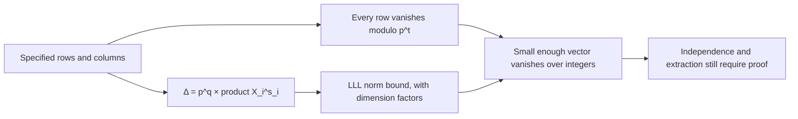

# Independent determinant review — TASK-20261024-da3810

Date: 2026-10-24. Reviewer session: `/root/smallroot_blind_review`.
Assigned archival task: `TASK-20261024-6c911a`.
Declared input branch: `research/joint-smallroot-reach-audit-20261024`.
Input snapshot: `32a2d2c246fe5a3e2f70481f703a795654424449`.

The independently derived modulus budget is **K = tN − q = ∑row k**, whereas the determinant contains **p^q**. For the specified full-box lattice the determinant-only equal-bound exponent is

```text
α_t = 2 ∑(j=0,...,t−1) (dj+1)^n / [n dt (dt+1)^n],
lim(t→∞) α_t = 2 / [n d (n+1)].
```

The fixed S3 fixture on its actual 13-monomial support has determinant
`101^12 * 2^33 = 9679353305462049028604227582164992`.
The exact arithmetic checks passed. These are independently established quantities for the assigned joint, not a verdict on an unseen implementation or a decomposition oracle.

## 1. Sources, blindness, and snapshot binding

The following are the only repository input files read. Each was read from the working tree and, for a byte comparison, from the specified commit with `git show <revision>:<path>`. All four comparisons were equal.

| Source | SHA-256 |
| --- | --- |
| `AGENTS.md` | `e1cfba0ea1772fef6dcd0265d38ba30bb17c226e2e24e8f51cc88a00db897944` |
| `agents/validator.md` | `33947db8c7cc8663ac79f1eff4b183e75d0546915feb23e77654cd03a249c9d2` |
| `ledger/handoffs/TASK-20261024-da3810.yaml` | `0bad7fb790be3bc2877e061906e1680e1c51f6043c75f58cdc1f811d6d2f7381` |
| `research/joint_smallroot_reach_20261024/blind-input.md` | `baad7c1a71febce74197ab7fd9831aeaa41e4059051c3144711c9318c7c7b579` |

The handoff disclosed a prior suspicion of an accounting discrepancy. It supplied no producer formula or numerical result. I did not read `tools/smallroot_reach.py`, `tools/joint_smallroot_reach.py`, any closure note, proposal, producer report/artifact, test, or sibling report. No literature was consulted. The mathematical arguments below are self-contained derivations from the blind statement, not claims supported by recalled literature.

There was one explicit procedural exception to the four-source boundary: higher-priority environment instructions required reading
`skill://plugin_connector_1p_c5b7d5df5d7081918f2c4be5a633ed5d/cloud-environment-runtime/SKILL.md`
and calling `mcp__codex_apps__cloud_environment_environment_status({})`.
Those sources concern runtime operation and contained no producer mathematics or research result. This exception is disclosed rather than counted as a perfectly literal four-source-only session. No scientific blindness breach occurred, and all `blind_from` restrictions were respected.

The parent dispatch supplied the branch, revision, authorization, and archival assignment. Local source identity against that commit was checked; remote publication and reachability were not independently audited. Repository documents referenced from AGENTS.md, workflow skills, feeds, and merge digests were not read, following the task's narrower blind input restriction. The graph below is embedded in this sole authorized output; no separate PDF or canonical graph edit was made.

## 2. Divisibility, determinant, and integer vanishing

Let L be the leading exponent vector of f. For each column exponent a, the assigned row is

```text
h_a(x) = p^(t−k_a) x^(a−k_a L) f(x)^k_a.
```

At any integer r with f(r) divisible by p, f(r)^k_a is divisible by p^k_a. Consequently every row evaluates to a multiple of **p^t**, and so does every integer linear combination g of the rows. The target divisor is uniform over rows; it is not p^q.

In increasing monomial order the row's diagonal coefficient is p^(t−k_a), because the leading coefficient of f is 1. Triangularity and distinct leading monomials therefore give, before and after column scaling,

```text
det(B_0) in absolute value = ∏row p^(t−k_a) = p^q,
Δ = |det(B_X)| = p^q ∏i X_i^s_i,
s_i = ∑(a in M) a_i,
q = ∑row (t−k_a).
```

These identities use the stated square triangular basis. They are not a formula for the covolume of an unspecified rectangular or dependent generator matrix.

Assume |r_i| ≤ X_i with X_i > 0. The scaled coefficient vector of g is the coefficient vector of g(X_1 x_1,...,X_n x_n). Cauchy–Schwarz gives

```text
|g(r)| ≤ ∑(a in M) |g_a| X^a ≤ sqrt(N) ||g(Xx)||_2.
```

Thus **||g(Xx)||_2 < p^t / sqrt(N)** is a sufficient integer-vanishing condition: g(r) is a multiple of p^t of absolute value less than p^t, so g(r)=0. The support size of a particular g can replace N for a sharper bound. The strict inequality matters.

For a basis reduced by LLL with δ=3/4, put C_N=2^((N−1)/4). Its first vector satisfies

```text
||b_1||_2 ≤ C_N Δ^(1/N).
```

For completeness, size reduction and the Lovász inequality imply that successive squared Gram–Schmidt lengths satisfy l_(i+1)^2 ≥ l_i^2/2. Multiplying gives Δ^2 ≥ ||b_1||^(2N) 2^(−N(N−1)/2), which is the stated bound. No LLL execution was performed in this review.

Writing A_N = sqrt(N) C_N, a rigorous sufficient condition for LLL to return one polynomial satisfying the integer-vanishing test is

```text
A_N [p^q ∏i X_i^s_i]^(1/N) < p^t,

equivalently:
∏i X_i^s_i < p^(tN−q) / A_N^N.
```

With X_i=p^β_i the same condition is

```text
∑i s_i β_i < (tN−q) − N log_p(A_N).
```

Discarding the dimension factors defines the usual determinant-level budget

```text
∑i s_i β_i < K,     K := tN−q = ∑row k_a.
```

This last condition is a determinant-level benchmark. It is not necessary for a useful short vector to exist, and failure does not prove failure of lattice methods or root finding. Without the norm factors it is not an unconditional finite-parameter LLL guarantee either. With those factors it is sufficient for one integer-vanishing polynomial, provided a modular root in the box exists. It does not guarantee several algebraically independent equations or actual root extraction. For fixed dimension, a strict exponent margin absorbs the fixed norm factors as p grows.



## 3. Specified full-box family

Here the leading exponent is L=(d,...,d), as required by the specified layers. Let

```text
M_k = [kd,td]^n ∩ Z^n,       0 ≤ k ≤ t,
M_(t+1) = empty,
A_k = |M_k| = [d(t−k)+1]^n,
c_k = |M_k minus M_(k+1)| = A_k−A_(k+1),
N = (dt+1)^n.
```

A row indexed by a in this layer has power k. The shift a−kL is nonnegative, and all terms remain inside M_0. Counting powers by telescoping, rather than counting the modulus power as usable budget, gives

```text
K = ∑(k=0,...,t) k c_k
  = ∑(k=1,...,t) A_k
  = ∑(j=0,...,t−1) (dj+1)^n,

q = tN−K.
```

The sum of a single coordinate over all columns is

```text
s_i = (dt+1)^(n−1) ∑(j=0,...,dt) j = dt N / 2,
S := ∑i s_i = n dt N / 2.
```

For equal bounds X_i=X=p^α, the determinant-only inequality is X^S < p^K. Hence

```text
α < α_t := K/S
          = 2 ∑(j=0,...,t−1) (dj+1)^n / [n dt (dt+1)^n].
```

Including the displayed LLL guarantee changes the right side to
α_t − (N/S) log_p(A_N). Since

```text
K = d^n t^(n+1)/(n+1) + O(t^n),
S = n d^(n+1) t^(n+1)/2 + O(t^n),
```

the formal limit of the determinant exponent is

```text
lim(t→∞) α_t = 2/[n d(n+1)].
```

This limit is not a guarantee obtained by increasing t at fixed p. The LLL correction is O(t^(n−1)/log p), with smaller norm terms, for fixed n,d. A joint limit must control that correction; for n>1, t^(n−1)=o(log p) is sufficient for it to vanish, and for n=1 p must still grow. No runtime, memory, or extraction claim follows from this normalization.

The required exact specializations are:

| n,d,t | N | q | K=tN−q | S | Determinant-only α_t |
| --- | ---: | ---: | ---: | ---: | ---: |
| 1,2,1 | 3 | 2 | 1 | 3 | 1/3 |
| 3,2,1 | 27 | 26 | 1 | 81 | 1/81 |

The same formula supplies the univariate control at all t:

```text
n=1,d=2: K=t^2, S=t(2t+1),
α_t=t/(2t+1) → 1/2.
```

For the three-variable quadratic box, summing odd cubes gives

```text
n=3,d=2: K=t^2(2t^2−1), S=3t(2t+1)^3,
α_t=t(2t^2−1)/[3(2t+1)^3] → 1/12.
```

As a diagnostic for the Coordinator's later comparison, using q/S in place of K/S would give 2/3 instead of 1/3 for the first finite control and 26/81 instead of 1/81 for the second. For n=3,d=2 its limiting value would be 1/4 instead of 1/12. I have not established whether any unseen calculator makes this substitution.

## 4. Exact S3 arithmetic fixture

Expanding the supplied polynomial at a=2,b=3 produces

```text
f = x^2 z^2 − 2xy z^2 + y^2 z^2
    − 2x^2 yz − 2xy^2 z − 4xz − 4yz − 12z
    + x^2 y^2 − 4xy + 4 − 12x − 12y.
```

The actual support has 13 monomials, not 27. Use increasing lexicographic order with x>y>z, whose leading monomial is x^2 y^2 with coefficient 1.

| Column exponent (x,y,z) | Coefficient in f | Scaled coefficient, X=2 |
| --- | ---: | ---: |
| (0,0,0) | 4 | 4 |
| (0,0,1) | −12 | −24 |
| (0,1,0) | −12 | −24 |
| (0,1,1) | −4 | −16 |
| (0,2,2) | 1 | 16 |
| (1,0,0) | −12 | −24 |
| (1,0,1) | −4 | −16 |
| (1,1,0) | −4 | −16 |
| (1,1,2) | −2 | −32 |
| (1,2,1) | −2 | −32 |
| (2,0,2) | 1 | 16 |
| (2,1,1) | −2 | −32 |
| (2,2,0) | 1 | 16 |

The 13×13 scaled matrix has its first 12 rows diagonal, representing 101 times the corresponding support monomial. Their diagonal entries are

```text
101, 202, 202, 404, 1616, 202, 404, 404, 1616, 1616, 1616, 1616.
```

The last row is the 13-entry scaled coefficient column of the table, transposed. This completely specifies the matrix, including every zero. It is lower triangular, with final diagonal entry 16. Direct fraction-free Bareiss elimination, independently of multiplying the diagonal, gave

```text
N=13, q=12, (s_x,s_y,s_z)=(11,11,11),
det(B_0) = 101^12 = 1126825030131969720661201,
det(B_X) = 101^12 * 2^33
         = 9679353305462049028604227582164992.
```

Thus K=1 and the sparse determinant-only equal-bound exponent is 1/33. At the stipulated X=2 the determinant-only test itself fails: Δ/101^13 = 2^33/101 = 8589934592/101 > 1. This is a failure of that sufficient-budget certificate at this fixture, not evidence that no useful vector, root, or other lattice exists.

To make the support convention explicit, I also padded the same fixed polynomial to every column of [0,2]^3, using f once at its actual leading pivot and 101 times each other column monomial. This is a deterministic arithmetic check on the same fixture, not a new scientific trial:

```text
N=27, q=26, (s_x,s_y,s_z)=(27,27,27),
det(B_0) = 101^26
         = 12952563149674059497286795495913738760889297603252601,
det(B_X) = 101^26 * 2^81
         = 31317376043659910319651924631222989562353041998652881204684610980512165527552.
```

Its determinant-only exponent is 1/81 and Δ/101^27=2^81/101>1. The two support choices explain the two different finite exponents. S3 does not contain the corner monomial x^2 y^2 z^2. The padded t=1 construction has the same counts as the full-box t=1 specialization, but that coincidence does not identify their higher-t families.

For the univariate finite control I additionally constructed the monic quadratic x^2+x−2 with the three full-box columns 1,x,x^2 at the same p,X. Its scaled matrix and direct determinant are

```text
[[101, 0, 0],
 [0, 202, 0],
 [-2, 2, 4]],

det = 81608 = 101^2 * 2^3.
```

The resulting determinant-only test is X^3<p, agreeing exactly with the derived t=1 exponent 1/3. This and the symbolic limit t/(2t+1)→1/2 form the finite and asymptotic univariate calibration. No roots were searched for, and no discrete logarithm was recovered.

## 5. Joint-system scope

Write F_1=S3(x1,x2,u), F_2=S3(x3,x4,v), and F_3=S3(u,v,xQ), with xQ fixed. A common modular root satisfies p | F_j for all three. Therefore a proposed row of the form

```text
p^(T−|k|) x^b F_1^k1 F_2^k2 F_3^k3,
|k|=k1+k2+k3 ≤ T,
```

evaluates to a multiple of p^T. If an explicitly specified square joint basis has distinct monic leading pivots, its determinant calculation is again

```text
q_joint = ∑row (T−|k|),
Δ_joint = p^q_joint ∏i X_i^s_i,
K_joint = TN−q_joint = ∑row |k|.
```

These are conditional identities, not a derived joint reach bound. The input supplies no joint row set, selected independent basis, rank, column support, or variable bounds from which N,q_joint,s_i can be evaluated. If generators are rectangular or have leading collisions, a full basis/covolume calculation is needed first.

One cannot multiply three single-equation exponents, count the shared modulus three times without the actual row multiplicities, or assume that u,v have the same small bounds as the four factor variables. Shared variables, distinct total multiplicities, and all six column scales must be accounted for together. Even a favorable joint determinant estimate supplies no guarantee of sufficiently many independent integer equations, a zero-dimensional extraction system, a root-extraction algorithm, or a successful decomposition oracle with stated probability and cost. Conversely, a negative certificate for this particular single-equation box family is not a no-go result for joint products or other lattices.

The next discriminating action is for the Coordinator to compare these exact formulas with the producer output for exactly matching rows and columns. A mismatch identifies an accounting or support-definition problem; agreement establishes only this determinant accounting. A proposed joint bound requires its concrete lattice and an additional independence/extraction argument.

## 6. Commands and recorded checks

Input reads used `cat` on the four paths in section 1. AGENTS.md was read repeatedly because initial combined output was truncated; a final complete read was obtained. Tool discovery used the environment-status tool's name/description and then its metadata call; neither exposed research content.

The initially submitted arithmetic command used `/usr/local/bin/python3 -I -` with the script below. It failed before Python execution with exit 127:

```text
/bin/bash: line 1: /usr/local/bin/python3: No such file or directory
```

The command `type -a python3 python3.12 python3.13 python` then identified the managed runtime. The successful command below ran with exit 0 under CPython **3.12.14**, in isolated mode, using only standard-library arithmetic and the four permitted input files. The image's /usr/bin interpreter was not used. This differs from AGENTS.md's environment-specific CPython 3.12.8 path and is recorded as an environment deviation; no harness or repository calculator was imported.

Exact command, run from `/workspace/crypto-autoresearcher`:

```bash
/opt/codex/runtimes/codex-primary-runtime/dependencies/python/bin/python3.12 -I - <<'PY'
from fractions import Fraction
from hashlib import sha256
from itertools import product
from pathlib import Path
import subprocess
import sys

revision = '32a2d2c246fe5a3e2f70481f703a795654424449'
paths = [
    'AGENTS.md',
    'agents/validator.md',
    'ledger/handoffs/TASK-20261024-da3810.yaml',
    'research/joint_smallroot_reach_20261024/blind-input.md',
]
print('python', sys.version.split()[0])
for path in paths:
    current = Path(path).read_bytes()
    frozen = subprocess.run(['git', 'show', revision + ':' + path], check=True,
                            capture_output=True).stdout
    assert current == frozen, path
    print('source_sha256', path, sha256(current).hexdigest(), 'matches_snapshot=True')

zero = (0, 0, 0)
one = {zero: 1}
x = {(1, 0, 0): 1}
y = {(0, 1, 0): 1}
z = {(0, 0, 1): 1}

def add(*polynomials):
    out = {}
    for polynomial in polynomials:
        for exponent, coefficient in polynomial.items():
            out[exponent] = out.get(exponent, 0) + coefficient
    return {e: c for e, c in out.items() if c}

def scale(polynomial, coefficient):
    return {e: c * coefficient for e, c in polynomial.items() if c * coefficient}

def mul(left, right):
    out = {}
    for e, c in left.items():
        for h, d in right.items():
            a = tuple(i + j for i, j in zip(e, h))
            out[a] = out.get(a, 0) + c * d
    return {e: c for e, c in out.items() if c}

def square(polynomial):
    return mul(polynomial, polynomial)

a, b, p, X = 2, 3, 101, 2
xy = mul(x, y)
x_plus_y = add(x, y)
f = add(
    mul(square(add(x, scale(y, -1))), square(z)),
    scale(mul(add(mul(x_plus_y, add(xy, scale(one, a))),
                  scale(one, 2 * b)), z), -2),
    square(add(xy, scale(one, -a))),
    scale(x_plus_y, -4 * b),
)

def bareiss(matrix):
    A = [row[:] for row in matrix]
    previous, sign = 1, 1
    for k in range(len(A) - 1):
        if A[k][k] == 0:
            swap = next(i for i in range(k + 1, len(A)) if A[i][k])
            A[k], A[swap] = A[swap], A[k]
            sign = -sign
        pivot = A[k][k]
        for i in range(k + 1, len(A)):
            for j in range(k + 1, len(A)):
                numerator = pivot * A[i][j] - A[i][k] * A[k][j]
                assert numerator % previous == 0
                A[i][j] = numerator // previous
            A[i][k] = 0
        previous = pivot
    return sign * A[-1][-1]

def fixture(name, columns):
    columns = sorted(columns)
    leading = max(f)
    assert f[leading] == 1
    assert set(f).issubset(columns)
    B0 = []
    B = []
    for row_exponent in columns:
        row = [f.get(e, 0) if row_exponent == leading
               else (p if e == row_exponent else 0) for e in columns]
        B0.append(row)
        B.append([c * X ** sum(e) for c, e in zip(row, columns)])
    N = len(columns)
    q = N - 1
    sums = tuple(sum(e[i] for e in columns) for i in range(3))
    determinant0 = bareiss(B0)
    determinant = bareiss(B)
    assert determinant0 == p ** q
    assert determinant == p ** q * X ** sum(sums)
    assert all(B[i][j] == 0 for i in range(N) for j in range(i + 1, N))
    print(name, 'N=', N, 'q=', q, 's=', sums,
          'alpha_det=', Fraction(N - q, sum(sums)))
    print(name, 'det_unscaled=', determinant0)
    print(name, 'det_scaled=', determinant)
    print(name, 'det_over_p_to_N=', Fraction(determinant, p ** N))
    print(name, 'determinant_only_HG_condition=', determinant < p ** N)
    if name == 'sparse':
        print('columns=', columns)
        print('scaled_rows=', B)

print('f_coefficients=', sorted(f.items()))
fixture('sparse', list(f))
fixture('padded_box', list(product(range(3), repeat=3)))

U = [[p, 0, 0], [0, p * X, 0], [-2, X, X ** 2]]
assert bareiss(U) == p ** 2 * X ** 3
print('univariate_t1_matrix=', U, 'det=', bareiss(U))
for n, d, t in [(1, 2, 1), (3, 2, 1)]:
    N = (t * d + 1) ** n
    K = sum((d * j + 1) ** n for j in range(t))
    q = t * N - K
    S = Fraction(n * t * d * N, 2)
    print('fullbox', (n, d, t), 'N=', N, 'K=', K, 'q=', q,
          'S=', S, 'alpha_det=', Fraction(K, S),
          'asymptotic=', Fraction(2, n * d * (n + 1)))
print('all_exact_checks_passed=True')
PY
```

The run printed the four source digests recorded above, with `matches_snapshot=True` for each; the polynomial coefficients and scaled matrix agreed with section 4. Its final control output was:

```text
univariate_t1_matrix= [[101, 0, 0], [0, 202, 0], [-2, 2, 4]] det= 81608
fullbox (1, 2, 1) N= 3 K= 1 q= 2 S= 3 alpha_det= 1/3 asymptotic= 1/2
fullbox (3, 2, 1) N= 27 K= 1 q= 26 S= 81 alpha_det= 1/81 asymptotic= 1/12
all_exact_checks_passed=True
```

Before creating this report, `test ! -e research/joint_smallroot_reach_20261024/independent-review.md` returned exit 0. The report is the only repository path written by this session. No scientific trial, LLL/root-extraction run, implementation comparison, commit, push, PR mutation, ledger mutation, or scientific-state change was performed. The report remains subject to the assigned archival task.

## 7. Attestation and limits

The exact formulas, finite counts, explicit matrices, and determinants above are established within the assigned joint. Compatibility of the historical instrument is **inconclusive in this blind session** because its implementation and results were deliberately not read. This is not a whole-claim or hypothesis verdict.

The handoff requests `review-breakthrough` at `max`, without fallback or degradation. This review used an independent agent session and did not invoke a substitute model. No repository inference-adapter probe was performed under the restricted input scope, so this report does not independently certify a serving-model identifier or backend-probe result.

```yaml
review_attestation:
  task_id: TASK-20261024-da3810
  reviewer_session: /root/smallroot_blind_review
  joints_owned:
    - Divisibility, determinant, finite-t budget, and asymptotic normalization.
  sources_read:
    - AGENTS.md
    - agents/validator.md
    - ledger/handoffs/TASK-20261024-da3810.yaml
    - research/joint_smallroot_reach_20261024/blind-input.md
    - skill://plugin_connector_1p_c5b7d5df5d7081918f2c4be5a633ed5d/cloud-environment-runtime/SKILL.md
    - "tool: mcp__codex_apps__cloud_environment_environment_status({})"
    - "parent dispatch for TASK-20261024-da3810: scope, revision, and archive assignment"
  source_snapshot: 32a2d2c246fe5a3e2f70481f703a795654424449
  permitted_repository_sources_match_snapshot: true
  read_sibling_reports: false
  blind_from_respected: true
  scientific_blindness_breaches: []
  independent_rederivation: true
  exact_fixture_check: passed
  mathematical_checks:
    divisibility: holds
    triangular_determinant: holds
    finite_budget: holds
    asymptotic_normalization: holds
    univariate_calibration: holds
    exact_S3_matrix: holds
  verdict: inconclusive
  verdict_scope: "Calculator compatibility is unassessed; independent mathematical quantities and exact fixture are established on the assigned joint."
  requested_inference:
    policy: review-breakthrough
    reasoning_effort: max
    fallback_allowed: false
    degraded_allowed: false
    independent_session_required: true
  model_probe_performed: false
  procedure_deviations:
    - "Required cloud runtime skill and status metadata were read outside the four repository inputs; no scientific producer content was exposed."
    - "The pinned /usr/local/bin/python3 path was absent; isolated managed CPython 3.12.14 was used for exact arithmetic."
    - "Only the authorized report was written; its diagram is embedded and no separate PDF was generated."
  scope_limitations:
    - "No producer implementation or numerical conclusion was inspected or compared."
    - "The asymptotic full-box exponent is a determinant normalization with dimension factors explicitly separated."
    - "The sparse S3 support and padded full box are distinct finite lattices."
    - "No joint-system lattice was specified, so no joint numerical bound is certified."
    - "A determinant certificate for one vanishing polynomial does not certify algebraic independence, root extraction, or a decomposition oracle."
    - "No independent backend/model probe or remote publication audit was performed."
  artifact_paths:
    - research/joint_smallroot_reach_20261024/independent-review.md
```
