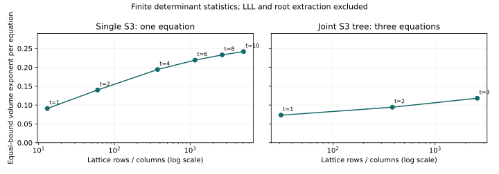

# Joint small-root finite accounting audit

This is a descriptive software audit, not an ECDLP experiment or a scientific
state transition. It records exact determinant arithmetic and finite candidate
constructions. No root-recovery or complete IC improvement is established.

## Objective and current execution status

Original objective: establish the reach-cost tradeoff of joint-system small-root
decomposition and demonstrate a verified improvement over the current prime-field
IC baseline. That objective remains incomplete. This audit implements the
accounting prerequisite. Optimized external shifts, higher-rank GAPs, root
extraction, random-target relation yield/rank, and matched full-pipeline
measurements have not been completed.

No EXP/RUN identifier is minted for software checks. Prepared independent blind
review TASK-20261024-da3810 was not dispatched: its required input publication
was refused by automatic approval review. No independent attestation exists.
TASK-20261024-6c911a owns local archival. No hypothesis, goal, or leaderboard
status is changed. The software diagnostics are not an official evidence record.

## Inputs, provenance and commands

- Historical source: main `dcfdd16cdf7783a059ca1e6e4cc5efbf77434b7b`.
- Candidate source snapshot: `fefa0dd26c24be4d34a5af7eb43253d67162fa84`; exact file hashes and dirty
  state are in [manifest.json](artifacts/manifest.json).
- Integer S3 coefficients a=2,b=3; joint xQ=5; coordinate order x1,x2,x3,x4,u,v.
- Exact determinant fixtures use p=101 and all column bounds 2. The joint
  fixture is an algebraic coefficient fixture, not an identified subgroup.
- Scope was fixed in [PROTOCOL.md](PROTOCOL.md) before successor diagnostics.
- Platform, dependency versions, argv, exit codes and source hashes are retained
  in the manifest. Tests and baseline output are captured verbatim beside it.

The historical command `tools/smallroot_reach.py --validate --m 4` reproduces
the hard-coded 0.840814 value and -0.0481 reported margin. This reproduces its
output, not a validated multivariate reach. Its extended-support function at
t_max=10 separately returns 0.8531320298632261, so neither the hard-coded
precision nor an asymptotic optimum follows from that finite call.

## Exact finite determinant accounting (derived)

For N triangular monic-pivot rows, each evaluating to a multiple of p^t,
write q for the sum of row modulus exponents and s_i for the column exponent
sums. Their scaled determinant is

    det(L) = p^q * product_i X_i^s_i.

The determinant-level target is p^(t*N). Thus the available budget is

    sum_i beta_i*s_i < t*N - q,   where X_i = p^beta_i.

LLL approximation and evaluation-norm losses make the usable finite budget
smaller. Independent short polynomials and successful root extraction are
additional obligations. These determinant statistics do not certify either.

For the t=1 S3 matrix, N=13, q=12 and (s_x,s_y,s_z)=(11,11,11).
Its exact determinant is 101^12 * 2^33. The available modulus exponent is 1;
the historical calculator instead places 12 on the right-hand side. The new
tests expand S3 independently in SymPy and compute actual integer determinants
for both the 13-column single and 31-column joint fixtures.

For the specified full-box shifts the derived equal-beta asymptote is
2/[n*d*(n+1)], with volume exponent 2/[d*(n+1)]. In one variable this is
1/d, explaining why asymptotic univariate calibration cannot distinguish the
two accounting formulas. This statement covers this explicit shift family;
it is not a bound on all small-root algorithms.

## Finite candidate data (exact counts)

Equal-bound volume per equation means sum(beta_i)/number_of_equations on the
equal-beta slice. Single and joint normalizations differ. A single scalar
does not certify arbitrary unequal leaf/internal bounds or validate a
comparison with the historical 8/9 model demand.

| Family | t | Rows/columns | Equal-bound volume per equation | Dense entry count |
| --- | ---: | ---: | ---: | ---: |
| single_s3 | 1 | 13 | 1/11 | 169 |
| single_s3 | 2 | 60 | 7/50 | 3600 |
| single_s3 | 4 | 371 | 61/314 | 137641 |
| single_s3 | 6 | 1158 | 653/2978 | 1340964 |
| single_s3 | 8 | 2645 | 533/2286 | 6996025 |
| single_s3 | 10 | 5056 | 1063/4394 | 25563136 |
| joint_union_support | 1 | 31 | 3/41 | 961 |
| joint_union_support | 2 | 382 | 98/1039 | 145924 |
| joint_union_support | 3 | 2591 | 640/5417 | 6713281 |

These are deterministic structural counts, with one exact construction per
cell and no statistical uncertainty. Dense entry counts are hypothetical
square-matrix storage proxies, not measured RAM or runtime. Large matrices
are counted without being materialized. Actual lattice reduction and root
extraction have not been timed. All displayed bounds omit LLL/norm losses.

The joint candidate uses products of all three S3 equations. Its column set
is the t-fold Minkowski sum of their support union. Each column receives the
largest total power whose shifted product stays within that set. Distinct
monic pivots establish row independence for this constructed lattice. This
does not establish globally optimal shifts or algebraic independence after LLL.

A second explicit total-degree candidate is recorded in finite-audit.json.
Its exact counts use pairwise-disjoint leading monomials and are checked
against independent direct monomial enumeration at t=1 and t=2. They are
another construction, not an upper bound on the possible joint optimum.

## Software checks and failures

The captured pytest output reports 23 passed tests (ten historical and thirteen
successor test cases). They check symbolic S3 coefficients, exact determinants,
finite full-box counts, the univariate asymptote, divisibility on a public toy
elliptic addition, and joint total-degree counts. Passing historical tests does
not validate their reach interpretation.

Earlier setup failures are retained in initial-attempts.json. The first pytest
attempt lacked the sparse orchestration module; materializing that tracked
directory resolved the import, with no test disabled. The first git add omitted
--sparse and staged nothing; the explicit scoped retry succeeded. A direct
network probe without network permission could not reach the proxy; the
network-enabled read succeeded. Automatic review rejected the GitHub push as
unauthorized external publication, and it was not bypassed. A read of the Ryan
artifact page returned HTTP 403. These are operational observations, not
mathematical evidence against the lead.

## Interpretation, limits and next action

Interpretation: the historical near-threshold argument needs reconciliation
before selecting experiments from its quoted 0.0481 gap. The successor supplies
checkable finite budgets and a joint construction, with no claim of an IC gain.

The missing next objects are an independently reviewed normalization and an
applicable optimized joint shift construction, followed by verified extraction
of actual bounded roots. The external AsymptoticBounds README and Variant I/II
source were inspected; they require SageMath. They were not executed or proved
applicable. No external-tool superiority claim is made. Higher-rank GAPs remain
unimplemented, and no random-target or complete DLP comparison was attempted.

See the [named obstruction](../../problems/joint-smallroot-reach-baseline-and-oracle-unverified.md)
for acceptance conditions. A useful negative outcome for these finite candidates
does not close the family. Publication authorization, independent review, and
an executable oracle are still required before the user's full goal can be met.

Canonical graph check: the earlier atlas snapshot and closure report are frozen
historical views and were not rewritten. The current lead links this additive
audit; its disposition remains open_next_step. This report adds its own graph.
