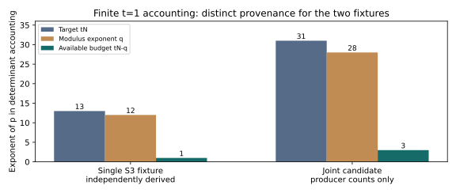

# Publication and independent-derivation addendum

2026-10-24. Archival task TASK-20261024-6c911a. This is a scoped software/math
audit addendum, not an ECDLP experiment or a scientific-state transition.

The prepared branch is published in [PR #2547](https://github.com/aburan28/crypto-autoresearcher/pull/2547).
The user explicitly authorized publication after the initial automatic-review
refusal. Hosted CI was queued at the latest inspection. Auto-merge was separately
refused because publication authorization did not cover a future merge into main.

## Independent mathematical result

[TASK-20261024-da3810's report](../independent-review.md), SHA-256 `bff484c89657f67ad71fb238e2c582972d8233727121d8e11fee82a4b84872e3`,
derives K=tN-q from the specified row divisibility and triangular determinant,
including the LLL/norm correction. It derives the full-box limiting equal-beta
statistic 2/[n*d*(n+1)] and independently reconstructs the exact sparse S3
determinant 101^12 * 2^33 using standard-library polynomial arithmetic and
fraction-free Bareiss elimination.

The reviewer saw only the four committed input/role files, plus disclosed
environment-runtime guidance and metadata. It read no producer implementation,
results, tests, closure note or sibling review. A runtime-path deviation was
disclosed. The report's verdict on calculator compatibility is explicitly
inconclusive because that implementation was deliberately unseen. No backend
probe or scientific-state promotion is claimed.

## Parent comparison

For the matching t=1 fixture the historical calculator returns q=12 as its RHS.
The independent derivation requires tN-q=13-12=1; the successor reports 1.
This parent comparison identifies the finite accounting discrepancy. It does
not turn the blind review into an independent audit of every implementation
path or a guarantee that the joint candidate extracts roots.

All plotted values are exact recorded counts from the original finite-audit.json,
one deterministic fixture per column group, with no sampling uncertainty. The
joint counts remain producer/test artifacts; the reviewer derived the conditional
joint determinant identity but did not inspect or certify that candidate.

## Remaining scope

The original report and artifacts remain unchanged. Twenty-three software tests
and the deterministic replay were already recorded there. This addendum adds an
independent derivation, not new solver performance measurements. The proposed
optimal shift construction, weighted-bound normalization, higher-rank GAPs,
root-extraction success/cost, random-target relation rank/yield and matched
complete IC comparison remain open. No verified IC improvement is established.

See [comparison.json](comparison.json) for the scoped composition, the original
[report](../report.md), and the [named problem](../../../problems/joint-smallroot-reach-baseline-and-oracle-unverified.md).
