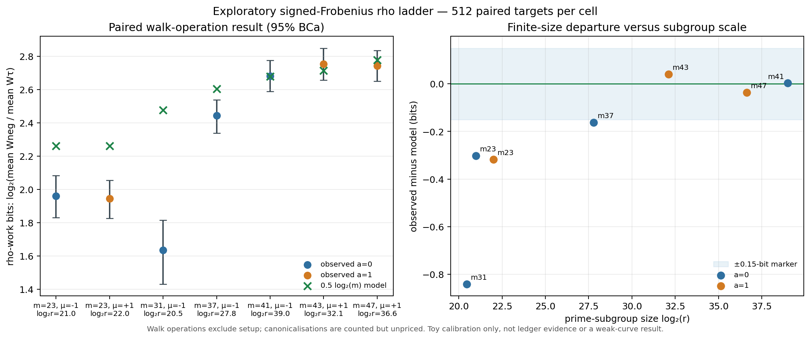

# Exploratory signed-Frobenius rho calibration ladder

Date: 2026-10-13

Status: **complete exploratory observation; not ledger evidence or a measured
bound.** This run calibrates source-curve rho counters on word-sized Koblitz
groups. It neither executes an isogeny transfer nor tests a named NIST curve
for weakness.

## Outcome

All 10,752 planned executions recovered their planted logarithms, and the
runner verified each returned scalar against its target. A subsequent full
same-binary deterministic replay reproduced all 10,752 executions with
identical counts and found zero problems. The primary analysis uses 512 paired
targets per cell and 50,000 paired target-level BCa resamples.

The result is a scale transition, not a blanket confirmation. The three cells
with `log2(r) >= 32` (`m=41,43,47`) measured 2.681, 2.754, and 2.741 rho-work
bits beyond negation; their pointwise 95% intervals contain the random-map
model `0.5 log2(m)`. All four smaller-subgroup cells undershot the model,
especially `m=31`, whose degree is larger than `m=23` but whose selected prime
subgroup is only about 20.46 bits. Field degree alone is therefore not a safe
experimental scale variable.



## Primary walk result

`W` is `counters.walk_operations`: steps plus look-ahead additions plus
cycle-escape doublings, excluding setup, walk starts, and verification. The
estimand is `log2(mean(W_neg)/mean(W_tau))`; it is not the mean of per-target
ratios. Cells are not pooled.

| cell | log2(r) | cofactor | neg/tau walk ratio (95% BCa) | observed bits (95% BCa) | model bits | residual |
|:--|--:|--:|--:|--:|--:|--:|
| a=0, m=23 | 20.999 | 4 | 3.890 [3.555, 4.237] | 1.960 [1.830, 2.083] | 2.262 | -0.302 |
| a=1, m=23 | 22.001 | 2 | 3.848 [3.546, 4.156] | 1.944 [1.826, 2.055] | 2.262 | -0.318 |
| a=0, m=31 | 20.457 | 1492 | 3.109 [2.698, 3.520] | 1.636 [1.432, 1.815] | 2.477 | -0.841 |
| a=0, m=37 | 27.781 | 596 | 5.437 [5.056, 5.806] | 2.443 [2.338, 2.537] | 2.605 | -0.162 |
| a=0, m=41 | 39.000 | 4 | 6.415 [6.014, 6.849] | 2.681 [2.588, 2.776] | 2.679 | +0.003 |
| a=1, m=43 | 32.113 | 1894 | 6.745 [6.307, 7.205] | 2.754 [2.657, 2.849] | 2.713 | +0.041 |
| a=1, m=47 | 36.636 | 1318 | 6.687 [6.277, 7.130] | 2.741 [2.650, 2.834] | 2.777 | -0.036 |

The `+/-0.15`-bit band in the graph is a frozen descriptive marker, not a
promotion rule. It contains the point residuals for `m=41,43,47`, not those
for the four smaller-subgroup cells. No asymptotic exponent was fitted.

## What “three to four rho bits” means

The baseline matters.

- Incremental signed-Frobenius work saving beyond an already standard
  negation quotient is modelled as `0.5 log2(m)` bits.
- Gross saving beyond unquotiented plain rho is `0.5 log2(2m)`, exactly one
  half-bit larger in the random-map model.

At the three larger-subgroup cells here, the observed incremental walk saving
is 2.68--2.75 bits and the observed gross plain-to-signed saving is 3.18--3.24
bits. For the named NIST K curves, the structural model gives 3.67--4.58 bits
beyond negation (12.77x--23.90x fewer expected transitions), or 4.17--5.08
bits beyond plain rho. Roughly four rho-work bits is operationally material,
but it is not a loss of four subgroup-entropy bits, a new attack, a wall-clock
gain, or evidence that an isogenous representative is weak.

## Secondary accounting

| cell | counted-GAE neg/tau | plain/tau walk bits | wall neg/tau (L0, descriptive) |
|:--|--:|--:|--:|
| a=0, m=23 | 3.033x | 2.339 | 1.261x |
| a=1, m=23 | 2.652x | 2.450 | 1.369x |
| a=0, m=31 | 2.530x | 1.981 | 0.959x |
| a=0, m=37 | 4.888x | 2.801 | 2.988x |
| a=0, m=41 | 6.393x | 3.223 | 5.477x |
| a=1, m=43 | 6.522x | 3.185 | 4.638x |
| a=1, m=47 | 6.635x | 3.241 | 5.553x |

The signed and negation arms count but do not price orbit canonicalisations,
and they omit different numbers of them. Each affected counted-GAE total is
incomplete, while their ratio has no automatic lower- or upper-bound
direction. Wall timing came from an unisolated virtual host (`L0`), so even its
BCa interval is descriptive rather than a performance result. The `m=31`
walk advantage disappearing in wall time illustrates why the transition
model cannot substitute for complete costing.

The run retained 589 local trail-cap restarts. These are charged cycle-control
events inside verified overall solves, not timeouts or exhausted executions.
Cycle, look-ahead, distinguished-point, useless-collision, setup, start,
verification, and unpriced-canonicalisation totals remain in
[`analysis.json`](analysis.json).

## Archived C-study setup reanalysis

The earlier C studies counted fixed target-dependent setup in both arms. The
exact common term is `(QPOW - 1) + R_ADD`: 155 group operations at `m=37` and
167 at `m=41`. A new deterministic 50,000-resample reanalysis gives:

| study | archived total-op ratio (95%) | setup-excluded target-dependent ratio (95%) | sqrt(m) | residual bits |
|:--|--:|--:|--:|--:|
| m=37 | 5.728 [5.616, 5.840] | 6.041 [5.920, 6.165] | 6.083 | -0.0098 |
| m=41 | 6.361 [6.198, 6.528] | 6.370 [6.205, 6.538] | 6.403 | -0.0076 |

This explains the apparent `m=37` shortfall in the old total-op comparison.
The setup-excluded C count still contains walk starts, look-ahead work, cycle
escapes, and abandoned work; it excludes recovery/verification and is not the
same counter as this ladder's `walk_operations`. Those independent-arm studies
use different implementations and are contextual replications only, never
pooled with the fresh data. The source and output are
[`reanalyse_archived_setup.py`](reanalyse_archived_setup.py) and
[`archived-setup-reanalysis.json`](archived-setup-reanalysis.json).

## Design, validity, and integrity

The design was committed before launch in [`PROTOCOL.md`](PROTOCOL.md) and
[`spec.json`](spec.json). Post-launch editorial clarifications are isolated in
[`PROTOCOL-CLARIFICATIONS.md`](PROTOCOL-CLARIFICATIONS.md); they change no
grid, sample count, seed, estimand, analysis, or stopping rule.

- producer: `aburan28/crypto` commit
  `0dc6b7f4a03253e7c7641f99700f7f423f8d07e0`, observed clean before build;
- dependency lock archive: [`producer-Cargo.lock`](producer-Cargo.lock), 29,115
  bytes;
- lockfile SHA-256:
  `4ddc5ef76119493b41352c64a551fbd3fea3b5789644949ee775975b38150bca`;
- binary SHA-256:
  `f2164ce16c6ae17c408777dc2448e8f226a42ca8c4d3da1d00aeff7419ec1f88`;
- spec: `ECS1h37e1cc41d056`, file SHA-256
  `751769ef2eeb6c9946f9822c14956c9c2617335859e46752ad7f1e510586c950`;
- session: `ECBS1h5a5461ff22d7`;
- uncompressed records SHA-256:
  `d82f6319a75e16d0185323b69e2e4b0760f2753510ec45f026b7004148a49a3c`;
- full replay/audit SHA-256:
  `74bfadbd5c6d3e0da09fc826dc5323365db5361577008d5ea5a31a7747b71cb7`.

The producer session sealed the binary digest but did not embed Git metadata
or the dependency-lock digest; [`build-provenance.json`](build-provenance.json)
records that boundary instead of pretending those fields were session-sealed.
The raw records and expanded plan are preserved as
[`records.jsonl.zst`](records.jsonl.zst) and [`plan.json.zst`](plan.json.zst).
The complete replay receipt is [`audit.json`](audit.json).
[`MANIFEST.sha256`](MANIFEST.sha256) seals every other file in this study
directory.

## Reproduce the analysis

From the `crypto-autoresearcher` repository root:

```sh
python3 research/koblitz_rho_ladder_20261013/analyze.py \
  --records research/koblitz_rho_ladder_20261013/records.jsonl.zst \
  --spec research/koblitz_rho_ladder_20261013/spec.json \
  --session research/koblitz_rho_ladder_20261013/session.json \
  --audit research/koblitz_rho_ladder_20261013/audit.json \
  --output research/koblitz_rho_ladder_20261013/analysis.json \
  --csv research/koblitz_rho_ladder_20261013/paired-results.csv
python3 research/koblitz_rho_ladder_20261013/reanalyse_archived_setup.py
MPLCONFIGDIR=/tmp/matplotlib-koblitz \
  python3 research/koblitz_rho_ladder_20261013/plot.py
```

The failed setup/launch attempts and successful commands are retained in
[`ATTEMPTS.md`](ATTEMPTS.md), [`run-command.txt`](run-command.txt), and
[`verify-command.txt`](verify-command.txt).

## What this changes—and what it does not

This run improves the source-action baseline in three ways: it adds seven
same-harness cells, exposes the finite-subgroup-size effect, and separates
walk work from setup. It does not discharge any map, dual, subgroup-transfer,
endpoint-action, or one-time-transfer gate in the isogeny protocol. It says
nothing new about conductor gaps, P/B curves, sect113r1, or the existence of a
weak endpoint.

The next high-value measurement is fully priced canonicalisation and
fixed-transition throughput, including larger prime subgroups and full-size
NIST K fixed-length blocks. The next isogeny result still requires an explicit
map/dual and the one-time transfer control; another nominal degree point cannot
replace either obligation.
