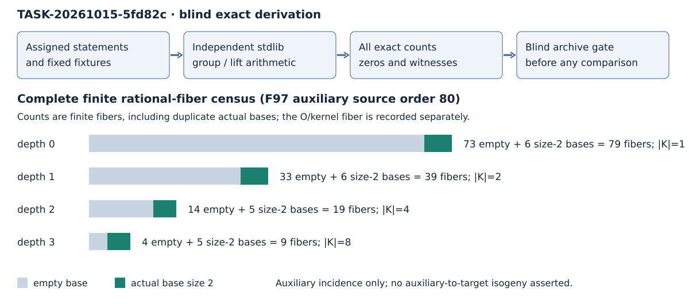

```{=typst}
#show raw: set text(size: 7.5pt)
```

This report derives exact predictions from the assigned statements and fixtures. Its local joint **holds**: the independent implementation passes the specified internal arithmetic and counting checks. No producer result was read or compared. Reserved joint TASK-20261015-ef06c6 remains pending its observation archives, verified blind snapshot and explicit unblind handoff. Serving backend, model and effective inference-policy binding are unverified; independence here means a fresh read context.

## Prime groups and coordinate windows — derived

All affine solutions of y²=x³+A x+B and O were enumerated. The literal admission rule selects the largest prime r≥5 occurring to valuation one, then the lexicographically first nonzero point of order r. The pairing curve explicitly uses r=11.

| Curve (p,A,B) | Exact order | Admission; generator |
|---|---|---|
| (43, 1, 0) | 44 = 2^2 × 11 | 11; P=(4, 5) |
| (97, 0, 2) | 117 = 3^2 × 13 | 13; P=(7, 32) |
| (101, 2, 3) | 96 = 2^5 × 3 | inadmissible: no qualifying prime |

For F_W={P in G: P≠O and 0≤x(P)<W}, retain both signs. Every m=2,3,5 distribution includes every target in G, including O, ordered tuples and repetitions. The table records exact missing-target counts; W is a coordinate width and M is the actual cardinality.

| p | W | M | Zero targets for m=2,3,5 |
|---|---|---|---|
| 43 | 2 | 0 | 11, 11, 11 |
| 43 | 4 | 0 | 11, 11, 11 |
| 43 | 8 | 2 | 8, 7, 5 |
| 97 | 2 | 0 | 13, 13, 13 |
| 97 | 4 | 0 | 13, 13, 13 |
| 97 | 8 | 2 | 10, 9, 7 |
| 101 | 2 | inadmissible | retained; no counts assigned |
| 101 | 4 | inadmissible | retained; no counts assigned |
| 101 | 8 | inadmissible | retained; no counts assigned |

When M=2, totals are 4,8,32; distributions have maxima 2,3,10 respectively. Every row retains its individual target counts and a checked point-tuple witness when positive; zero rows have an explicit null witness. Inadmissible rows carry null counts and a reason, not zero measurements. Exact means are M^m/r; neither the mean nor any Poisson assumption is used to infer coverage.

```{=typst}
#pagebreak()
```

## Rational auxiliary fibers — derived

Over F97, C_j is y²=x³+a_j x, with coefficients (1,93,16,33). Each curve has order 80. The projectively extended maps send O and (0,0) to O; finite evaluation uses x'=x+a_j/x, y'=y(1-a_j/x²). Every rational source point and every pair in the source group were checked. Full image points, including y, define fibers.

| Depth | a_depth | Rational kernel / degree | Finite fibers | Empty bases | Size-2 bases |
|---|---|---|---|---|---|
| 0 | 1 | 1 / 1 | 79 | 73 | 6 |
| 1 | 93 | 2 / 2 | 39 | 33 | 6 |
| 2 | 16 | 4 / 4 | 19 | 14 | 5 |
| 3 | 33 | 8 / 8 | 9 | 4 | 5 |

The rational kernels are respectively {O}; {O,(0,0)}; {O,(0,0),(22,0),(75,0)}; and {O,(0,0),(1,14),(1,83),(22,0),(75,0),(96,17),(96,80)}. Thus no incomplete-rational-kernel cell occurs in this exact schedule. There are 80,40,20,10 total rational image fibers including the kernel/O fiber. Every finite fiber equals A+K and has |K| points; their sources plus K exhaust all 80 source points.



The actual nonempty bases are the signed point pairs at x=39,51,55 on the target. Their fiber multiplicities by depth are (2,2,2), (2,2,2), (1,2,2), (1,2,2). Empty-base multiplicities remain in each full denominator. Each finite fiber has its own tuple distributions, even when its actual base duplicates another fiber's base.

The original lex-first-source slice differs from canonical image order. Ordinals below are zero-based; the full slice is recoverable from the flagged fiber and ordinal in JSON.

| Depth | Original source A | Fiber ordinal | Full image | Base size |
|---|---|---|---|---|
| 0 | (0, 0) | 0 | (0, 0) | 0 |
| 1 | (1, 14) | 3 | (2, 0) | 0 |
| 2 | (1, 14) | 0 | (0, 0) | 0 |
| 3 | (5, 18) | 0 | (0, 0) | 2 |

```{=typst}
#pagebreak()
```

## Rational lifts and action controls — independently checked

An independent polynomial recurrence expands x=N/D: start N=X,D=1 and replace (N,D) by (N²+a_j D²,ND). The y-coordinate is y(N'D−ND')/D². This expanded evaluator agrees with chained point maps on all 80 source points per depth, including projective poles. For every finite fiber the expanded equation N(x)−uD(x)=0 with D(x)≠0, an actual rational auxiliary y, and the full image y selects exactly that fiber. Separate rational x-chain checks verify x_j x_(j+1)=x_j²+a_j; original projective exceptions remain explicit.

A full fixed 97-coordinate P1 census at every depth retains adverse roots with no rational auxiliary y. For example at depth 0, image x=7 has the P1 root x=7 but no source lift: x³+x=59 modulo 97 is nonsquare. The target points (7,32),(7,65) therefore cannot enter this auxiliary fiber construction just because x=7 is a P1 root. At depths 1,2,3 the retained adverse image coordinates include 21,67,13 respectively. These lie outside the rational image-point fiber census and are reported separately; no adverse case was substituted into that census.

For the target action α(x,y)=(35x,y), 35³=1 mod97 and 35≠1. Curve preservation and homomorphism hold on all 117 points and 13,689 pairs. The selected G of order13 is stable, and λ=3 is the unique scalar matching α on every G point. Orbit completion of each nonempty actual size-2 base gives one of two size-6 bases, at x={7,39,51} or {55,57,82}. Every tested m covers all 13 targets after this completion. Totals for m=2,3,5 are 36,216,7776; count ranges are [2,6], [12,19], [570,610]. Empty bases remain empty. This is a target action closure and an auxiliary incidence construction; it asserts no auxiliary-to-target isogeny or relation sufficiency.

In F25=F5[z]/(z²+z+1), elements are canonical pairs (c0,c1). Enumeration of y²=x³+1 gives 36 points and nine rational 3-torsion points: the rational torsion is not cyclic. There are four cyclic order-3 lines. The line x=0 is stable under (zx,y), with λ=1. The other three lines cycle 1→3→2→1 in canonical ordinal order. One explicit nonstable witness is P=(z,1+2z), whose image (4+4z,1+2z) is outside its line {O,P,−P}. Each nonstable line has its own witness and no scalar assigned in JSON.

## Checks, resources and scope

Small software controls ran first on curves (5,1,1) and (7,0,3), with orders 9 and 13. Closure, inverse, commutativity and annihilation checks are exhaustive on each enumerated group; associativity is exhaustive for controls (729 and 2,197 triples), and follows a fixed deterministic boundary-inclusive schedule on study groups. Dynamic programming starts at the mass at O and adds each actual base point once per step. Full brute force independently checks m=2,3 for every actual and completed study base and m=2,3,5 on the small controls. Every emitted positive witness is resummed; totals and exact first moments are checked. No claim of exhaustive study-group associativity is made.

Arithmetic uses Python 3.12.14 standard-library integers only, one worker, against the task's 2 GiB memory budget. The final audit took 1.051690 s wall, 1.051584 s CPU, peak RSS 17,792 KiB (Linux ru_maxrss). Instrumented calls: 322,989 group-add calls and 287,512 field inversions. These describe this audit only. A preliminary successful draft took 0.912914 s, 17,408 KiB RSS; the final version additionally retains the entire P1 coordinate census, with no study fixture changed. The first draft is preserved in scratch and its hash is recorded in the attestation.

The statement explicitly requests m=2,3,5 for each fiber; the fixture's factorbase m=2,3 list is retained and m=5 is also supplied. Output completeness is scoped to these finite fixtures. No DLP recovery, producer agreement, novelty, ECDLP advantage, full-joint verdict, or scientific promotion follows.

```{=typst}
#pagebreak()
#set text(size: 9pt)
```

## Reproduction, provenance and phase-scoped attestation

Run `python research/lattice_ic_experiments_20261015/coordinator/TASK-20261015-5fd82c/independent_enumerator.py` to create the write-once JSON; `--output` can name a fresh scratch path. The script imports no repository helper and launches no experimental driver. Its only mathematical inputs are the supplied fixtures; the assigned statement is hashed for custody. Runtime measurements will naturally differ between executions.

Rendering uses this Markdown source, Pandoc 3.9 via pypandoc_binary 1.17, Typst 0.15.0 and the hand-authored SVG. PyMuPDF 1.26.6 rasterizes every final PDF page; actual per-page image inspection is recorded in visual-inspection.json. Matplotlib 3.11.2 metadata was checked for availability but matplotlib was not used. The normative /usr/local/bin/python3 path was absent; the actual interpreter is /opt/codex/runtimes/codex-primary-runtime/dependencies/python/bin/python.

**Source provenance:** internal assigned and normative documents, read directly by this Reviewer. No external mathematical citation is load-bearing. The complete external read set appears in the attestation below. The cloud environment status tool was also read for runtime context only.

The route instructions were read as normative guidance; no catalog, repository search, history, sibling artifact, producer helper, tests, result, report, or Coordinator outcome was read. Missing path existence checks were limited to /AGENTS.md, /workspace/AGENTS.md and agents/reviewer.md; these yielded no contents. Own enumerator and own draft/final predictions, report, SVG and PDF are derived self-authored material; their reads and inspection are recorded separately in read-attestation.yaml. Renderer libraries and font resources are tool dependencies, not mathematical evidence. No canonical graph was searched or changed because the exclusive blind write scope forbids it.

```yaml
review_attestation:
  task_id: TASK-20261015-5fd82c
  parent_joint_task: TASK-20261015-ef06c6
  phase: blind derivation only
  joints_owned:
    - Blind independent finite-field groups, rational fibers and ordered-tuple counts from statement and fixtures
  sources_read:
    - AGENTS.md
    - ledger/handoffs/TASK-20261015-5fd82c.yaml
    - orchestration/roles.yaml
    - agents/validator.md
    - .claude/skills/research-visuals/SKILL.md
    - .claude/skills/route/SKILL.md
    - research/lattice_ic_experiments_20261015/coordinator/blind-group/statement.md
    - research/lattice_ic_experiments_20261015/coordinator/blind-group/fixtures.json
    - "skill://plugin_connector_1p_c5b7d5df5d7081918f2c4be5a633ed5d/\
      cloud-environment-runtime/SKILL.md"
  read_sibling_reports: false
  blind_from_respected: true
  unexpected_exposure: false
  verdict: holds
  verdict_scope: internal arithmetic and exact-count derivation only
  producer_comparison_performed: false
  full_joint_completed: false
  requested_policy: review-adversarial
  requested_reasoning_effort: xhigh
  actual_backend: unverified
  actual_model: unverified
  adapter_probe_performed: false
```

All seven artifacts must be archived and their hashes verified by the root before any deliberate unblinding. This report terminates only the assigned blind subtask.
