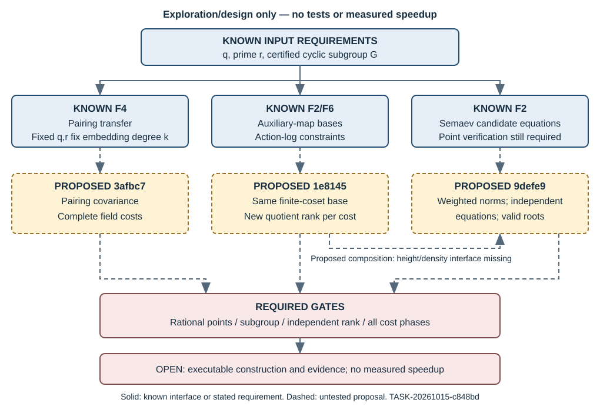

# Three lattice routes into ECDLP index calculus

Exploratory report, 2026-10-15. Idea Generator: `/root/lattice_exploration`,
TASK-20261015-c848bd, RQ-IC-a39c7e. Input archive 266ad7929cca0cce1fca600543aab80c92107e27;
handoff input revision 285ab8873505d6780d8490b19831b96caa2706d4.
**These are proposals and review-pending derivations, not scientific findings.**
No tests, timings, ECDLP recovery, hypothesis changes or approvals occurred.

## What each route would actually change

| Proposal | Concrete mechanism | First useful discrimination | What remains unknown |
|---|---|---|---|
| IDEA-20261015-3afbc7 | Compatible isogeny-adjoint pairing witnesses and explicit target-field bases | Verify tiny nondegenerate pairing covariance at unchanged $q,r,k$, then price map/pairing arithmetic | Complete field DLP/precomputation/descent costs; no easier field follows |
| IDEA-20261015-1e8145 | Identical auxiliary finite-coset base as list, expanded map and low-degree chain | Exact rational base/density equality, followed by new quotient-rank per paid solve | Density, fresh-row rank yield, acquisition and solver cost |
| IDEA-20261015-9defe9 | Dense versus Newton-target modular shifts with achieved norm certificates | Independent integer equations, root extraction and actual valid decomposition | Useful uniform-target coverage and unknown solver exponent $\sigma$ |

The user explicitly authorized F2/F4/F6 comparisons and compositions with F3 as
an isogeny component. The proposals therefore retain known-family routes even
when they supply no new lossy object. Each uses partial-action relation vectors;
the pairing transfer itself is lossless, explicitly labeled as such. No family
escape or general prime-field speedup is claimed. The three notes contain exact
fixtures, controls, proof-search maps and literature boundaries.

## Pairing: fixed field and subgroup fix the embedding degree

Write $q$ for working field cardinality, $r$ for the chosen prime subgroup order,
and $k=\operatorname{ord}_r(q)$. A same-field isogeny of degree $d$ coprime to $r$
preserves that subgroup order and $q$, hence $k$. It may alter arithmetic
presentation or point availability; it cannot lower $k$ at those fixed inputs.
This does not assert identical full rational point-group structures.

With a nondegenerate Weil witness $S$, pairing gives $h=e(Q,S)=e(P,S)^a=g^a$
for $Q=[a]P$. Under compatible transport of both arguments,
$g'=g^d$ and $h'=h^d$. Relative to $\phi(P)$ the scalar is $a$ directly. Check
any alternative normalization separately. The point $S$, extension construction,
map exceptions and nondegeneracy are inputs to certify and price, not free
consequences of a small embedding degree. Root's Galbraith source scope covers
the pairing/extension and isogeny context only, not an entire book or NFS audit.
[Galbraith, ch 26.3–26.4 and 25.4](https://www.math.auckland.ac.nz/~sgal018/crypto-book/main.pdf)

The proposed unexecuted toy is $E/\mathbb F_{43}:y^2=x^3+x$,
$E':y^2=x^3-4x$ with degree-two map
$(x+1/x,y(1-1/x^2))$, claimed count 44, $r=11,k=2$.
Independently verify these claims, choose a certified order 11 point, and compare
direct/transported/reused-power pairings over $\mathbb F_{43}[u]/(u^2+1)$.
$S=(-x(P),u\,y(P))$ is a candidate distortion witness, not session evidence.
Compare bases $u$ and $v=u+1$ with conversion charged. Degenerate $S=P$, a map
that kills $G$, and a large-$k$ gate are controls.

Powering by invertible $d$ permutes $\mu_r$. For uniform target images, a fixed
descent cost function has the same subgroup average after that permutation.
Selected-target variation alone is not an average descent improvement. A faster
pairing presentation, alternative field solver or carefully priced reusable setup
remains a legitimate separate comparison.

## NFS uses a public ideal lattice; the ECDLP relation kernel is hidden

For $K=\mathbb Q(\theta)$ and a good prime $\ell$ with $f(s)=0\pmod\ell$,
the special ideal $(\ell,\theta-s)$ imposes

$$a-bs=0\pmod\ell,\qquad
L_{\ell,s}=\mathbb Z(\ell,0)+\mathbb Z(s,1),\qquad\det L_{\ell,s}=\ell.$$

This lattice is public before logarithms are known. Sieving organizes divisibility
and smooth norms, followed by actual ideal/unit relation verification, filtering,
LA and descent. The proposed tiny illustration uses $f_1=z^2+1$, $f_2=z^2+44$
modulo 43, first-side $(\ell,s)=(5,2)$ and a fixed coefficient box; it is not
optimized NFS or a recorded solve. A full performance proposal needs an exact
primary NFS algorithm/regime and implementation beyond the supplied read scopes.

For ECDLP factor-base points $F_i$, the formal relation lattice
$\{c:\sum c_iF_i=O\}$ has index $r$ if they generate $G$. But its log-coordinate
description $\sum c_i\log_P(F_i)=0\pmod r$ uses the unknown logarithms.
Membership can be tested with group operations; a cheap short-vector basis is
not thereby available. Its determinant is not a substitute for constructing
relations. This is the missing interface in a direct NFS-lattice analogy.

## Auxiliary chains: density and fresh rows, not raw orbit multiplication

PKM2016 already includes the auxiliary-map base primitive, including an auxiliary
curve unrelated to the target. FGHR symmetry solving is also established in its
stated extension-field setting; its abstract does not transfer a prime-field
solver bound. The added question is the simultaneous density, membership, solver
and new-rank cost on the **same actual base**.
[PKM2016](https://people.maths.ox.ac.uk/petit/files/16PKC_primeECDLP.pdf),
[FGHR abstract](https://eprint.iacr.org/2012/199)

The proposed target is $E/\mathbb F_{97}:y^2=x^3+2$ with candidate
$\alpha(x,y)=(35x,y)$. Independently admit a prime cyclic subgroup and scalar
action. Separately use $C_a:y^2=x^3+ax$ and the degree-two chain
$C_a\to C_{-4a}$ with $x\mapsto x+a/x$, $a_0=1$, $d=0..3$.
Choose a completely certified rational kernel and finite nonkernel coset
$A+\ker\Phi_d$. Intersect its auxiliary x-values with actual target subgroup
points. Compare list, expanded map and quadratic chain equations at identical
base cardinality. Auxiliary rational lifts are not optional. No isogeny from
this auxiliary curve to the target is asserted.

Finite-coset pole exclusions are justified because the chosen image is finite.
Kernel/preimage-$O$ bases require the projective/pole branches; generic denominator
saturation can delete desired roots. A rank-two torsion negative fixture over
$\mathbb F_{25}$ tests whether the endomorphism moves a chosen cyclic line.
Without $\alpha(G)=G$, assigning a scalar $\lambda$ is invalid.

For stable $G$ and $\alpha(P)=[\lambda]P$, substituting
$\log(\alpha^jF_i)=\lambda^j\log(F_i)$ makes every transformed copy of
one augmented relation row a scalar multiple of the original. This does not
deny solver sharing or independent rows from genuinely new decompositions.
H-BINSTD-ce4f38 already studies this and is currently analyzed; its evidence was
not audited here. IDEA-20260922-261004 is also prior rank work. The fact is not new.

Price all setup, membership, failed solves, orbit completion/canonicalization,
filtering, reduced-rank checks, LA, descent and verification. If a raw base is
orbit-completed, recount its larger actual $M$ and quotient dimension $U$.
Under a separately justified repeated-attempt model, rank-deficit stage $j$ costs
$C_j/(p_j\eta_j)$, where $p_j$ is valid-decomposition probability and $\eta_j$
conditional new-rank yield. Neither a constant yield nor an exponent is established.

## Small roots: soundness, density and extraction are different gates

Use a coordinate window of width $W$ but count actual $M=|F_W|$. With ordered
m-tuples and repetition, $\sum_RN(R)=M^m$, so

$$\mathbb E_RN(R)=M^m/r,\qquad
\Pr[N(R)>0]\le\min(1,M^m/r).$$

This exact first moment is a necessary density bound. It does not provide a
Poisson success law, independent rows or a cheap solver. Signs, unordered tuples,
subgroup filtering and orbit duplicates change the appropriate counting unit.

The proposed lattice rows are $X^a f_R^b p^{t-b}$, $0\le b\le t$.
Compare ordinary total-degree shifts with exactly specified Newton-target support
shifts. Scale coefficient columns by the root box. Let $D$ count supported
monomials and $n$ be row rank; $D$ need not equal $n$. For an achieved polynomial
vector $v$, the strict certificate

$$D\|v\|_2^2<p^{2t}$$

implies its value at every bounded modular root is zero over the integers.
The weighted lattice's row covolume is $\sqrt{\det(BB^T)}$; only the square
full-rank case permits $|\det B|$. No determinant-only LLL guarantee is asserted.
These are explicit review-pending norm deductions, not a blanket multivariate
Coppersmith theorem. Coppersmith's scoped abstract and Kosters–Yeo's abstract
justify neither general root extraction nor a first-fall-degree runtime claim.
[Coppersmith abstract](https://research.ibm.com/publications/small-solutions-to-polynomial-equations-and-low-exponent-rsa-vulnerabilities),
[Kosters–Yeo abstract](https://arxiv.org/abs/1503.08001)

Many short coefficient-independent polynomials may have a common factor and a
positive-dimensional zero set. Require actual independent integer equations,
bounded-root extraction and verification of all original conditions. A Semaev
zero is only a candidate: recover rational y-values, signs and subgroup membership,
then verify the sum and new row rank. The geometric summation-polynomial framework
is known; root read its author abstract/metadata, not its blocked PDF.
[Semaev](https://eprint.iacr.org/2004/031)

The proposed tiny grid is $(p,A,B)=(43,1,0),(97,0,2),(101,2,3)$,
$W=2,4,8$, $m=2,3,5$, $t=1,2$, $L=0,1,2$, with a common row-rank cap 64
and monomial cap 256. Full tiny oracle, planted/uniform targets, rational-lift and
positive-dimensional controls are specified in the note. Overflow is an instrument
limit, not mathematical failure. H-ECDLP-c3d48a covers only Stage 0 thresholds;
H-ECDLP-a00090 only a degree table. No small-root experiment is inferred from them. For univariate modular slices,
compare direct finite-field factorization/root finding before claiming an LLL
advantage; brute force is not the only applicable baseline.

In the restricted constant-yield fixed-m model $M=r^\beta$ and per-attempt
$r^\sigma$, collection plus classical sparse LA is
$r^{\beta+\sigma}+r^{2\beta}$. Subroot bookkeeping requires
$\beta+\sigma<1/2$, $\beta<1/4$ and $\beta m\ge1$, hence $m\ge5$ only in
that model. The exponent $\sigma$ and every success/independence assumption remain unknown;
construction, extraction, descent, memory and verification can dominate.

Low-degree auxiliary chains do not automatically compose with small-root methods:
their intermediate field coordinates may require boxes near $p$. A useful mixed
method needs a demonstrated density-preserving low-height/sparse encoding and
paid search for small intermediates. Record this interface rather than combining
two conditional advantages for free.

## Source receipt and next action

All 51 rows in the two committed known-results renderings and the fresh dedup
context were read. Only matching indexed designs were opened. The six primary
retrieval scopes belong to `/root` in `inputs/source-read-receipts.json`:

| Source | Root's inspected scope | Boundary retained here |
|---|---|---|
| Galbraith | ch 26.3–26.4 and 25.4 excerpts | No whole-book or NFS proof audit |
| PKM2016 | abstract/introduction, 2.1, 3.1–3.4, Algorithm 1/partial cost | Existing primitive; no practical prime-field speedup |
| FGHR | author abstract/metadata | PDF 403; no full-paper inspection |
| Kosters–Yeo | version 3 abstract | No universal restricted-root impossibility |
| Coppersmith | IBM author abstract | No general modular multivariate guarantee |
| Semaev | author abstract/metadata | PDF 403; rational/subgroup checks still needed |

No extra source inspection, historical evidence review or novelty certification is
claimed. Root's working deductions were challenged by separating invariance from
availability, row multiplicity from reduced rank, mean from success, and norm
soundness from independent extraction. KB unavailable and experiment inventory
unmaterialized do not imply absence. No canonical graph is changed: the supplied
maps were checked as prior-art boundaries, and no new verified scientific edge exists.

Recommended first discrimination is the route 2 exact auxiliary/target base and
subgroup admission check; it can cheaply expose empty density or invalid scalar
action before a solver comparison. In parallel future design work, route 1 needs
pairing covariance controls and route 3 needs achieved certificates plus independent
root extraction. These are **proposed next tests**, each requiring its own executable
protocol and canonical admission. The shared obstruction and exit criteria are in
[the problem record](../../problems/lattice-index-calculus-relation-construction-not-demonstrated.md).
Root will render and inspect the PDF in the separate visual task. All three routes
remain open; no experimental result or status transition is requested by this report.
