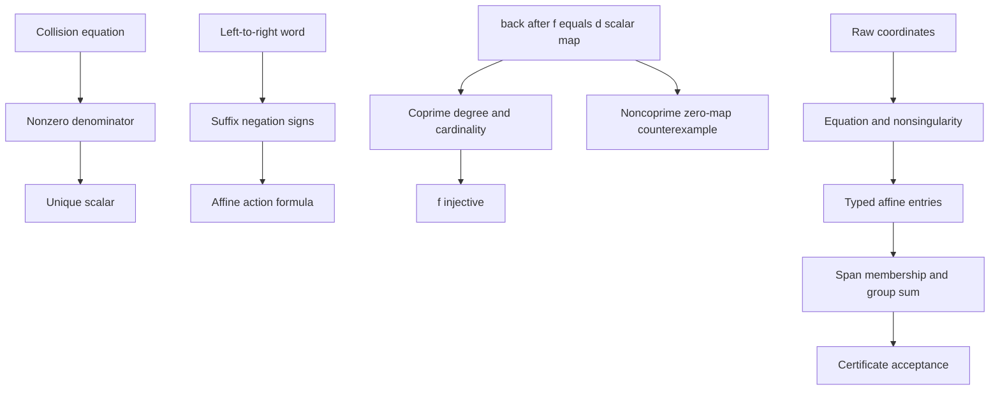

# Blind mathematical boundary review

Task: `TASK-20261018-29a8c7`. Joint owned: `J4-blind-mathematical-boundary`.
Verdict: **holds**, restricted to the independently derived mathematical
boundaries below. This is no verdict on unseen producer statements, proofs,
execution, imports, or reports. No official research status is changed.

The only mathematical input was the isolated
`/workspace/lean-blind-review/statements.json` (SHA-256
`9805fc58c5280ecede8084682d99d12f9b577695df88b12a4a609127698f5285`).
The assignment's claim that this copies a committed/pushed input was supplied
by the dispatcher; I did not inspect git or independently verify that binding.
The controls were constructed independently in a blank workspace using only
Lean and pinned third-party Mathlib. Producer sources, producer outputs,
review-plan, workflow/input manifests, sibling reports and sibling messages
were not read. `blind_from_respected: true`.

All five requested tasks have checked controls. The final `Controls.lean`
contains **34 theorems**, compiled with exit code 0, with no diagnostic
warnings or errors. Every theorem has a printed axiom dependency list;
the union is exactly `propext`, `Classical.choice`, and `Quot.sound`.
There is no `sorryAx`, extra axiom, native decision procedure, or producer
import in the final controls. The proof-term check uses Lean's kernel under
these standard Lean/Mathlib axioms. The pinned dependency binaries were
consumed as supplied and were not rebuilt or independently audited.

**Ordinary collision.** In a field, subtracting the two expressions gives

\[
(b_1-b_2)x=a_2-a_1.
\]

If `b₁-b₂ ≠ 0` (equivalently `b₁ ≠ b₂`), the equation is equivalent to

\[
x=\frac{a_2-a_1}{b_1-b_2}.
\]

Thus the formula gives both existence and uniqueness, rather than just a
necessary condition. For the supplied values in `ZMod 7`, `2x=1` and
`2⁻¹=4`, so the unique answer is **x = 4**. At that value the two expressions
are both 2. The generic equivalence and requested example are checked in
`Controls.lean:18` and `Controls.lean:40`.

Equal coefficients require a separate branch: if `a₁=a₂` every field
element is a solution; if `a₁≠a₂` there is no solution. The controls use
`1+2x=1+2x` to disprove uniqueness and `1+2x=2+2x` to check absence of a
solution for every `x` in `ZMod 7`. The unconditional division formula is
also falsified: in Lean `0/0=0`, but `x=1` satisfies the first equation.
These are checked known-false controls at `Controls.lean:54`, `:59`, and
`:62`; division notation does not supply the missing invertibility premise.

**Negated collision.** Rearranging gives

\[
(b_1+b_2)x=-(a_1+a_2),\qquad
x=-\frac{a_1+a_2}{b_1+b_2}\quad(b_1+b_2\ne0).
\]

The generic equivalence is checked at `Controls.lean:29`. For the requested
values, `6x=-4=3` and `6⁻¹=6` in `ZMod 7`, so again **x = 4**. The left
side is `1+2·4=2` and the right side is `-(3+4·4)=2`; the unique-solution
equivalence is checked at `Controls.lean:47`. The zero-sum-coefficient
equation `1+2x=-(6+5x)` holds for every `x` in `ZMod 7`, and its
non-uniqueness is checked at `Controls.lean:67`.

**Affine word.** Let the word be executed from left to right. Write `N`
for its total number of `v` letters, and `r(j)` for the number of `v`
letters strictly to the right of a particular translation occurrence `j`.
The action is

\[
x\longmapsto (-1)^N x+
\sum_{\text{translation occurrences }j}(-1)^{r(j)}s_{i(j)}.
\]

The sum counts occurrences, including repeated uses of the same letter.
Every negation reverses the accumulated input coefficient and offset;
every translation initially adds its value and is then reversed by each
later negation. This also proves the formula inductively. The independent
Lean representation `signedTranslations` recursively records exactly these
suffix counts, and the formula for arbitrary words over a commutative ring
is checked at `Controls.lean:88` and `:93`. It needs no division or
characteristic restriction; characteristic two simply makes all signs equal.

For `[t₀,v]` with `s₀=2` and initial `x=1` in `ZMod 7`, the actual
execution is `1 → 3 → 4`. The suffix formula is `-1-2=4`.
Keeping the translation positive instead would give `-1+2=1`, which is
false. The positive example and this wrong-sign control are checked at
`Controls.lean:102` and `:104`. The empty word acts as the identity (`:107`).

**Transport.** The composition law alone does **not** imply injectivity
when cardinality and degree are not coprime. For the supplied group
`S=ZMod 7` and `d=7`, let both `f` and `back` be the zero map. Then
`back(f(P))=0=7•P` for all seven elements, while `f(0)=f(1)` and `0≠1`.
This is a concrete known-false control for dropping the coprimality premise,
checked at `Controls.lean:122`, `:124`, and `:126`.

A sufficient hypothesis is `gcd(|S|,d)=1`. Multiplication by `d` is then
injective on the finite additive group. From `f(P)=f(Q)` the composition
law yields `d•P=d•Q`, hence `P=Q`. Equivalently, Lagrange's theorem and
Bezout's identity give the inverse scalar on `S`. The generic implication
is checked at `Controls.lean:109`; neither map needs a homomorphism
assumption for this argument.

The nonconstant positive example uses `d=2`, `f(P)=2P`, and `back=id`
on `ZMod 7`. The composition holds and `f` is injective, with inverse
scalar 4 (`Controls.lean:131`, `:135`, and `:137`). Coprimality is sufficient
for the general implication, but is not necessary for an individual `f`
to be injective: with `d=7`, `f=id` and `back=0` also obey the composition
law and `f` is injective (`:141`). Thus the noncoprime branch is genuinely
underdetermined by the composition law.

**Certificate boundary.** I modelled acceptance as a finite list of typed
curve points, each entry required to be affine with x coordinate in the
specified span, and with its group sum equal to the target. Mathlib's
`Point.some` requires nonsingularity evidence; its separate zero
constructor is the identity at infinity and is excluded as an affine entry.
This definition is independent of any producer certificate representation
(`Controls.lean:183` and `:187`).

The empty tuple has sum the identity and its entry conditions are vacuous.
It therefore accepts exactly the identity target, for any declared span
(`Controls.lean:195`). It rejects the nonidentity point `P=(0,1)` (`:202`).
No positive-length requirement was present in the supplied definition.
Adding such a requirement would change this boundary and is outside this
statement-only review.

The linear span of the empty family is `{0}`, rather than an empty set
(`Controls.lean:192`). A nonempty certificate can therefore use valid
points whose x coordinate is zero. On `y²=x³+1` over `ZMod 7`, the supplied
points `P=(0,1)` and `Q=(0,6)` both satisfy the equation. At these points
the y partial derivative `2y` equals 2 and 5 respectively, so both are
nonsingular (`Controls.lean:162`, `:166`). Since `6=-1`, `Q=-P` and
`P+Q=O`; the actual typed Mathlib group law checks this sum (`:176`).
Both x coordinates lie in the empty span. Consequently the two-entry
certificate accepts the identity (`:206`) and rejects target `P` (`:211`).
The singleton `[P]` accepts `P` even with an empty span (`:216`).

Raw `(0,0)` fails the curve equation: its left side is 0 and its right
side is 1. It also fails nonsingularity (`Controls.lean:154`, `:158`).
A coordinate pair is not a typed valid point and cannot be supplied to
`Point.some` without the required proof. The affine origin is also not
the identity at infinity. Treating all coordinate inputs or all x=0
entries as automatically valid would cross the checked boundary.

| Input certificate with empty span | Identity target | Target P=(0,1) |
| --- | --- | --- |
| Empty tuple | Accept | Reject |
| Singleton [P] | Reject (P is nonidentity) | Accept |
| Pair [P,Q] | Accept | Reject |
| Raw pair (0,0) as a proposed entry | Reject as invalid coordinates | Reject as invalid coordinates |

The table entries follow from the checked acceptance rules and the checked
point/group facts. The singleton's identity-target rejection is a direct
consequence of those facts, not a separately named theorem. The statement
`Q=-P`, the displayed derivative values, and the arithmetic narrative are
written derivations; the kernel controls check nonsingularity, the sum,
and the resulting accept/reject claims directly. There are no unchecked
core requested controls.



**Reproduction and retained attempts.** The final command is

```text
cd /workspace/lean-blind-review
PATH=/workspace/.elan/bin:$PATH ELAN_HOME=/workspace/.elan XDG_CACHE_HOME=/workspace/.cache \
  lake env lean /workspace/review-lean-evidence/research/lean_review_evidence_20261018/reports/TASK-20261018-29a8c7/Controls.lean
```

Lean is `4.35.0` (commit `eb6cafb7290e8bd5f2937522d8d804f58f02bafc`);
Mathlib is pinned by the isolated manifest to
`cfc55fc58714a59dc06e6e79edc6d1d95140d3c2`. Final source SHA-256 is
`77fd3b9d88a5b10dde52fe8d10035fe8ce26d2d997b4b1b09a984f0b10530dc2`.
See [controls.log](controls.log) for the actual command, source digest,
elapsed time, exit code, stdout, stderr, and all 34 axiom lists.

Every attempt is retained under `artifacts/`. Attempt 01 stopped because
the umbrella `Mathlib.Tactic.olean` was absent; I imported cached individual
tactics instead, without building or changing dependencies. Attempts 02
and 03 exposed missing finite-field/primality instances, explicit numeral
typing, and local proof/elaboration issues. Attempt 04 exposed that direct
kernel reduction cannot evaluate the chosen field-inverse implementation;
the final proof checks division identities after multiplication by the
proved nonzero denominator. Error recovery in those failed elaborations
printed `sorryAx`; those attempts are explicitly failed and are not accepted
evidence. Attempt 05 and the final named file both pass without `sorryAx`.
A preliminary Python driver failed because `/usr/local/bin/python3` was
absent; this infrastructure log is also retained. The available interpreter
was `/opt/codex/runtimes/codex-primary-runtime/dependencies/python/bin/python3`.

[artifacts/checks.json](artifacts/checks.json) is the machine-readable
per-claim and per-theorem check table.
[artifacts/source-digests.json](artifacts/source-digests.json) records every
non-self-authored source read. [review_attestation.yaml](review_attestation.yaml)
lists actual source reads, direct imports, blindness, and the joint verdict.
The artifact diagram and one-page PDF preserve this review's visual record.
All mathematical references here have provenance `internal`: the supplied
isolated statements, independently authored proofs, and identified pinned
third-party library definitions. No publication or prior experiment is cited.

No performance gain, ECDLP transfer, producer proof correctness, or research
promotion was assessed. `dominated_by` and `sota_delta` are not applicable
to this mathematical boundary review. Provenance binding to the producer's
commit and comparison with producer code remain outside this blind joint.
