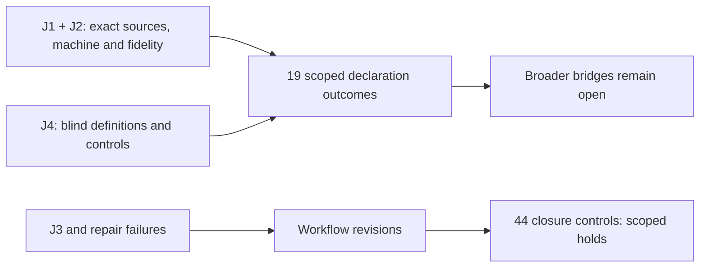

# Scope and disposition

The reported evidence supports **19 explicitly scoped declarations**: machine `passed`, fidelity `faithful_scoped`, outcome `validated_scoped` within their respective proof-map rows. Broader source/target obligations remain open. The corrected workflow has an independently reported **holds within the exercised contract** finding from TASK-20261018-2ea34a: 44 completed checks pass. Earlier workflow candidates demonstrably failed. Public raw reproducibility remains partial; no blanket workflow or historical-research approval follows.

This synthesis composes independent reports under the [precommitted plan](https://github.com/aburan28/crypto-autoresearcher/blob/9d3017bff107eb8792d4ad52bc2995febbd78105/research/lean_review_evidence_20261018/review-plan.yaml) and [handoff](https://github.com/aburan28/crypto-autoresearcher/blob/9d3017bff107eb8792d4ad52bc2995febbd78105/ledger/handoffs/TASK-20261018-b1d5fa.yaml), extended by [published synthesis inputs](https://github.com/aburan28/crypto-autoresearcher/blob/712435bf2ad76da941291ac960f68c59d17a708f/research/lean_review_evidence_20261018/synthesis-inputs-v4.json). It supplies no new mathematical-author fidelity verdict and makes no scientific, evidence-ledger, knowledge, or goal transition. All citations have provenance `internal`, retrieved through immutable GitHub files. The synthesist ran no shell, tests, Lean checks, or rendering.

# Observation

The original four reports were archived at `14a1ffacab80ff786619bf6fe0747b126b16a123`. Their scope and separate roles are:

| Joint | Reported finding | Evidence boundary |
| --- | --- | --- |
| J1, [63a7cc](https://github.com/aburan28/crypto-autoresearcher/blob/14a1ffacab80ff786619bf6fe0747b126b16a123/research/lean_review_evidence_20261018/reports/TASK-20261018-63a7cc/report.md) | Holds: 5 transport/range and 4 rho declarations | Fresh exact-source compilation, elaborated types and transitive axiom audit; source-aware fidelity and nonvacuity controls |
| J2, [a5dcec](https://github.com/aburan28/crypto-autoresearcher/blob/14a1ffacab80ff786619bf6fe0747b126b16a123/research/lean_review_evidence_20261018/reports/TASK-20261018-a5dcec/report.md) | Holds: 3 certificate, 4 affine and 3 kernel declarations | Fresh compilation and named audits; typed-point, scalar-action and single-witness scope |
| J3, [dae80c](https://github.com/aburan28/crypto-autoresearcher/blob/14a1ffacab80ff786619bf6fe0747b126b16a123/research/lean_review_evidence_20261018/reports/TASK-20261018-dae80c/report.md) | Breaks: 3 workflow boundaries | Reproduced all 19 declarations and 65 target identities, but demonstrated omitted sources, contradictory receipts and imported-input changes |
| J4, [29a8c7](https://github.com/aburan28/crypto-autoresearcher/blob/14a1ffacab80ff786619bf6fe0747b126b16a123/research/lean_review_evidence_20261018/reports/TASK-20261018-29a8c7/report.md) | Holds: statement-only mathematics | 34 independently authored checked controls; no access to producer proofs or sibling reports |

J1 uses Lean 4.35.0 and Mathlib `cfc55fc5...`; J2 uses Lean 4.35.0-rc1 and Mathlib `7fa22735...`. J4 uses the former pins. These distinct pinned workspaces must not be described as one uniform build. Accepted new proofs/controls use standard foundational axioms only (`propext`, `Classical.choice`, `Quot.sound`), with no reported custom axioms or compiler-trust exception. Dependency binaries were cached and not independently rebuilt or externally rechecked with `lean4checker --fresh`.

The [final proof-identity record](https://github.com/aburan28/crypto-autoresearcher/blob/9d3017bff107eb8792d4ad52bc2995febbd78105/research/lean_review_evidence_20261018/machine/final-proof-identity.json) reports that every one of the 19 source rows still matches its reviewed SHA-256 and that the shared mathematical library/auditor did not change. This is producer provenance evidence connecting the unchanged proofs to later heads, not a replacement independent review of changed workflow code.

J3 freshly built/audited exact names for 64 targets in the main workspace and one in the scoped Lean 4.22.0 workspace; `ncp-reachability` has no proof file. That replay was not 65 new CLI receipts or semantic review of all 65 targets. The later 65 available target receipts were actually run under verifier `2951f9b77d96606820be80bf61ee0d539cfbb4dd`. The [current validator's reported 65/65 consistency result](https://github.com/aburan28/crypto-autoresearcher/blob/171f43d363d414a5faf49bf74ed39ba0a29d7b8f/research/lean_retrospective_20261018/verification-summary-v4.json) selects that archived revision explicitly. Later fixes cannot be attributed to those old runs.

# Comparison

The [J1 claim table](https://github.com/aburan28/crypto-autoresearcher/blob/14a1ffacab80ff786619bf6fe0747b126b16a123/research/lean_review_evidence_20261018/reports/TASK-20261018-63a7cc/claims.json) and [J2 claim table](https://github.com/aburan28/crypto-autoresearcher/blob/14a1ffacab80ff786619bf6fe0747b126b16a123/research/lean_review_evidence_20261018/reports/TASK-20261018-a5dcec/claims.json) supply the row-level judgments copied into `claim-verdicts.json`. The complete mapping contains 19 distinct declarations, with hypotheses, exact sources, evidence links and stronger obligations separated.

| Mapped family | Independently supported statement | Coverage still withheld |
| --- | --- | --- |
| Transport/range (5) | Reverse composition plus finite-subgroup coprimality gives injectivity and integer-scalar DLP equivalence; genuine subgroup closure stays in a supplied range | Concrete isogenies, geometric degrees/duality, Jacobian/base-change and actual factor-base/target membership; historical solver/cost construction |
| Rho (4) | Ordinary and negated field-collision recovery; ordinary group recovery through an assumed injective prime-order encoding; zero-coefficient control | Exact-order encoding construction, negated group bridge, C arithmetic/walk/hash/canonicalization refinement, composite candidate enumeration and its cap |
| Certificate (3) | Actual span membership, actual typed point-group sum and a correct Boolean checker/decision contract | Raw-coordinate parser, serialized run-certificate integration, existence probability and runtime |
| Affine action (4) | Left-to-right scalar word action with suffix parity; equal shadows suffice for equal action; orbit value at 1 | Concrete point-action equivariance, implementation correspondence and opposite/reversal convention bridge |
| Kernel witness (3) | `v²−1` separates the genuine two-sided commutator ideal from the actual affine-permutation group-algebra kernel | Surjectivity, companion witnesses, full historical kernel/presentation and reachability |

J4 independently obtains the ordinary formula `x=(a₂−a₁)/(b₁−b₂)` and negated formula `x=−(a₁+a₂)/(b₁+b₂)`, each under its own nonzero premise. Its requested finite examples yield 4. Left-to-right translations acquire signs from later negations. These agree with the J1/J2 scoped formulas; J4 itself gives no verdict on unseen producer artifacts.

The blind proves-too-much controls retain their discriminating boundaries: zero maps with degree 7 on `ZMod 7` satisfy reverse composition without injectivity; zero collision denominators do not give unique recovery; an empty certificate accepts exactly the identity; raw `(0,0)` fails `y²=x³+1` over `ZMod 7`. An empty declared span is `{0}`, so valid x=0 summands are legitimate. These are counterexamples to weakened assumptions, not refutations of the reviewed claims.

J2 additionally checks two stronger-wording failures: unrestricted evaluation need not be onto when `B=0,n=7`; and extending the full historical kernel presentation literally to every modulus fails at `n=2`, where `v−1` is an additional relation. The odd-prime historical setup and delivered single-witness inequality are unaffected. Standard permutation multiplication and left-to-right word execution have different raw order; `v²−1` is insensitive to that difference.

# Inference

The narrow mathematical outcome is scoped validation of the 19 enumerated proof-map claims, as reported by their independent owners. Their conditional assumptions have checked nonvacuous examples. This does not promote broader prose, full target specifications, all historical coverage, execution correctness, performance, security, or an ECDLP advantage.

Workflow repair is a separate sequence, preserving every adverse result. Its breaks concern evidence instruments; none is a refutation of a mapped theorem:

| Candidate/review | Reported outcome and consequence |
| --- | --- |
| Original J3 | Breaks: an unimported tracked bad module escaped project coverage; inconsistent success JSON passed the summary; changed imported source escaped four-hash CLI binding |
| [695548 repair review](https://github.com/aburan28/crypto-autoresearcher/blob/9d3017bff107eb8792d4ad52bc2995febbd78105/research/lean_review_evidence_20261018/reports/TASK-20261018-695548/report.md) | Breaks: ordinary reproductions were repaired, but configured hidden source mutation still escaped binding; legitimate alternative audit formats also needed support |
| [1cab3a reduced summary](https://github.com/aburan28/crypto-autoresearcher/blob/9d3017bff107eb8792d4ad52bc2995febbd78105/research/lean_review_evidence_20261018/reports/TASK-20261018-1cab3a/publication-summary.md) | Coordinator reports another independent breaks: exact audit-name suffix mismatch and explicit failure diagnostics beside pass text were accepted |
| [2ea34a compact closure report](https://github.com/aburan28/crypto-autoresearcher/blob/712435bf2ad76da941291ac960f68c59d17a708f/research/lean_review_evidence_20261018/reports/TASK-20261018-2ea34a/publication/report.md) | Holds within the exercised contract: all 44 completed checks pass; prior breaks remain candidate-specific |

The closure report binds review `e0765d49...`, autoresearcher `171f43d3...`, CryptoLean `5c4f359a...`, crypto `3d790e41...` and cryptanalysis `ebf0236c...`. Its [44 named results](https://github.com/aburan28/crypto-autoresearcher/blob/712435bf2ad76da941291ac960f68c59d17a708f/research/lean_review_evidence_20261018/reports/TASK-20261018-2ea34a/publication/checks.json) cover exact audit-name/failure rejection in both legitimate audit formats, persistent hidden-source mutation/addition/deletion, registered and auxiliary-source positives/negatives, consumer selftests without a default toolchain, matching gate/auditor copies and restored historical configurations. The two selftests include 22 fixture/project cases; these descriptive counts are not universal-correctness probabilities. Current/wrong verifier selections reject all 65 archived receipts, while explicit `2951f9b...` accepts them. Closure used Lean 4.22.0 for smoke/hidden controls and 4.35.0 for gate controls; it did not rebuild every historical theorem.

The root's reported 229 relevant tests and 11 gate controls, consumer checks and archived-receipt consistency checks are author machine checks. They are distinct from this independent closure evidence. Receipt consistency does not authenticate execution. Input hashes do not rule out restored transient edits.

# Limitation, protocol deviations and next actions

Original attestations report no sibling-report access; synthesis unblinding was explicitly permitted after archival. J4's [v2 attestation](https://github.com/aburan28/crypto-autoresearcher/blob/9d3017bff107eb8792d4ad52bc2995febbd78105/research/lean_review_evidence_20261018/reports/TASK-20261018-29a8c7/review_attestation-v2.yaml) preserves statement-only blindness and expands its read inventory; J4 did not independently check the dispatcher's statement-to-commit binding. This synthesis reads the published attestation declarations; their truth is not authenticated by an independence checker. A declaration-level checker checks reported structure; it cannot authenticate attestations or erase deviations.

J3 disclosed ancillary immutable implementation/CI reads, the first frozen mirror's missing executable bits, and a concurrent later CLI repair in the mutable checkout. It reloaded the unchanged frozen CLI to confirm its original failure. Repair review 695548 retained an ineffective deletion hook, rejected initial positives and setup failures, then supplied discriminating follow-ups. Failed elaborations and infrastructure errors are retained, not counted as mathematical evidence.

Closure has a material read-scope deviation: while checking wrapper shape, the reviewer read lines 1–95 of the prior 695548 attestation although only its report was named in the allowlist. It exposed prior J3 inventory/attestation, not current control outcomes. The reviewer disclosed it; the plan stayed unchanged. No current-round sibling, J1/J2/J4 or synthesis report was read. The [compact attestation](https://github.com/aburan28/crypto-autoresearcher/blob/712435bf2ad76da941291ac960f68c59d17a708f/research/lean_review_evidence_20261018/reports/TASK-20261018-2ea34a/publication/review_attestation.yaml) retains the weakened allowlist adherence. A checker pass does not erase it. A missing promisor object (clone exit 128) and a recovery wrapper's missing runtime module path were recovered; their failed outputs remain local and count as no mathematical or control finding.

Two raw bundles remain withheld. Automatic approval review blocked the preceding TASK-1cab3a inventory/absolute-path bundle; its published reduced summary is root-authored, and [identifying hashes](https://github.com/aburan28/crypto-autoresearcher/blob/9d3017bff107eb8792d4ad52bc2995febbd78105/research/lean_review_evidence_20261018/reports/TASK-20261018-1cab3a/local-original-hashes.json) are not a replacement independent attestation. Publication of the full TASK-2ea34a bundle was also rejected for internal inventories/cache content. Its 130 original files remain unchanged locally. The reviewer-authored, versioned compact report, attestation and all 44 result rows publish the same completed review with no new execution, but omit full raw controls/failures and read inventory. Their original hashes identify unavailable records; neither packet provides complete public raw reproduction or execution authentication.

Next actions are to render/inspect/archive this packet through the root task and retain both unchanged local raw bundles alongside their public identity bindings. Any changed workflow candidate needs fresh affected-boundary checks. Separately, discharge the individually listed geometry, C, parser, point-action/convention, surjectivity, companion/full-kernel and `ncp-reachability` obligations before claiming their broader coverage. No current canonical scientific graph changes follow; the diagram above records evidence dependencies only. Installed Lean/Lake/runtime/dependency binaries remain trusted; no independent kernel rechecker, live CI, proof generation, installed console command or arbitrary hostile build system was exercised.

