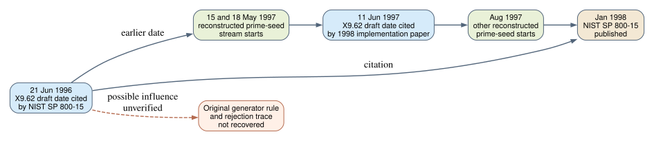

# A pre-seed ANSI X9.62 draft citation

**Date:** 2026-10-23 UTC. **Scope:** Primary-source chronology for the missing prime-curve acceptance rule. **Result:** NIST Special Publication 800-15 cites an ANSI X9.62 ECDSA working draft dated **21 June 1996**, before the reconstructed May–August 1997 seed streams. The cited draft's text and parameter tables were not obtained. This is evidence of a dated draft reference, not of what the original curve generator did.

## Source and exact observation

The [NIST-hosted archived SP 800-15 PDF](https://nvlpubs.nist.gov/nistpubs/Legacy/SP/nistspecialpublication800-15.pdf) is a January 1998 NIST publication by Burr, Dodson, Nazario and Polk. Its reference `[X9.62]` on printed page **4-2**, PDF page **71**, names a working draft of *The Elliptic Curve Digital Signature Algorithm* dated **21 June 1996**. The PDF was retrieved on 2026-10-23; its SHA-256, size, page count, and reference location are in [source.json](source.json). The source PDF is retained in local scratch and linked by its NIST URL, rather than committed as a duplicate 5.6 MB file. The 2015 PDF creation timestamp describes digitization, not the date of the 1996 draft.

The same NIST publication states that it adopted evolving standards where possible and made educated guesses when their stability was uncertain (printed section 1.3, PDF page 10). This reinforces the distinction between **a citation to a draft** and **an authenticated copy of that draft**. It does not establish whether the 1996 draft already contained the later prime-field parameter appendix, the SHA-derived coefficient method, or a candidate-rejection test. The cited date could also reflect the version held by the NIST authors rather than every revision circulating in 1997.



*Solid arrows show dated references or the reconstructed seed-stream period. The dashed arrow is the still-unverified claim that a pre-seed draft constrained the 1997 selection program. Source: the NIST publication and the existing [June 1997 draft lead](../nist_seed_1997_june_draft_20261023/report.md). Editable graph: [timeline.dot](timeline.dot).*

```{=typst}
#pagebreak()
```

## What this changes

The earliest specific X9.62 draft date now identified by a retrieved NIST source is **21 June 1996**. The [earlier archive search](../nist_seed_1997_draft_archive_20261023/report.md) had recorded a 31 August 1996 citation and a 17 November 1997 citation; the [1998 implementation paper](https://cosicdatabase.esat.kuleuven.be/backend/publications/files/conferencepaper/69) adds an 11 June 1997 citation. These are references to versions, not the versions themselves. No reference names one of the eleven omitted candidate seeds or a rejection reason.

The 1996 version is worth obtaining because it could show which numerical acceptance checks were specified **before** the first reconstructed May 1997 stream. If its text contains a criterion absent from the published 1998 procedure, that criterion could be evaluated against the eleven omissions and same-field published controls. A match would still require historical evidence that the selection program used it. If the version lacks parameter-generation rules, it would narrow the origin of those rules to a later draft or separate submission. If it already lists a candidate by exact `p,a,b,n,seed`, that would date that candidate's circulation. None of those outcomes is asserted by the present citation.

The user-stipulated premise that the original program evaluated all eleven omissions and rejected them for a weakness remains unverified. This source changes the **archive acquisition target**, not the arithmetic comparison or evidence for a common weakness. The existing [selection-rule problem](../../problems/nist-seed-selection-rule-unexplained.md) remains open. The canonical ECDLP graphs and prior selection diagrams were checked; this citation adds no verified attack edge or candidate-level decision, so their content is unchanged.

## Reproduction and limits

Retrieve the linked NIST PDF and compare its SHA-256 to [source.json](source.json). Check printed page 4-2 (PDF page 71) and section 1.3 (PDF page 10). The reported citation and publication date are `retrieved` NIST-source facts. The chronology is `derived` from that source and the previously archived source-bound reports. The original June 1996 draft, its contents, and any 1997 generator trace are **missing**, so no claim about their curve-selection behavior follows.
