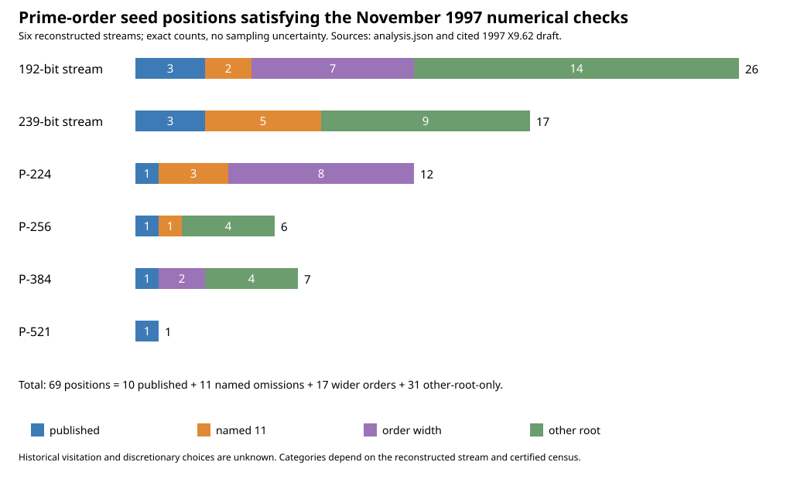
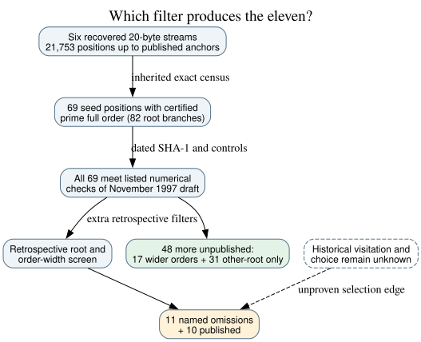

# The eleven are a narrow subset of the draft-compatible seed positions

**Date:** 2026-10-24 UTC. **Question:** If the recovered `lrand48` streams are considered under the *contemporaneous* November 1997 X9.62 curve-selection procedure, does its listed mathematics isolate the eleven later named omissions? **Answer:** No. Of the already certified prime-order seed positions in the six prime-field stream prefixes, **69** pass the draft's listed numerical checks: **10 published and 59 unpublished**. The eleven are the subset left by an additional retrospective root/bit-width screen. The 1997 draft does not state that screen. This is a lower bound on qualifying positions under the draft's near-prime procedure, because the inherited census targeted full prime order rather than every possible near-prime cofactor. It is not a historical attempt count.

## Source and method

**Retrieved primary source:** [ANSI X9.62 working draft, cover dated 17 November 1997](https://archive.org/download/x962-11-17-97/x962-11-17-97.pdf), SHA-256 `0c231d5176fcf0b239b44732213d281b518a0e16cc6f13f7bd4039ec99807b6e`. Section F.3.2 (PDF p. 63, printed p. 55) loops over a verifiably generated curve, counts its order, checks near-primality, MOV and anomalous conditions, and finds a prime-order point. Its notes (PDF p. 64) give `r_min > 2^160`, advise a bound at or below the Hasse lower endpoint, and describe `l_max = 255` as typical. Section F.3.3.b (PDF p. 65) permits arbitrary seed strings of at least 160 bits and arbitrary `a,b` satisfying the specified SHA-1 relation; it does not prescribe either square-root sign or an upper bound on the subgroup-order bit length. The PDF's listed steps also do not specify how a new seed is chosen or which of several accepted examples is published. This description is of the text, not a reconstruction of private software.

**Internal input:** the [complete prime-order census cross-check](../nist_seed_selection_20261016/raw/full_census_crosscheck_v4.json) and its [82 branch-bound order/point certificates](../nist_seed_selection_20261016/raw/full_prime_order_certificates.jsonl). Their SHA-256 digests, the draft digest, the frozen [protocol](PROTOCOL.md), and all 69 seed-level rows are retained in [analysis.json](analysis.json). The inherited census checked 21,753 stream positions, 11,042 seeded coefficient candidates, and 69 seed positions having at least one certified prime-order root branch. This round reclassified those already certified branches against the dated draft. It did not redo point counting or enumerate all near-prime orders.

**Independently checked:** [analyze.py](analyze.py) recomputed the 1997 SHA-1 integer `r` and checked `r b² ≡ (-3)³ (mod p)`, nonsingularity, retained prime-order and point-certificate flags, Hasse membership, `n > 2^160`, `n != p`, and the MOV condition through `B=20` for all 82 branches. It checked a changed-seed control for every branch. A separate bit-string [verify.py](verify.py) reproduced all 82 SHA-1 equations and the disjoint 69-position classification without importing the first implementation. A certified prime full order has cofactor one and satisfies the draft's near-primality predicate for any `l_max >= 1`. Since every order lies in its Hasse interval, the draft's advised `r_min` ceiling cannot reject one of these curves. A user-chosen threshold outside that advice or unavailable implementation behavior is a separate historical hypothesis.

## Exact partition of the certified set

The names `prime192v2` and `prime239v3` below identify shared streams, each containing three different published curves. Every count is a distinct 160-bit seed position; 82 is the number of qualifying root branches, not a second set of positions.

| Reconstructed stream | Published | Named eleven | Wider-order only | Other-root only | Draft-compatible certified total |
| --- | ---: | ---: | ---: | ---: | ---: |
| 192-bit shared | 3 | 2 | 7 | 14 | 26 |
| 239-bit shared | 3 | 5 | 0 | 9 | 17 |
| P-224 | 1 | 3 | 8 | 0 | 12 |
| P-256 | 1 | 1 | 0 | 4 | 6 |
| P-384 | 1 | 0 | 2 | 4 | 7 |
| P-521 | 1 | 0 | 0 | 0 | 1 |
| **Total** | **10** | **11** | **17** | **31** | **69** |



*Bars count exact seed positions in the reconstructed prefixes. `published`, `named eleven`, `wider-order only`, and `other-root only` are disjoint. [Editable chart source](render.py). The counts are exact within the inherited prime-order census, so there are no sampling error bars.*

The finding is clearest in **P-384**: the familiar eleven-curve list has no P-384 omission, yet six earlier seed positions have a certified prime-order root branch meeting these November 1997 numerical checks. Likewise P-256 has five earlier unpublished certified positions under this broader reading, not just block 876. The P-521 prefix has only its publication among this certified prime-order set; near-prime possibilities were not exhaustively classified here.



*Solid arrows are the dated-text and inherited-arithmetic checks. The dashed edge is historical behavior that these records cannot establish. [Editable diagram source](inference.dot).*

## What this says about a possible commonality

**Derived:** The eleven share a **definition in the retrospective screen**: they are unpublished seed positions whose selected coefficient root has prime order fitting the field's bit width and passes its other tests. That is a useful fixed comparison cohort, but the dated 1997 selection procedure does not isolate it. Any claim that a hidden mathematical defect explains *exactly these eleven* must first say why the other **48** unpublished, draft-compatible prime-order positions were excluded from the alleged historical decision set. One answer might be an actual root convention and an order-width constraint in the original software; neither is documented by the draft or proven by this arithmetic replay. The 1997 draft's freedom to choose a coefficient pair satisfying its hash relation makes the opposite-root cases legitimate numerical possibilities under its text.

**Limitation:** This does not imply the original program evaluated 59 alternatives, rejected any particular one, or intentionally applied a secret weakness screen. A source-identical generator and run trace could still establish a narrower path. The six prefixes end at their last published position; they do not count other timestamps. The complete near-prime acceptance space may be larger than the 69 full-prime-order positions established here. The point-certificate check uses inherited immutable certificates; the independent verification in this round recomputes the seed equations and partition, not scalar multiplication or point counts. No ECDLP advantage is identified.

**Next discriminator:** Recover original generator code and candidate-by-candidate logs, including root choice and any subgroup-order bit-length check. A proposed common mathematical weakness should predict labels across the **69** draft-compatible certified positions, or give a source-supported reason to restrict to the eleven, and should include a concrete mechanism and matched published controls. This round checked the existing seed-selection and canonical ECDLP graph sources. No verified security mechanism or transport edge changed, so those graphs remain unchanged; this diagram records the new source-bound selection-space inference.

The unresolved historical rule is tracked in the existing [selection-rule problem record](../../problems/nist-seed-selection-rule-unexplained.md). Its exit conditions are not met by this replay.

## Reproduction

From the repository root with the hash-matching source PDF at the path fixed in [PROTOCOL.md](PROTOCOL.md):

```sh
python3 research/nist_seed_1997_acceptance_20261024/analyze.py
python3 research/nist_seed_1997_acceptance_20261024/verify.py
python3 research/nist_seed_1997_acceptance_20261024/render.py
dot -Tsvg research/nist_seed_1997_acceptance_20261024/inference.dot -o research/nist_seed_1997_acceptance_20261024/inference.svg
```

The analysis printed `69` positions and `82` branches; the independent verifier printed `verified 82 dated SHA-1 branch equations and 69 disjoint seed-level classes`. Source provenance: X9.62 `retrieved`; census and point certifications `internal`; this round's equations and partition `independently checked`; historical generator behavior `unknown`.
