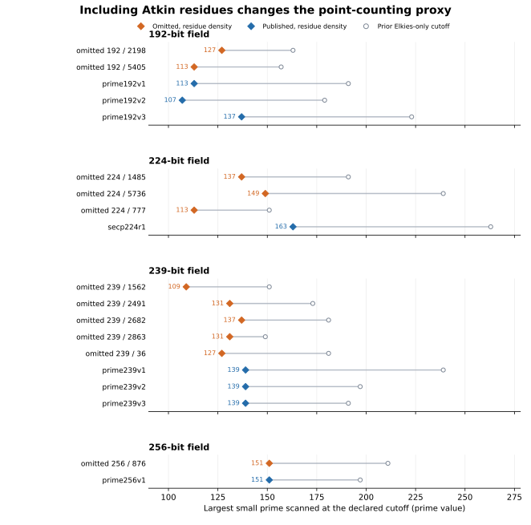
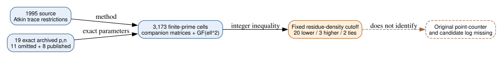

# Atkin information changes the point-counting comparison without identifying a selector

**Date:** 2026-10-24 UTC. **Question:** Did the earlier Elkies-only analysis omit enough contemporaneous point-counting information to hide a common reason for passing over the eleven named curves? **Verified result:** The frozen residue-density measure including Atkin information gives an earlier cutoff to an omitted curve in **20 of 25** same-field comparisons, a later cutoff in **three**, and a tie in **two**. The prior strict Elkies-only count was 24 earlier and one later. Including Atkin information makes the P-256 pair tie and creates mixed directions in the 192-bit field. Neither measure separates all eleven omissions from the eight published controls. These are exact arithmetic proxies, not historical execution times or a demonstrated weakness.

## Why Atkin information matters to this question

**Retrieved:** Schoof's [1995 paper](https://jtnb.centre-mersenne.org/article/JTNB_1995__7_1_219_0.pdf), printed pp. 239–242, describes how projective Frobenius order restricts possible trace residues, and how combining ambiguous residues requires a further search. This method predates the recovered timestamp inputs. The source does not identify Reiter's implementation or the original program's limits. The [source record](source.json) pins the PDF SHA-256 and visually inspected pages.

**Internal context:** The [prior strict Elkies-only proxy](../nist_seed_1997_selection_extension_20261023/sea_signature/report.md) ignored Atkin and ramified trace information. Its 24/25 direction was already a refinement of earlier splitting statistics, rather than independent evidence of a hidden selector. The present [protocol](PROTOCOL.md) was fixed before calculating the new orders or sets. It keeps exactly the same nineteen full curve UIDs, four fields, 167 odd primes through 997, and all 25 same-field pairs. This is an extension of that correlated feature family.

## Exact arithmetic and what the cutoff means

For a curve with exact trace `t=p+1−n`, classify each odd prime `ell` by the quadratic character of `t²−4p`. In the Elkies case, optimistically assume its eigenvalue calculation supplies the single true trace residue. In the ramified case, retain the residues satisfying `u²=4p`. In the Atkin case, compute the least `r` for which the companion matrix `[[0,-p],[1,t]]` becomes scalar after raising it to `r`, then retain every `u` with nonsquare discriminant and the same projective order. The [raw record](runs/scan-v1/raw.json) retains all 3,173 sets and their cardinalities, together with exact curve UIDs and inputs.

Let `M` be the product of the primes scanned and `A` the product of the corresponding allowed-set sizes. CRT gives exactly `A` compatible residue classes modulo `M`. The declared cutoff is the first prime for which **`M² > 16p A²`**. Thus the permitted residue-class density times the real Hasse-interval length falls below one. This is **not a guarantee of a unique trace in that interval**; residue placement matters. The metric omits the expense of finding projective orders, processing modular polynomials, and the final match/sort search. It is a fixed information proxy with an exact integer comparison, not an SEA runtime model.

**Independently checked arithmetic:** A separate [Sage verifier](verify.py) used eigenvalue ratios in `GF(ell²)` and primitive roots of unity to reconstruct **945 distinct Atkin trace sets**, verifying all **1,613 real Atkin cells** and all **3,173 cells** in total. It reproduced every cutoff and all 25 pair comparisons and checked the prior nineteen Elkies-only cutoffs unchanged. Its [passed receipt](runs/verification-v2/verification.json) binds the raw output digest and verifier source. The scanner's trace-sign, scalar-matrix and strict-boundary controls passed. The first verification attempt failed on a Sage API call before completion; [VERIFIER_CORRECTION.md](VERIFIER_CORRECTION.md) preserves its code and traceback and records the correction. No metric was changed.

| Field | Omitted residue-density cutoffs | Published residue-density cutoffs | Omitted earlier / later / tie |
| --- | --- | --- | --- |
| 192-bit | 2198: 127; 5405: 113 | v1: 113; v2: 107; v3: 137 | 2 / 3 / 1 |
| P-224 | 777: 113; 1485: 137; 5736: 149 | published: 163 | 3 / 0 / 0 |
| 239-bit | 36: 127; 1562: 109; 2491: 131; 2682: 137; 2863: 131 | v1: 139; v2: 139; v3: 139 | 15 / 0 / 0 |
| P-256 | 876: 151 | published: 151 | 0 / 0 / 1 |
| **Total** | **11 omitted curves** | **8 published controls** | **20 / 3 / 2** |

*Diamond markers give the verified residue-density cutoff; open circles give the prior strict Elkies-only cutoff. Labels are exact prime values. The fixed 19-curve sample has no sampling error; the workload interpretation remains a proxy. Source: `scan-v1/raw.json`, independently checked by `verification-v2/verification.json`. Editable plotting code: [render.py](render.py).*

## What this changes about the missing criterion

**Derived:** The previously striking 24/25 ordering depends partly on omitting information that was publicly available before 1997. Including it weakens the ordering and moves the counterexamples. In particular, a universal rule rejecting curves because this cutoff is too large cannot fit the P-224 or 239-bit choices, where every omission has a smaller cutoff than its published controls. A rule rejecting cutoffs that are too small fails in the 192-bit field, where published v2 has a smaller cutoff than either omission; P-256 is tied. No monotone threshold in either direction separates the labels under this fixed measure.

**Unknown:** The original program may have used a different SEA variant, stopping rule, representation, error handling, or selection stage. Neither this density measure nor the earlier Elkies-only cutoff measures the cost of that program. This calculation does not identify a common weakness or imply that all eleven candidates were visited. The [selection-rule problem](../../problems/nist-seed-selection-rule-unexplained.md) remains open. The prior seed-selection diagrams and `knowledge/frontiers/ecdlp/` graph sources were checked: no verified attack, map or ECDLP cost edge changes.

**Next discriminator:** Recover a versioned point-counter and invocation or candidate logs, or define a source-supported implementation model before testing all nineteen curves. A purely arithmetic workload explanation must specify both information acquisition and ambiguity-resolution costs. A prospective security hypothesis still needs an unknown-scalar mechanism and an independent historical prediction; an ordering association alone supplies neither.

## Reproduction and recorded scope

The scan command was `gtimeout 180 python3 research/nist_seed_1997_atkin_20261024/scan.py research/nist_seed_1997_atkin_20261024/runs/scan-v1`. Its [receipt](runs/scan-v1/receipt.json) binds protocol, code, source PDF, input, head and dirty state, environment, stdout/stderr and local wall/CPU measurements. The corrected verification command was `gtimeout 300 sage -python research/nist_seed_1997_atkin_20261024/verify.py research/nist_seed_1997_atkin_20261024/runs/scan-v1 research/nist_seed_1997_atkin_20261024/runs/verification-v2`. To rerun, use fresh output directories. Build the plot with `sage -python render.py`, Graphviz on [inference.dot](inference.dot), and Typst on [report.typ](report.typ). The source PDF is linked and hash-bound rather than redistributed. Source provenance is `retrieved`; exact candidate identities and prior certificates are `internal`; extension-field replay is `independently checked arithmetic`; original program behavior is `unknown`.
