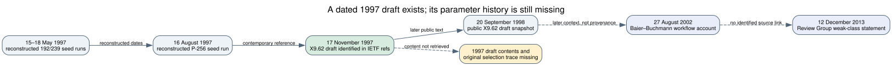

# A dated 1997 X9.62 draft is the next historical source to recover

**Date:** 2026-10-23 UTC. **Scope:** Read-only archival search for a contemporaneous X9.62 parameter record or acceptance rule. **Result:** Two primary IETF documents identify an ANSI X9.62 ECDSA working draft dated **17 November 1997**. The draft's contents were not obtained, so this search does not establish which curves it listed or why any candidate was passed over.

## Evidence and its precise limit

The NIST-coauthored [PKIX ECDSA Internet Draft of 21 November 1997](https://www.ietf.org/archive/id/draft-ietf-pkix-ipki-ecdsa-00.txt) cites an ANSI X9.62-199x ECDSA working draft dated 17 November 1997 at its lines 832–836 (`retrieved`, primary). An early [TLS ECC Internet Draft](https://www.ietf.org/archive/id/draft-ietf-tls-ecc-00.txt) names the same working-draft date at lines 947 and 974 (`retrieved`, primary). The [source metadata record](evidence.json) binds the exact retrieved text SHA-256 values. Both documents point to the X9.62 draft; neither supplies its parameter table or a candidate-rejection log. The claim sometimes made in later discussion that P-256 already appeared *inside* that draft is **not independently verified here**.

The November draft is a concrete contemporary target because it followed the reconstructed May and August 1997 seed-stream starts and preceded the public 1998 X9.62 text. The recovered start dates are computational reconstructions from the seed streams, not independent wall-clock run logs ([earlier workflow study](../nist_seed_1997_workflow_20261016/report.md), `internal`). The September 1998 [X9.62 text](https://safecurves.cr.yp.to/grouper.ieee.org/groups/1363/private/x9-62-09-20-98.pdf) (`retrieved`, primary) documents final sample parameters and ordinary screens, but cannot tell us which decisions had already been made in November 1997.

The original 2014–15 email exchange reproduced in [Bernstein and Lange's paper, Appendix C](https://cr.yp.to/papers/safecurves-20240809.pdf) (`retrieved`, primary correspondence reproduced by its recipient; PDF digest in [evidence.json](evidence.json)) identifies **Bob Reiter as the programmer**. Solinas wrote in June 2015 that neither he nor Reiter remembered the exact method and that they had not found their archives. In September 2014 Solinas had recalled hashing a humorous ASCII message, perhaps with SHA-1; his June 2015 reply recalled a counter but explicitly disclaimed the details. These are attributed retrospective recollections, not recovered generator code. The 2026 exact `srand48`/`lrand48` reconstruction of the published prime seeds is numerical evidence inconsistent with treating the remembered phrase-hash method as a complete account of those seeds. It does not establish whether a phrase was used elsewhere in the workflow, why any of the eleven candidate blocks was passed over, or whether Reiter's program reached them.

An [Internet Archive CDX query](sources/wayback_x962_index.json) for `grouper.ieee.org/groups/1363/private/x9-62*` returned five indexed URLs for the September 1998 draft, four with archived `401` statuses and one `404`. It returned no 1997 draft content. This search covered only one file-prefix path in one archive; it does **not** prove that the November draft no longer exists elsewhere. A guessed `x9-62-11-17-97.pdf` at the live IEEE path returned `404`; that guessed filename is not a documented historical URL.

## What a later technical account can test

Baier and Buchmann's [2002 evaluation report on elliptic-curve generation](https://www.cryptrec.go.jp/exreport/cryptrec-ex-1030-2002.pdf) (`retrieved`, primary technical report; retrieved PDF SHA-256 in [evidence.json](evidence.json)) describes a concrete `isStrongP` gate: large prime subgroup with bounded cofactor, nonanomalous order, and a bounded MOV degree check (pages 6–7 and 11). All eleven omitted classes satisfy those properties under the exact archived arithmetic. Its random-generation workflow also describes an **early abort** during SEA point counting when a small tested prime divides the group order and exceeds the allowed cofactor (page 12). A correct such early abort cannot reject any of the eleven **prime-order** omitted curves: no small tested prime divides their full group order. The same source says a twist may be tested as a second candidate after a failed curve; that is an optimization, not a rule rejecting a prime-order curve for twist weakness (page 13).

This 2002 report is a **later general account**, not the recovered 1997 generator, its input parameters, or a log of NIST/ANSI decisions. It narrows one proposed explanation—correct early-abort logic on the omitted candidate—but leaves an implementation error, different procedure, extra policy, and the possibility that the eleven windows were never evaluated. Its prose about hash-derived coefficients also does not prove the original seed selection was uniform. The exact original call trace remains the historical discriminator.

## The 2013 weak-class statement does not name these curves

[Appendix E of the President's Review Group's 2013 final report](https://www.nsa.gov/portals/75/documents/about/civil-liberties/resources/liberty_security_prgfinalreport.pdf) (`retrieved`, primary) says the appendix received information from NSA and, in its ECDH / SP 800-56A paragraph, says a class of potentially weak elliptic-curve parameters was kept out of a NIST standard (web-extraction lines 6463–6466 and 6507–6518). It gives **no class definition, parameter list, generation date, seed, or decision trace**. The underlying briefing has not been obtained. The NSA-hosted PDF returned `403` to local retrieval; a [White House archived copy](https://obamawhitehouse.archives.gov/sites/default/files/docs/2013-12-12_rg_final_report.pdf) was downloaded, hashed, and checked for the same sentence. The mirror's SHA-256 is in [evidence.json](evidence.json). Byte identity between the two hosted files is not asserted.

A [2001 CRYPTREC evaluation of SEC 1 ECDH](https://www.cryptrec.go.jp/exreport/cryptrec-ex-0108-2000p1.pdf) (`retrieved`, primary technical evaluation; exact PDF SHA-256 in [evidence.json](evidence.json)) explicitly lists then-known prime-field exclusions as the MOV/Frey–Rück low-embedding-degree and Semaev–Smart–Satoh–Araki anomalous-curve classes (PDF page 20). Its binary-field validation adds Weil-descent concerns (page 23). The eleven omitted prime-field curves are nonanomalous and have exact, enormous embedding degrees in the [archived mathematical audit](../nist_seed_exact_embedding_degree_20261023/report.md); binary-field Weil descent is not a criterion on their prime fields. These public classes therefore do not identify a common weakness of the eleven. The 2001 list does **not** prove what the 2013 sentence meant or what an NSA program considered in 1997. A later unknown or withheld class remains outside this comparison.

*Figure 1. Solid links show dated reconstructed runs and primary-document references. The dashed branch marks the absent draft contents and decision trace. Editable source: [timeline.dot](timeline.dot).*

## Why obtaining the draft matters

The draft could give a dated candidate list, equations, seed values, version notes or security language closer to the 1997 decisions than the 1998 publication. If it lists an omitted candidate as a then-current sample or records a replacement, that would directly alter the keep/skip history. If it contains only the final curves, it would bound publication timing but still not identify why other qualifying stream blocks were unused. Either outcome must be compared by exact seed or `p,a,b,n` identity against the [eleven-candidate archive](../nist_seed_skipped_curves_20261016/assessed.json), with the ten published controls; names or bit lengths alone are insufficient.

The actionable acquisition target is the **17 November 1997 X9.62-199x ECDSA working draft cited by the two IETF documents**, and then any immediately preceding or following committee drafts, change sheets, parameter tables, or Bob Reiter's generator/review records. Reiter's role comes directly from the reproduced correspondence; a source-tree, build artifact, log, or dated committee submission from him would be more discriminating than another retrospective seed story. A copy should be pinned by source, date and digest before its entries are compared with the 21 known seed-level classes. The current [selection-rule problem](../../problems/nist-seed-selection-rule-unexplained.md) remains open. This search found no new curve property or attack edge; the canonical ECDLP graphs were checked and remain unchanged.

## Provenance and reproduction

The retrieved IETF text digests, 2001 and 2002 PDF digests, the Bernstein–Lange PDF digest and correspondence page numbers, exact reference lines, 2013 White House mirror digest and NSA URL access limit, and narrow CDX query URL are in [evidence.json](evidence.json); the [CDX response](sources/wayback_x962_index.json) is retained verbatim. The study's observation is limited to these sources and to the current access result. It does not assert that the original 1997 draft was publicly archived, accessible through IEEE, or absent from NIST, ANSI, or private collections. No official hypothesis or goal status changes here.
